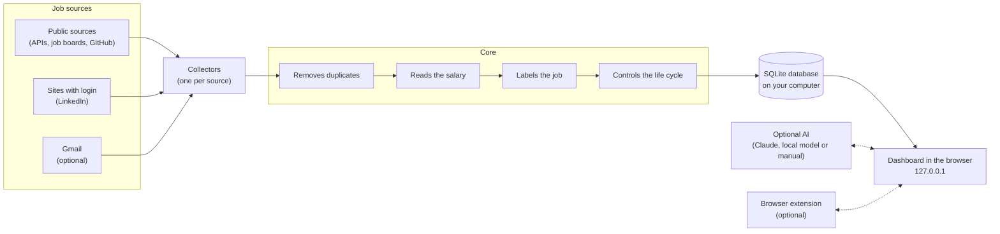

<div align="center">

# joBot

**Your personal job search assistant.**<br>
It gathers, filters and organizes jobs from many sites into a nice dashboard that runs on your own computer.

[](LICENSE)
[](#roadmap)
[](#requirements-and-installation)
[](#requirements-and-installation)
<br>
[](#how-it-works)
[](#how-it-works)
[](#how-it-works)
[](#job-sources)
[](#requirements-and-installation)
<br>
[](#how-to-contribute)
[](#how-to-contribute)
[](#how-to-contribute)
<br>
[](#privacy-and-security)
[](#privacy-and-security)
[](#artificial-intelligence)

[Português](README.md) · **English**

[How it works](#how-it-works) · [Installation](#requirements-and-installation) · [Roadmap](#roadmap) · [FAQ](#faq)

</div>

> [!IMPORTANT]
> **joBot phases 1, 2 and 3 (the foundation, the browser with login and the installer) have been done since version 0.4.0; the version to install now is 0.5.0, which brings the first part of phase 4 (the optional AI).** It searches public sources for jobs, keeps everything on your computer and shows it in a dashboard. You can already [install and use it](#requirements-and-installation).
> LinkedIn is the site with login today (others can come through the [new site template](docs/site-novo.en.md)); it has been here since version 0.3.0 and comes off (you turn it on in Settings, Accounts). The Gmail card is already in Settings, Accounts. AI arrives in version 0.5.0, off by default, to list the skills each job asks for, and 0.6.0 brings the full profile, reading your résumé and preparing applications ([details](#artificial-intelligence)); reading the emails, audio and the rest (the other sites with login, AI on the emails and browser extension) are still a plan. See the [roadmap](#roadmap). Before you turn on the sources, read the [usage and terms notices](#license-and-notices).

## 📑 Contents

- [What joBot is](#what-is-jobot)
- [Star history](#star-history)
- [What it does not do](#what-it-does-not-do)
- [How it works](#how-it-works)
- [The two versions](#two-versions)
- [Job sources](#job-sources)
- [The dashboard](#dashboard)
- [Artificial intelligence](#artificial-intelligence)
- [Using the Claude Code you already have](#using-claude-code)
- [Privacy and security](#privacy-and-security)
- [Requirements and installation](#requirements-and-installation)
- [Roadmap](#roadmap)
- [FAQ](#faq)
- [Project decisions](#project-decisions)
- [How to contribute](#how-to-contribute)
- [Support the project](#support-the-project)
- [License and notices](#license-and-notices)

<a id="what-is-jobot"></a>
## 🤖 What joBot is

joBot was born to help young university students find their first job. Then the idea grew: now it aims to help everyone who is looking for work.

Looking for a job today is tiring. You have to open many sites, repeat the same filters and hope you don't miss a deadline.
joBot does this repetitive work for you. It visits job sites, gathers everything in one place and shows what matches what you are looking for.
Everything runs on your computer. One installation serves one person, who can have several saved searches.

What it does today (phases 1, 2 and 3):

- 🔎 **Search** for jobs in dozens of public sources: sites, APIs and company job boards.
- 🧹 **Clean up**: removes duplicate jobs, reads the salary and tags the field, level, work mode, region and contract type.
- 🎯 **Rank**: shows how well each job matches your search (● good, ◐ medium, ○ weak) and explains why. In phase 1 this is done by rules, without AI.
- 🗂️ **Organize**: each job has a status, from "new" to "offer".
- 📌 **Track pages** of programs, such as trainee and summer school, and tell you when the text changes.

What comes in the next phases:

- 🔐 **Sites that require login**: you sign in in a regular browser window, with no automation, and joBot reads the jobs (phase 2; LinkedIn is the site with login today; others can come through the template, in [`docs/site-novo.en.md`](docs/site-novo.en.md)).
- ✍️ **Prepare the application**: cover letter, a résumé summary adjusted to the job and a list of what you have and what is missing, always in the job's language (phase 4, with optional AI).
- 🧩 **Help with forms**: a browser extension suggests answers, and you confirm (phase 5).
- 📬 **Read Gmail** (optional): brings in jobs from alert emails and suggests status changes when a recruiter replies (phase 6).

It works for every kind of job and every field: full-time employment (CLT), contractor (PJ), internship, trainee, temporary, apprentice, research and scholarships, programs and summer schools, public exams and notices.
Every feature can be turned on or off.

<a id="star-history"></a>
## ⭐ Star history

If joBot helps you, leave a star on the repository.

<a href="https://www.star-history.com/?repos=fezarosa-dev%2FjoBot&type=date&legend=top-left">
 <picture>
   <source media="(prefers-color-scheme: dark)" srcset="https://api.star-history.com/chart?repos=fezarosa-dev/joBot&type=date&theme=dark&legend=top-left" />
   <source media="(prefers-color-scheme: light)" srcset="https://api.star-history.com/chart?repos=fezarosa-dev/joBot&type=date&legend=top-left" />
   
 </picture>
</a>

<a id="what-it-does-not-do"></a>
## 🚫 What it does not do

joBot does not do the following, and was planned never to:

- **It does not mass-apply.** There is no "apply to 200 jobs with one click".
- **It does not send anything on its own.** You are always the one who sends the application.
- **It does not type your password.** On sites with login, you sign in with your own hands, in a regular browser window: however you like (Google, email and password), and then you close the window. joBot checks the session by itself.
- **It does not get past a CAPTCHA on its own.** If one shows up, it stops and warns you. On the public sources, that is always the case. In the browsing with login, the only exception is your own 2Captcha: only if you save your key and turn on the switch in Settings, Services (it comes off).
- **It does not send telemetry.** joBot does not send usage data to anyone.
- **It does not invent experience.** The AI only uses what is in your profile.

<a id="how-it-works"></a>
## ⚙️ How it works



One search cycle, step by step:

1. **At the scheduled time**, joBot wakes up. Public sources: every 3 hours. Or when you press "Search now". (Sites with login, in Settings, Accounts, are read twice a day.)
2. **Each collector** visits its source calmly and brings the jobs in a single format.
3. **The core** merges duplicate jobs, understands the salary, adds labels and marks as closed the jobs that disappeared.
4. **Everything goes to the SQLite database**, a file that stays on your computer.
5. **The dashboard** shows the result in your browser. It only works on your computer (address 127.0.0.1).
6. **If you turn on the AI** (from version 0.5.0), it lists the skills each job asks for, and joBot compares them with the ones in your profile and adds that to the match. The AI does not give a score. From 0.6.0 on, it also reads your résumé to fill in the profile, suggests questions about what the profile is missing and writes the cover letter and summary for an application, always when you ask. Without AI, the match comes from the rules of your search.

If one source fails, the others keep going. If the computer was off at the scheduled time, the missed search runs when it turns on.

Want to see joBot from the inside, with folders, layers, database and diagrams? See the [Architecture page on the wiki](https://github.com/fezarosa-dev/joBot/wiki/Architecture).

<a id="two-versions"></a>
## 🖥️ The two versions

joBot will have a single core and two "faces". The **local version** is the focus. The **browser version** (GitHub Pages) is for people who don't want to install anything, and it arrives in phase 8.

| | 💻 Local version | 🌐 Browser version (GitHub Pages) |
|---|---|---|
| **Installation** | Native, with uv ([how to install](#requirements-and-installation)) | None: just open the site |
| **Sources** | All | Public sources only |
| **Sites with login** | Yes, you sign in in a regular browser window | No |
| **AI** | Automatic (local model or a service with your key: Anthropic, OpenAI, Gemini or a compatible address) or manual | Manual (copy and paste); labels by rules only |
| **Browser extension** | Yes | No |
| **Gmail** | Yes (optional) | No |
| **Audio** | Yes, transcription on your computer | No |
| **Where the data lives** | In the SQLite database on your computer | Your profile stays in your browser (localStorage) |
| **Updates** | Every 3 h (public) and twice a day (login) | Once a day, with an "updated on &lt;date&gt;" notice |

In the browser version, you can export your profile to a file and import it later into the local version. There is also a "download full version" button.
It never uses logins or secrets.

<a id="job-sources"></a>
## 🌎 Job sources

Each source has an on/off switch, in Settings, Sources. In phase 1 the public sources work. Sites with login (for now, LinkedIn) live in Settings, Accounts, which shows whether joBot is still signed in to each one.
Three Brazilian portals call for care, because of their terms of use: Eureca, Abler and Gupy. Read the notice in [License and notices](#license-and-notices).

| Group | Examples |
|---|---|
| Job repositories on GitHub | backend-br, frontendbr, soujava, remotejobsbr, developersRJ |
| International sites and APIs | Jobicy, Hacker News "Who is hiring", Remotive, RemoteOK, Himalayas, We Work Remotely |
| Company job boards (recruiting systems, the "ATS") | Greenhouse, Lever, Ashby, SmartRecruiters, Workday, Eightfold, Oracle HCM, InHire, Quickin, Recrutei |
| Brazilian portals | Gupy, CIEE, Sólides, IEL, Super Estágios, Cia de Talentos, Eureca, Abler |
| Careers at big companies | Google, Amazon, Microsoft, NVIDIA |
| Internship boards | Public boards, such as the one at USP |
| 🔐 Site with login (phase 2, the only one for now) | LinkedIn |
| 🔐 Sites with login (ideas for the future, no date yet) | Vagas.com, Catho, Indeed |
| 🔐 Sites with login (ideas for the future, one at a time) | InfoJobs, Glassdoor, Remotar, Trampos |
| 🔐 Technology-only sites with login (ideas for the future, last, one at a time) | Programathor, GeekHunter, Revelo, Coodesh |

Also in phase 1:

- **Own company list**, made only of public facts (company name and job board identifier), each one checked against the real address. You add your own in Companies.
- **Weekly discovery** of new job boards through Common Crawl (a public archive of the web). The finds go to Suggested, and nothing enters your search until you approve it. You can turn it off in Settings.
- **Tracking program pages**, such as trainee and summer school, in the Sites screen. The change shows up in the Programs tab.

**Polite collection.** The robot identifies itself, waits between one request and the next and waits longer when the site asks for calm.

**Health of each source.** On every search, each source is marked as ok, partial or failed. You see this in the dashboard.

> [!WARNING]
> **Sites with login carry risk.** LinkedIn and other sites with login that may join later may restrict accounts that access them automatically, and this may go against their terms of use.
> joBot reduces the risk: you sign in in a regular browser window, with your own hands; after that it only reads (it does not click "apply", it does not send messages), and it visits rarely and slowly.
> Even so, the risk exists. **You decide whether to turn on each site.**

<a id="dashboard"></a>
## 📋 The dashboard

The dashboard runs at `http://127.0.0.1:47615`. When joBot finds Chrome, Edge or Chromium on your computer, it opens in **its own window**, with no tabs or address bar, like an app; with none of them, it uses the Chromium it installed, and only then a regular browser tab. With the installer, the dashboard opens in your default browser, through the **Open joBot** button in the joBot window.

- **Sidebar:** on the left, the Jobs section (Today's Highlights and the tabs, each with its count) and the Where to Look section (Searches, Companies, Suggested, Sources and Sites), plus Settings. You can hide it and drag its edge to change the width.
- **List with detail:** the job list sits on one side and the detail of the chosen job on the other. In a narrow window the detail slides over the list.

- **Tabs:** Today's Highlights (the best new ones, one per company), All, New, Closing Soon, Saved, Applied, Programs and Hidden.
- **Filters** as "chips" (little buttons) with counts: country and how many days ago the job was posted stay in view; salary, city, company and words the job must not have are under "More Filters". The current filter stays in the page address, so you can save the link. Quick search with the `/` key.
- **Status of each job:** new → saved → applied → interview → rejected or offer.
- **Match with your search:** ● good, ◐ medium, ○ weak, always with the reasons.
- **12-month calendar** on each job, to see deadlines at a glance.
- **Overview and application queue:** the Overview, in the sidebar, gathers the day: what closes soon, the applications and the search. When you open a job's application link, the dashboard asks "Did you apply?" ("Yes, I Applied" or "Not Yet", with Undo); the job's timeline shows the date of each step and the Applied tab shows the "since". If the description has an application email, the "Apply by Email" button only opens your email app: joBot sends nothing.
- **Jobs hidden** by a rule can come back. The dashboard shows how many were hidden for each reason.
- **"Something Wrong with This Job?"**: a button to fix a label or a piece of data.
- **Undo:** hiding a job, discarding a suggestion or removing a company happens right away, and a bar with an **Undo** button stays on screen until you close it. What really deletes (such as deleting a search) asks for confirmation first.
- **Keyboard and command palette:** `⌘K` (`Ctrl+K` outside the Mac) opens the palette, which takes you to any screen and changes theme, language and text size; there is also a button for it in the bar. See every shortcut in [Keyboard shortcuts](https://github.com/fezarosa-dev/joBot/wiki/Keyboard-shortcuts).
- **Text size:** Default, Large or Larger, in Settings, General.
- **Search progress:** when you press "Search now", the top shows a progress bar and the step joBot is on (for example, "Reading Greenhouse · 13 of 20 queries"), including when it waits for a source to allow more requests. "Show Details" opens the summary.
- **Mac app look:** translucency, smooth animations, light and dark mode following the system, and reduced motion for anyone who asks for it. SF font on Mac and Inter on other systems. Icons from [Lucide](https://lucide.dev) (ISC license, in `src/jobot/painel/static/icones/LICENSE`).
- **Languages:** Portuguese and English.

<a id="artificial-intelligence"></a>
## 🧠 Artificial intelligence

The AI is **optional** and arrives in version 0.5.0 (phase 4), **off by default**. Without it, joBot works with rules and keywords, as it has since phase 1.

> **Golden rule:** the AI never invents. In Matching it does not even receive your profile: each skill it lists has to be written in the job.
> In the tasks that use the profile (résumé, questions and application, since 0.6.0), it only uses the data in your profile and shows which data it used. What it takes from the résumé that is not written there comes marked for you to check. If information is missing, it suggests a question, which only becomes profile data when you answer it.

### What 0.5.0 brings

- **The skills of each job.** With the **Matching** task on in Settings › AI and at least one skill in your profile, after each search the AI reads up to 20 jobs not yet read that already match a search, newest first, and lists what each one asks for. Switching the service or the model makes the AI read everything again, 20 per round. Each item has to be written in the job. The AI does not see your profile and does not give a score: joBot compares the list with the skills you put in Settings › Profile, shows in the job details the ones you have and the ones you are missing, and adds that to the match, next to the title, the location and the rest.
- **Where the AI runs:** on the local model (free, on your computer) or on a service with your key: the Anthropic API, OpenAI, Google Gemini or an OpenAI-compatible address (Ollama, LM Studio, OpenRouter and others). The keys stay in the system password vault, in Settings › Services.
- **Test when you turn it on.** Turning the task on or switching the service sends a short request, with a sample job. If it fails, the task stays off and the screen says why.
- **Cost in plain sight.** A paid service shows as "billed per use", turning Matching on with it asks for confirmation, and joBot makes at most 200 requests a day to each outside service, not counting the test when you turn it on.

### What 0.6.0 brings

- **The full profile**, in Settings › Profile: contact, job title, years of experience, education, summary, links, languages with their level, skills and up to 10 experiences and 10 courses. Each part has its own Save. Saving one part does not erase what you typed in the others, also without JavaScript. The contact fields (name, email, phone and city) never go into requests to AI. **Delete profile** deletes all of it, the answers and the prepared applications.
- **Reading your résumé PDF.** You send the PDF (up to 5 MB) in the Profile tab, joBot reads the first 20 pages on your computer, and the **Résumé** task fills in the form for you to check. What the AI puts in that is not written in the résumé comes marked "Not found in the résumé" and stays out of **Approve All**. Email, phone and CPF are taken out of the text before it goes to the AI; the email and phone are filled in on your computer, and the CPF is not kept. The rest of the text goes as it is, including the name and city, if they are written in it. Nothing is saved before you save, and neither the PDF nor its text is kept. Reading the résumé needs JavaScript turned on in the browser; without it, you fill in the profile by hand.
- **Profile questionnaire.** Questions about you (where you live, job title, experience, education, skills, languages, contact and links) that save the profile; you open the questionnaire from the Profile tab. With the **Questions** task on, the AI suggests up to 5 questions about what the profile is missing, each with the reason.
- **Prepare Application**, in a job's details, with the task on: the AI writes the cover letter and a summary of your profile for the job, in the job's language, and joBot shows what you have and what you are missing of what the job asks for, and the profile data the AI used. The letter and the summary come in boxes you can edit and copy, with the notice "Check before using: the AI can be wrong." and, if the letter mentions something that is not in your profile, a notice with the item. joBot never sends anything: you are the one who uses the letter.
- **Suggested questions.** The questions the AI suggests while preparing an application wait for you to accept or discard them in the Profile tab (up to 20 wait; the oldest goes), and only the answer to an accepted question goes into the next requests.
- **Manual AI**, for the résumé and the application: joBot shows the request, you copy and paste it into the AI chat you want, and paste the answer back. The answer goes through the same checks, and joBot sends nothing to anyone.
- **First run with AI and profile.** The wizard gets two optional steps before the search: where the AI runs (the local model, the Anthropic API with your key, or continue without AI) and your profile (the résumé and the questionnaire). Both can be skipped, and the search comes with the job title and city from the profile.
- **Laya as the default local model.** The model downloaded is Laya 2B, a fine-tune of Qwen3.5 2B for jobs (see the offline package, below).

The tasks you trigger (Résumé, Questions and Prepare application) make one request per click and do not count toward the limit of 200 requests a day, which belongs to Matching. All three are experimental: always check what the AI returns. The Claude Code and Codex sessions wait for the owner's decision on the terms of use and have not been built yet.

### Options

| Option | Cost | Where it runs | Where the data goes | Needs internet? | Status |
|---|---|---|---|---|---|
| **Local model** (Laya, by default) | Free | On your computer | Does not leave the computer | No (after downloading) | Since 0.5.0; Laya since 0.6.0 |
| **Anthropic API key** | Pay per use | At Anthropic | Anthropic | Yes | Since 0.5.0, experimental |
| **OpenAI key** | Pay per use | At OpenAI | OpenAI | Yes | Since 0.5.0, experimental |
| **Google Gemini key** | May be billed per use, depending on your Google AI Studio account plan | At Google | Google | Yes | Since 0.5.0, experimental |
| **OpenAI-compatible address** (Ollama, LM Studio, OpenRouter) | Depends on the service | Wherever the address points | To that address | Depends on the address | Since 0.5.0, experimental |
| **Keywords** (no AI) | Free | On your computer | Does not leave the computer | No | Since 0.1.0 |
| **Manual AI** (copy and paste) | Free in joBot; depends on the chat AI you use | In the chat AI you choose | Wherever you paste it | Depends on the chat AI | Since 0.6.0, for the résumé and the application |
| **Claude Code session** ([details](#using-claude-code)) | Uses your Claude subscription | At Anthropic | Anthropic | Yes | Waiting for the owner |

**Experimental, not yet proven:** joBot's CI has no key for a paid service, so the Anthropic API, OpenAI and Gemini were only tested against a fake service. They carry that mark in the AI tab until they are proven with a real key. The local model was only proven in CI: it ran on GitHub's computers (Linux, Windows and Mac, on the processor only); in the 0.6.0 run, Laya took up to 23 s for the longest job (Qwen3.5 4B, up to 66 s). Not yet proven: the compatible address against a real Ollama, LM Studio or OpenRouter (the same client only ran against the local model's `llama-server`, in CI), the installer really downloading the Local model, resuming a cut download against the real servers, the Windows Defender and SmartScreen warnings on `llama-server.exe` and the speed on an ordinary computer.

So you don't have to set up task by task, there are shortcuts in the AI tab:

- **Turn AI off**: nothing leaves your computer. This is the default.
- **All Claude**: uses Claude, through the Anthropic API (billed per use), for every task.
- **All offline**: uses the local model (Laya, by default), which runs on your computer, for every task.
- **Custom**: you choose the option and the model for each task. If you were on **All Claude** or **All offline** in 0.5.0, you see **Custom** in 0.6.0, because the new tasks start off.

### Default models with Claude

The app uses only two models: Haiku 5.5 (`claude-haiku-5-5`), faster and cheaper, and Sonnet 5.5 (`claude-sonnet-5-5`), more capable.
**The Opus model is never used**, to save cost and your usage limit.

| Task | Model |
|---|---|
| Read the résumé and build the profile | Sonnet 5.5 |
| Skills the job asks for (Matching, already in 0.5.0) | Haiku 5.5 |
| Prepare the application | Sonnet 5.5 |
| Browser extension | Sonnet 5.5 |
| Extra questionnaire questions | Sonnet 5.5 |
| Job alert emails | Haiku 5.5 |
| Recruiter replies | Keywords + Haiku 5.5 |

### Offline package

Since version 0.5.0, the offline package is the **Local model**: llama.cpp's `llama-server` and an AI model. It does not come inside the installer: joBot downloads it from the official source, only when you ask, and checks the checksum of each file. There are two ways to ask: tick **Local model** in the installer's Tools step (it comes unticked) or press **Download** on the model card in Settings › Tools. The default model is **Laya 2B**, a fine-tune of Qwen3.5 2B for jobs, the same on every computer; with less than 7 GiB of memory joBot warns that it may be slow. On the same card you switch to the original Qwen3.5 2B or 4B, update or remove. Once downloaded, it works without internet and without paying anything.

| Item | Size | Where it comes from | Note |
|---|---|---|---|
| llama-server (llama.cpp program that runs the model) | ~23 MB Linux · ~25 MB Windows · ~17 MB macOS with Apple chip · ~13 MB Mac with Intel | GitHub, llama.cpp release | Pinned version, checked by checksum; MIT license |
| Laya-2B (AI model, the default) | 1.29 GB | GitHub, joBot's releases (`modelo-laya-2b-1`) | Fine-tune of Qwen3.5 2B for jobs; Apache-2.0 license |
| Qwen3.5-2B (AI model, optional) | 1.28 GB | Hugging Face, from Unsloth | The original, switched in Settings › Tools; Apache-2.0 license |
| Qwen3.5-4B (AI model, optional) | 2.74 GB | Hugging Face, from Unsloth | The original, switched in Settings › Tools; Apache-2.0 license |

Audio (the transcription to answer by speaking) is not in the offline package: it is left for phase 6.

A "checksum" is a fingerprint of the file: joBot checks that the downloaded file is exactly the expected one.

### What works without internet

| What | Without internet? |
|---|---|
| See the jobs already saved, filter, set the status and change the settings | Yes |
| Match by the rules of your search | Yes |
| Job skills through the local model (All offline) | Yes, after downloading the model |
| Job skills through a service (Anthropic, OpenAI, Gemini) | No |
| Read the résumé, suggest questions and prepare applications with the local model | Yes, after downloading the model |
| Those tasks through a service or manual AI | No |
| Search for new jobs, check companies and pages, get the currency rates | No |
| Read the sites with login | No |
| Download the local model, the browser or a new joBot version | No |

<a id="using-claude-code"></a>
## ✨ Using the Claude Code you already have

> This section describes an option that still waits for the owner's decision on Anthropic's terms of use: it does not ship in 0.5.0 or 0.6.0. Until then, Claude comes in through the Anthropic API key.

If you already use Claude Code on your computer, joBot can use Claude **with no extra login**.
You do not log in to Claude inside joBot. Ever.

### Step by step

1. **Install Claude Code** following the instructions on the [official Claude Code site](https://code.claude.com/docs/en/setup#install-claude-code).
2. **Sign in once through the terminal.** Open the terminal, type `claude` and press Enter. Inside it, type `/login` and follow the instructions, which open the Anthropic site. This login is done with Anthropic itself ([how login works](https://code.claude.com/docs/en/authentication)).
3. **Open joBot.** At step 0 of the first run, it notices on its own that Claude Code is ready and offers this option.

That's it. The account, the subscription, the limits and the cost remain yours.

### What joBot does

- Asks Claude Code whether you are logged in (`claude auth status`).
- Sends requests through Claude Code's headless mode (`claude -p`, [documentation](https://code.claude.com/docs/en/headless)), asking for the answer in a fixed format (JSON).
- Uses only Haiku 5.5 or Sonnet 5.5.
- If there is an error, it shows it in the dashboard. If you are not logged in, it explains how to sign in through the terminal.

### What joBot never does

- Never reads, copies, stores or passes on your Claude credential or token.
- Never shows a Claude login screen inside itself.
- Never bundles or modifies Claude Code.
- Never uses the Opus model.

### Technical precautions

- Call with no tools at all (`--tools ""`), no MCP servers (`--strict-mcp-config`) and without saving the session (`--no-session-persistence`). Details in the [command reference](https://code.claude.com/docs/en/cli-reference).
- Runs in an empty temporary folder, so it doesn't load the settings of some project. Your personal settings in `~/.claude` still apply.
- Removes `ANTHROPIC_API_KEY` and `ANTHROPIC_AUTH_TOKEN` from the call environment (except in "API key" mode). Without this, Claude Code would use the key and the charge would go to the API without you noticing. For the same reason, it removes the cloud provider variables (`CLAUDE_CODE_USE_BEDROCK`, `CLAUDE_CODE_USE_VERTEX` and `CLAUDE_CODE_USE_FOUNDRY`).
- Before each call, it checks with `claude auth status` that the active login is the subscription one. If another method is active (for example, an `apiKeyHelper` in your settings), the dashboard warns you and does not make the call.
- Does not use `--bare`, because that mode does not read the subscription login.
- Does not use or ask for `CLAUDE_CODE_OAUTH_TOKEN`.
- The credential stays where Claude Code keeps it: `~/.claude/.credentials.json` on Linux, `%USERPROFILE%\.claude\.credentials.json` on Windows and the Keychain on macOS. If the `CLAUDE_CONFIG_DIR` variable is set, the folder changes. joBot never opens any of it.

### About Anthropic's rules

Anthropic does not allow third-party apps to offer Claude login, to send requests using people's subscriptions on their behalf, or to collect, store or pass on credentials and tokens. The login must happen in Anthropic's own flow ([official policy](https://code.claude.com/docs/en/legal-and-compliance)). Apps that run Claude Code are also under Anthropic's Commercial Terms: Claude Code cannot be modified and each person signs in with their own account.
joBot does not offer login, does not bundle or modify Claude Code and never touches your credential: each person uses their own, on their own computer.

It also does not share a subscription between people: each one runs their own Claude Code and spends only the limit of their own subscription.
Details in [ADR 0010](docs/decisions/0010-claude-code-da-pessoa.md) (in Portuguese).

<sub>Claude and Claude Code are trademarks of Anthropic. joBot is not affiliated with Anthropic.</sub>

<a id="privacy-and-security"></a>
## 🔒 Privacy and security

> These rules apply to what phases 1 and 2 brought and to the AI of versions 0.5.0 and 0.6.0. The ones that talk about Telegram, extension and audio describe the next phases. For Gmail, the card in Settings, Accounts already applies: it keeps the app password in the system password vault and only opens the inbox read-only, to check the sign-in; reading emails comes in phase 6.

- **There is no joBot server.** Your data stays on your computer.
- **No telemetry.** No usage data is sent.
- **Local record of opening.** joBot keeps, only on your computer, when you opened the application for each job; it never leaves here.
- **Search and check requests only.** joBot only makes network requests in these cases: to the public job sources you leave on (they all come on), including each job's page; to the Central Bank of Brazil, to get the exchange rates of the currencies in the jobs and show salaries in the display currency you choose, with currency conversion on (it comes on); to Common Crawl, once a week, to discover new companies, and then to those companies' job boards, to check them (it comes on); to the pages you ask it to follow (it comes on, but with no pages on the list there is no request); to the sites with login you turn on (they come off), through the browser, with your account; to Playwright's servers, to download the browser, only when you press "Download" in Tools or, in the desktop app, check it during installation (joBot does not distribute the browser; it comes from Playwright) or update joBot with it already downloaded; to 2Captcha, only when you test the key in Settings, Services, or, while browsing with login, with the key saved and the switch on (comes off); to Gmail (Google), over a read-only IMAP connection, only when you save or check the app password in Settings, Accounts (with no app password there is no request); to the AI services you set up (Anthropic API, OpenAI, Google Gemini or the compatible address you type), with the title and text of the jobs, your profile without name, contact details and city and the résumé text without email, phone and CPF, depending on the task, only when you turn on an AI task on one of them in Settings, AI (the tasks come off), and in the test when you turn it on, and the résumé, the questions and the application only when you ask for them; the local model makes no network request; to GitHub and Hugging Face, with their CDNs, to download the local model (llama-server and the model: Laya, from joBot's releases on GitHub, or a Qwen model, from Hugging Face), only when you press "Download", "Switch" or "Update" on the model card in Tools, check it during installation or run jobot ferramentas baixar (or atualizar) ia-local; to a company's website, only when you paste an address, test it or accept a suggestion; to the internet through git and uv (or to GitHub, when joBot came from the installer), to download the new joBot version, only when you ask to update (the Update now button or the jobot atualizar command). With the version notice (next item) on, it also asks GitHub (it comes on; you can turn it off). Whoever receives a request sees your computer's IP address, as with any internet request.
- **Version notice on by default.** Once a day joBot asks `api.github.com` which version is the newest. The request carries only joBot's fixed user agent (which includes the version number) and your computer's IP, like any request on the internet. It carries no search and no data of yours. To turn it off, go to Settings, Privacy; off, it makes no request at all.
- **What goes to the AI, task by task.** Matching sends the service only the title and text of the job (the beginning and the end, when it is long). Résumé sends the PDF text without email, phone and CPF, which joBot takes out first; the name and city written in the résumé go along. Questions sends your profile without name, email, phone and city (nor the links); what you wrote in the profile's text fields, such as the summary and the experiences, goes as you wrote it, except email, phone, CPF and your name, when written as it is in the profile. Prepare Application sends the same profile and the job text, only when you click the button. A question the AI suggests only goes into requests after you accept and answer it. Each task says, in the AI tab and next to the button or the upload, what goes and where. With manual AI joBot sends nothing: you copy the request, built with the same rules, and paste it into the AI chat you choose. The local model runs on your computer and only serves your own computer (127.0.0.1).
- **The résumé is not kept.** The PDF is read on your computer, in a separate process, and neither it nor its text stays in the data folder or the database: only what you approve and save goes into the profile.
- **Secrets in the system vault.** The Gmail app password, the AI service keys and the Telegram token stay in the operating system's password vault. Without a vault, they go to a file that only your user can read, and the dashboard warns you.
- **Protected personal data.** The profile stays in the database, in a folder that only your user can access and that is not synced to the cloud. joBot does not keep a CPF (Brazilian tax ID) or date of birth. The dashboard recommends turning on disk encryption (LUKS, BitLocker or FileVault).
- **Dashboard closed to the outside.** It only accepts connections from your own computer (127.0.0.1) and checks every request.
- **Paired extension.** The extension only talks to joBot after pairing. It never touches password or card fields.
- **Audio deleted.** The recording is transcribed on your computer and deleted right after.
- **Gmail read-only.** joBot opens the mailbox read-only, with an app password that you create in your Google account and paste into the dashboard. Note that the app password itself gives full access to your email (read, delete and send) to whoever has it; only joBot limits itself to reading. See the [step-by-step guide](https://github.com/fezarosa-dev/joBot/wiki/Gmail-app-password).
- **Your data only leaves** for the services you turn on: Anthropic, OpenAI, Google (Gemini or Gmail), the AI address you type or Telegram, and other optional services (see ADRs [0009](docs/decisions/0009-ia-backends-e-modelos.md), [0014](docs/decisions/0014-seguranca-e-privacidade.md) and [0026](docs/decisions/0026-ia-da-fase-4.md)).
- **Found a security flaw?** Do not open a public issue. Follow the [security policy](.github/SECURITY.en.md).

<a id="requirements-and-installation"></a>
## 📦 Requirements and installation

> There are two ways to install. **With the installer** (from version 0.4.0 on): you download one file, open it and get the joBot window, a small control that starts joBot and opens the dashboard in your browser, with no terminal. **From the code**: you download the code and run it with uv, as in versions 0.1.0 to 0.3.0. The step by step with more detail is on the [Install page of the wiki](https://github.com/fezarosa-dev/joBot/wiki/Install).

### Requirements

- **System, with the installer:** 64-bit Windows 10 or 11, 64-bit Linux (Ubuntu 22.04 or newer, or a distro from the same time) or a Mac with Apple Silicon or Intel. The Mac is experimental: its installer was only tested in CI.
- **System, from the code:** Linux. Windows and macOS run joBot, but this path has not been tested on them yet.
- **Programs, from the code:** [git](https://git-scm.com/) and [uv](https://docs.astral.sh/uv/). uv downloads Python 3.14 and the libraries by itself. The installer needs none of this: it already brings everything.
- **Memory:** an ordinary computer is enough. The local AI model (optional, since 0.5.0) runs with 8 GB of RAM and uses the larger model from 12 GB.
- **Graphics card and Docker:** not needed. The installation is native.
- **Disk space:** about 100 to 200 MB to download the installer, depending on the system, and the installation takes much more (the browser, if you tick it, takes about 420 MB on its own, and the local model up to about 2.8 GB); the install screen shows how much it will use.
- **Internet:** to download the installer (or the code) and to search for jobs. Installing with the installer only uses the internet to download the browser and the local model, if you tick them.

### With the installer

Download the file for your system from the [latest version page](https://github.com/fezarosa-dev/joBot/releases/latest). Each one is about 100 to 200 MB (the Windows one about 120 MB, the Mac ones about 105 MB, the `.deb` and the `.rpm` about 125 MB and the AppImage about 200 MB), because it already brings Python 3.14, the libraries and joBot. The browser for sites with login is not in the file: it comes from the internet, if you tick it during installation.

| System | File | How to open it |
|---|---|---|
| Windows | the one ending in `-setup.exe` | Double-click it. It installs for your user only, without asking for an administrator password. |
| Linux, any distro | the one ending in `.AppImage` | Mark it as executable (`chmod +x` on the file, or Properties, Permissions) and open it. |
| Linux, Debian and Ubuntu | the one ending in `.deb` | `sudo apt install ./` and the file name. |
| Linux, Fedora | the one ending in `.rpm` | `sudo dnf install ./` and the file name. Experimental: the `.rpm` has not been tested in CI yet. |
| Mac with Apple Silicon (M1 or newer) | the one ending in `_aarch64.dmg` | Open the `.dmg` and drag joBot to Applications. Experimental. |
| Mac with Intel | the one ending in `_x64.dmg` | Open the `.dmg` and drag joBot to Applications. Experimental. |

The first time you open it, the joBot window shows the install screen:

1. **Tools.** joBot and Python 3.14 come ticked and locked (they are required). Only two items come from the internet: the browser for sites with login, which comes ticked, and the AI **Local model**, which comes unticked. joBot downloads the browser through Playwright, from Playwright's servers (about 210 MB), and the Local model from GitHub (`llama-server` and Laya, about 1.3 GB, from the llama.cpp and joBot releases), with its sha256 checked. If you untick the browser, or leave the model unticked, you can download them later in Settings › Tools.
2. **Installing.** The rest comes from inside the installer: nothing else is downloaded during the installation besides the browser and the Local model, if ticked. joBot checks the sha256 of every file against the list recorded when the installer was built, and that of every library; if any does not match, nothing is installed. The browser is left out of this check: Playwright does not publish its sha256, and the download comes over HTTPS. Without internet, the installation works the same without the browser: if its download fails, the screen offers to go on without it. The Local model is downloaded after joBot is already installed: if its download fails, joBot stays installed and the screen says why.
3. **Done.** The window becomes the joBot control. Press **Start** and then **Open joBot**: the dashboard opens in your default browser, with the first-run questions (below).

From then on, the joBot window is always the control. It shows whether joBot is **Running** or **Stopped**, the dashboard address (with a **Copy** button) and the **Start**, **Stop** and **Open joBot** buttons; Open joBot only shows while joBot is running. When it opens, it only shows the state: it does not start or open anything by itself. If the background service already started joBot, it shows Running.

Closing the window while joBot is running asks **Keep joBot running?**. **Keep running** closes only the window, and the dashboard stays on in your browser until you open the window again and press **Stop**. **Turn off** stops joBot and closes the window. With joBot stopped, the window closes right away. The background service is for joBot to start by itself when the computer starts. From the dashboard, **Quit joBot**, in Settings › General, also stops everything.

On Windows, the window uses Microsoft's WebView2, which Windows 11 and an up-to-date Windows 10 already have. On a Windows without it, the installer downloads nothing: it warns you, with Microsoft's official link (https://developer.microsoft.com/microsoft-edge/webview2/), and cancels. Install WebView2 from that link and open the installer again.

### Windows and Mac warnings

The installers have no seal (code signing) yet, so the system warns that it does not recognize the program. The files are built by GitHub Actions from this code. The version's `SHA256SUMS` lists the sha256 of each one: it checks that the download did not arrive broken, but, since it comes from the same release, it does not prove where the file came from. That is left to code signing, when it comes.

- **Windows:** "Windows protected your PC" appears. Click **More info** and then **Run anyway**.
- **Mac:** a message says Apple could not verify joBot. Close it, open System Settings › Privacy & Security, scroll down to the message about joBot and click **Open Anyway**. Confirm with your password. This only happens the first time.
- **Linux:** there is no warning.

### From the code

```bash
git clone https://github.com/fezarosa-dev/joBot.git
cd joBot
uv sync --locked
uv run jobot
```

The last command starts joBot and opens the dashboard at `http://127.0.0.1:47615`. If the computer has Chrome, Edge or Chromium, the dashboard opens in its own window, with no tabs or address bar; without them, it uses the Chromium joBot installed, and only then a tab of your browser. With nothing after `jobot`, the `abrir` command runs.
If another program already uses port 47615, joBot warns you and opens nothing. Set `JOBOT_PORTA` to another port and run it again.

### Commands

If you installed from the code, run all of them from inside the `joBot` folder, with `uv run` in front (for example, `uv run jobot buscar`). With the installer, the dashboard has a button for what you need and the terminal is not necessary.

| Command | What it does |
|---|---|
| `jobot abrir` | Opens the dashboard in the browser and starts the server if it is not running yet. This is the default. |
| `jobot sair` | Stops the server. |
| `jobot serve` | Starts only the server, without opening the browser. |
| `jobot buscar` | Runs one search in the terminal and shows how each source went. |
| `jobot segundo-plano ligar` | Turns on the background service, so joBot starts by itself with your user. `desligar` removes the service, and `status` shows how it is. On Linux it uses systemd; on Windows, Task Scheduler; on the Mac, a LaunchAgent (experimental). |
| `jobot atualizar` | Updates joBot to the newest version and turns back on what was on. |
| `jobot ferramentas baixar navegador` | Downloads the browser for sites with login (the same as the "Download" button in Tools). |
| `jobot ferramentas baixar ia-local` | Downloads the local AI model from the official source (llama.cpp's `llama-server` and the model), with the sha256 checked. With `--modelo auto` (the default) it downloads the default model, Laya, from joBot's releases on GitHub; `--modelo laya`, `2b` or `4b` picks by hand (2B and 4B are the Unsloth Qwen3.5). `atualizar ia-local` downloads what changed; `remover ia-local` deletes it all and turns off the tasks that used the local model. |
| `jobot avaliar-rotulos` | For project maintainers: measures the label rules against an examples file of your own. |

### Where the data lives

The data lives in a folder only your user can access. To use another folder, set `JOBOT_DADOS`. The database is the `jobot.db` file, and the record of what happened is in `logs/jobot.log`. With the installer, the window keeps its Python and libraries apart (the window folder).

| System | Data | Window folder (installer only) |
|---|---|---|
| Linux | `~/.local/share/jobot` | `~/.local/share/jobot-app` |
| Windows | `%LOCALAPPDATA%\joBot` | `%LOCALAPPDATA%\joBot\app` |
| Mac | `~/Library/Application Support/joBot` | `~/Library/Application Support/joBot/app` |

The browser for sites with login lives in the folder Playwright uses: `~/.cache/ms-playwright` on Linux, `%LOCALAPPDATA%\ms-playwright` on Windows and `~/Library/Caches/ms-playwright` on the Mac. Nothing leaves these folders, except the network requests listed in [Privacy and security](#privacy-and-security).

### Uninstalling

Uninstalling never deletes your data: the jobs, the searches and the settings stay in the data folder, and come back if you install again. The browser stays too, because the Playwright folder may serve another program; to remove it, press **Remove** in Settings › Tools before uninstalling. The local model stays too, in the `ferramentas` folder inside the data folder, and takes up to about 2.8 GB (the larger model alone is 2.7 GB); to remove it, press **Remove** on the model card, on the same screen, before uninstalling, or delete the `ferramentas` folder afterwards.

- **Windows:** in Settings › Apps (or in Control Panel), choose joBot and **Uninstall**. The uninstaller turns off the background service, quits joBot and deletes the window folder.
- **Linux:** first turn off the background service (Settings › Background) and use **Quit joBot**. Then remove the package with your package manager (`sudo apt remove` or `sudo dnf remove`) or delete the `.AppImage` file. The package does not reach your home folder: delete the `~/.local/share/jobot-app` folder by hand.
- **Mac:** first turn off the background service and use **Quit joBot**. Then drag joBot from Applications to the Trash and delete the `~/Library/Application Support/joBot/app` folder by hand.
- **From the code:** delete the `joBot` folder that `git clone` created.

To delete the data too, delete your system's data folder (table above). This cannot be undone.

### If you use distrobox

joBot also runs inside a distrobox container, as on Fedora Silverblue.

- **The browser:** there is almost never a browser inside the container. joBot calls the one on the host system with `distrobox-host-exec xdg-open`.
- **The background service:** the service lives in your user's systemd, on the host system, and joBot reaches it through `distrobox-host-exec` and `distrobox-enter`. Both must be available inside the container.
- **The home folder:** the container's must be the same as the system's. If it is not, the dashboard refuses to turn on the background service and says why.
- Run all the commands from inside the container.

### First run

The first time, the dashboard asks a few questions. Everything is optional, and every step has **Skip all**.

| Step | What happens |
|---|---|
| **Do you want to use AI?** | Where the AI runs: the local model (free, once downloaded), a paid service with your Anthropic API key, or continue without AI, which is the default. You can change it later, in Settings › AI. |
| **Your profile** | Your résumé PDF and the questions about you, which save the profile. It also has **Skip this step**. You can complete it later, in Settings › Profile. |
| **What are you looking for?** | Job titles or keywords, cities, work modes, levels, minimum salary and job languages, already with the job title and city from your profile. This becomes your first search. If you skip it, jobs appear by date, with no match score. You can change it later, in Searches. |
| **Sites with login** | Only shows up when there is a site with login to turn on. You can turn it on later, in Settings. |
| **Background** | Choose whether joBot starts by itself with your user and searches for jobs every 3 hours, even with the dashboard closed. You can change it later, in Settings. |

Then press **Search now**, at the top of the dashboard, or wait for the next scheduled search.

### Updating

When a new version comes out, the dashboard tells you in a banner at the top. The version notice comes **on by default**: to turn it off, go to Settings, Privacy. The details are in [Privacy and security](#privacy-and-security).

- **With the installer:** press **Update now**, in the banner or in Settings › General. joBot downloads the new version's package, checks the sha256 of every file, builds the new version next to the one you use and only switches when it opens; if anything fails, nothing changes. The update replaces only joBot, not the window. When the window has a new version too, it shows **There is a new version of this window.** and the **Download the new window** button, which opens the version page: download the installer again and open it, and your data stays. If you still have the 0.4.0 window, you see this notice in a banner on the dashboard.
- **From the code:** run `uv run jobot atualizar` in the `joBot` folder.
  Cloned before 2026-11-24? The git history was rewritten on that date, and the regular update refuses, because the new history does not continue the old one. Run once, in the clone's folder, `git fetch origin && git reset --hard origin/main && uv sync --locked`, or clone again. The reset discards any local change in the clone; your data lives in the data folder, outside it, and does not change. Fork or working clone: see [CONTRIBUTING](.github/CONTRIBUTING.en.md).

### What the next phases will download

`uv sync` only downloads Python 3.14 (if missing) and joBot's libraries. It does not download an AI model, a controlled browser or any large file. These items come separately, and they are optional:

| Item | Size | When |
|---|---|---|
| Browser controlled by Playwright (Chromium, optional) | about 210 MB to download and 420 MB on disk | Phase 2, only for sites with login; download and remove it in Settings, Tools |
| llama-server | ~13 to 25 MB, depending on the system | Since 0.5.0, only if you ask for the Local model; download and remove it in Settings, Tools |
| Laya-2B (the default), Qwen3.5-2B **or** Qwen3.5-4B model | 1.29 GB, 1.28 GB or 2.74 GB | Since 0.5.0, together with llama-server; Laya is the default since 0.6.0 |
| Audio transcription "small" | 484 MB | Phase 6 |
| Audio transcription "medium" | 1.53 GB | Phase 6, optional |

<a id="roadmap"></a>
## 🗺️ Roadmap

Each phase only starts after the previous one passes the tests. No dates are promised.

| Phase | What is included | Status |
|---|---|---|
| **1. Base** | Common core, public sources, database, dashboard and scheduling | 🟢 Done (version 0.1.0) |
| **2. Browser with login** | Login through a regular window, LinkedIn first, site mapping, CAPTCHA handling | 🟢 Done (version 0.3.0) |
| **3. Installer** | 64-bit installer with a list of tools to tick (Windows and Linux first, Mac later) | 🟢 Done (version 0.4.0) |
| **4. Local AI** | Offline package (llama-server + Qwen) | 🟡 Being built (0.5.0 brought the first part; toward 0.6.0) |
| **5. Browser extension** | Browser extension for forms | ⚪ Planned |
| **6. Audio and Gmail** | Answers by voice and email reading | ⚪ Planned |
| **7. Training** | Learn from what you save and discard | ⚪ Planned |
| **8. GitHub Pages version** | GitHub Pages version, no installation | ⚪ Planned |
| **9. Release** | README with badges and security review | ⚪ Planned |

Version 0.3.0 came out between phase 2 and phase 3, with the "Overview" screen and the complete application queue. Version 0.4.0 closes phase 3, with a window of its own and the installer. Version 0.4.1 fixes Linux: the window becomes a control and the dashboard opens in your browser. Version 0.5.0 brings the first part of phase 4: the optional AI, off by default, which lists the skills each job asks for.

<a id="faq"></a>
## ❓ FAQ

The most common questions and answers are on the [FAQ page of the wiki](https://github.com/fezarosa-dev/joBot/wiki/Frequently-asked-questions).

<a id="project-decisions"></a>
## 📚 Project decisions

Each important decision is recorded in a short document called an ADR (architecture decision record).

- **Index (in Portuguese):** [docs/decisions/README.md](docs/decisions/README.md)
- **Open questions (open and resolved, in Portuguese):** [duvidas.md](duvidas.md)

| No. | Decision |
|---|---|
| 0001 | [Scope: what joBot is and what it is not](docs/decisions/0001-escopo-do-jobot.md) |
| 0002 | [Two versions, one core](docs/decisions/0002-duas-versoes-um-nucleo.md) |
| 0003 | [Technologies and native installation (no Docker)](docs/decisions/0003-stack-e-instalacao-nativa.md) |
| 0004 | [Public job sources and polite collection](docs/decisions/0004-fontes-publicas.md) |
| 0005 | [Sites that require login](docs/decisions/0005-sites-com-login.md) |
| 0006 | [Search schedule and background running](docs/decisions/0006-agenda-e-segundo-plano.md) |
| 0007 | [Job data handling: duplicates, life cycle, salary and labels](docs/decisions/0007-tratamento-dos-dados.md) |
| 0008 | [Dashboard and look](docs/decisions/0008-painel-e-visual.md) |
| 0009 | [Artificial intelligence: options, models and offline package](docs/decisions/0009-ia-backends-e-modelos.md) |
| 0010 | [Use the Claude Code the person already has (no login inside joBot)](docs/decisions/0010-claude-code-da-pessoa.md) |
| 0011 | [Profile, résumé, first run and audio](docs/decisions/0011-perfil-e-primeira-execucao.md) |
| 0012 | [Browser extension](docs/decisions/0012-extensao-do-navegador.md) |
| 0013 | [Gmail and notices](docs/decisions/0013-gmail-e-avisos.md) |
| 0014 | [Security and privacy](docs/decisions/0014-seguranca-e-privacidade.md) |
| 0015 | [Model training (phase 7)](docs/decisions/0015-treino.md) |
| 0016 | [License, clean room and work process](docs/decisions/0016-licenca-clean-room-e-processo.md) |
| 0017 | [Project phases](docs/decisions/0017-fases.md) |
| 0018 | [Community maintenance and CI open to every PR](docs/decisions/0018-manutencao-pela-comunidade.md) |
| 0019 | [Project wiki and question form](docs/decisions/0019-wiki-do-projeto.md) |
| 0020 | [Financial support: donations only](docs/decisions/0020-apoio-financeiro.md) |
| 0021 | [No Dependabot: dependencies updated by hand](docs/decisions/0021-sem-dependabot.md) |
| 0022 | [CAPTCHA solved by the service the person turns on](docs/decisions/0022-captcha-pelo-servico-da-pessoa.md) |
| 0023 | [Everything through the dashboard: tools, updates and shutdown](docs/decisions/0023-tudo-pelo-painel.md) |
| 0024 | [Gmail with an app password](docs/decisions/0024-gmail-por-senha-de-app.md) |
| 0025 | [Desktop app and installer](docs/decisions/0025-app-de-desktop-e-instalador.md) |
| 0026 | [Phase 4 AI: tasks, backends and local model](docs/decisions/0026-ia-da-fase-4.md) |
| 0027 | [The shell only controls; the dashboard opens in the person's browser](docs/decisions/0027-casca-so-controla.md) |

<a id="how-to-contribute"></a>
## 🤝 How to contribute

The repository is on GitHub. Phases 1, 2 and 3 are done, phase 4 is being built and the following ones are being planned.

- **Suggestions and job sources** can already be sent through issues, with ready-made forms.
- **Questions** go through the [question form](https://github.com/fezarosa-dev/joBot/issues/new?template=duvida.yml). Read the [FAQ](https://github.com/fezarosa-dev/joBot/wiki/Frequently-asked-questions) first.
- **Code** only after the release (phase 9).
- The wiki is edited through PRs on the `wiki/` folder of the repository.
- The complete rules are in the contribution guide.

Useful links:

- [Contribution guide](.github/CONTRIBUTING.en.md)
- [Code of Conduct](.github/CODE_OF_CONDUCT.en.md)
- [Security policy](.github/SECURITY.en.md)
- [Support](.github/SUPPORT.en.md)
- [Changelog](CHANGELOG.en.md)

<a id="support-the-project"></a>
## 💛 Support the project

joBot is free and kept by one person. If it helps you and you want to chip in for upkeep, you can donate:

- **Pix** (Brazil only), random key:

  ```text
  65c34f26-c646-431f-af90-e5b1d2808ad4
  ```

- **GitHub Sponsors:** <https://github.com/sponsors/fezarosa-dev>

- **Buy Me a Coffee:** <https://buymeacoffee.com/zanoni.dev>

Donating is optional. joBot stays fully free, with no ads, no affiliate links and no tracking (see [decision 0020](docs/decisions/0020-apoio-financeiro.md)).

Other ways to help and more details are on the [Support the project wiki page](https://github.com/fezarosa-dev/joBot/wiki/Support-the-project).

<a id="license-and-notices"></a>
## ⚖️ License and notices

- **License:** MIT. See the [`LICENSE`](LICENSE) file.
- **Trademarks:** Claude and Claude Code are trademarks of Anthropic. joBot is not affiliated with Anthropic. The other trademarks mentioned belong to their owners.
- **Terms of use:** respect the terms of use of each site you turn on. joBot is gentle with the sources (it waits between requests and bypasses no block; on public sites it uses no login, and on sites with login it only uses the session you opened and never types a password), but you decide what to turn on, at your own risk.
- **Personal use:** joBot is made for one person to organize their own job search, on their own computer. Do not use it to build a job site or to pass the jobs on to other people: several sources forbid that.
- **Eureca, Abler and Gupy:** these three Brazilian portals have no open API, with published usage rules, for a program like joBot. It reads only what the portals themselves show without login, slowly, and always with the link to the original job. Their terms of use may restrict this use, and each one has its own on/off switch.
- **Eureca and prior consent:** Eureca's terms ask for prior consent, and Eureca comes on like the other sources. If you prefer to respect that request, turn Eureca off in Settings, Sources, by unchecking Eureca and saving.

---

<div align="center">
<sub>[Leia em português](README.md)</sub>
</div>
