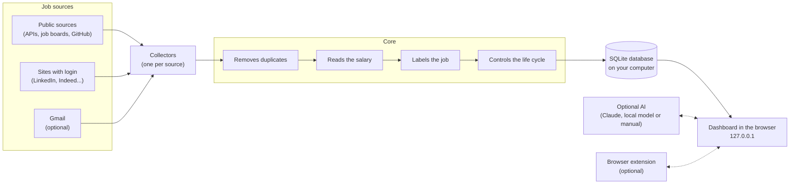

<div align="center">

# joBot

**Your personal job search assistant.**<br>
It gathers, filters and organizes jobs from many sites into a nice dashboard that runs on your own computer.

[](LICENSE)
[](#roadmap)
[](#requirements-and-installation)
[](#requirements-and-installation)
<br>
[](#how-it-works)
[](#how-it-works)
[](#how-it-works)
[](#job-sources)
[](#requirements-and-installation)
<br>
[](#how-to-contribute)
[](#how-to-contribute)
[](#how-to-contribute)
<br>
[](#privacy-and-security)
[](#privacy-and-security)
[](#artificial-intelligence)

[Português](README.md) · **English**

[How it works](#how-it-works) · [Installation](#requirements-and-installation) · [Roadmap](#roadmap) · [FAQ](#faq)

</div>

> [!IMPORTANT]
> **joBot is under development.** The main decisions have already been made and recorded. Phase 1 (the foundation) is in progress.
> There is **nothing to install yet**. Everything described here is the plan, not a finished product.

## 📑 Contents

- [What joBot is](#what-is-jobot)
- [What it does not do](#what-it-does-not-do)
- [How it works](#how-it-works)
- [The two versions](#two-versions)
- [Job sources](#job-sources)
- [The dashboard](#dashboard)
- [Artificial intelligence](#artificial-intelligence)
- [Using the Claude Code you already have](#using-claude-code)
- [Privacy and security](#privacy-and-security)
- [Requirements and installation (planned)](#requirements-and-installation)
- [Roadmap](#roadmap)
- [FAQ](#faq)
- [Project decisions](#project-decisions)
- [How to contribute](#how-to-contribute)
- [Star history](#star-history)
- [Support the project](#support-the-project)
- [License and notices](#license-and-notices)

<a id="what-is-jobot"></a>
## 🤖 What joBot is

joBot was born to help young university students find their first job. Then the idea grew: now it aims to help everyone who is looking for work.

Looking for a job today is tiring. You have to open many sites, repeat the same filters and hope you don't miss a deadline.
joBot will do this repetitive work for you. It will visit job sites, gather everything in one place and show what matches your profile.
Everything will run on your computer. One installation serves one person, who can have several saved searches.

What it will do:

- 🔎 **Search** for jobs in dozens of sources: public sites, company job boards and, if you want, sites that require login.
- 🧹 **Clean up**: removes duplicate jobs, reads the salary and tags the field, level, work mode, region and contract type.
- 🎯 **Rank**: shows how well each job matches you (● good, ◐ medium, ○ weak) and explains why.
- 🗂️ **Organize**: each job has a status, from "new" to "offer".
- ✍️ **Prepare the application**: cover letter, a résumé summary adjusted to the job and a list of what you have and what is missing, always in the job's language.
- 🧩 **Help with forms**: a browser extension suggests answers, and you confirm.
- 📬 **Read Gmail** (optional): brings in jobs from alert emails and suggests status changes when a recruiter replies.

It works for every kind of job and every field: full-time employment (CLT), contractor (PJ), internship, trainee, temporary, apprentice, research and scholarships, programs and summer schools, public exams and notices.
Every feature can be turned on or off.

<a id="what-it-does-not-do"></a>
## 🚫 What it does not do

joBot was planned not to do the following:

- **It does not mass-apply.** There is no "apply to 200 jobs with one click".
- **It does not send anything on its own.** You are always the one who sends the application.
- **It does not type your password.** On sites with login, you sign in with your own hands.
- **It does not bypass CAPTCHA.** If one shows up, it stops and warns you.
- **It does not send telemetry.** joBot does not send usage data to anyone.
- **It does not invent experience.** The AI only uses what is in your profile.

<a id="how-it-works"></a>
## ⚙️ How it works



One search cycle, step by step:

1. **At the scheduled time**, joBot wakes up. Public sources: every 3 hours. Sites with login: twice a day (9 am and 6 pm, adjustable). Or when you press "search now".
2. **Each collector** visits its source calmly and brings the jobs in a single format.
3. **The core** merges duplicate jobs, understands the salary, adds labels and marks as closed the jobs that disappeared.
4. **Everything goes to the SQLite database**, a file that stays on your computer.
5. **The dashboard** shows the result in your browser. It only works on your computer (address 127.0.0.1).
6. **If you turned on the AI**, it calculates the match with your profile and helps prepare applications.

If one source fails, the others keep going. If the computer was off at the scheduled time, the missed search runs when it turns on.

<a id="two-versions"></a>
## 🖥️ The two versions

joBot will have a single core and two "faces". The **local version** is the focus. The **browser version** (GitHub Pages) is for people who don't want to install anything, and it arrives in phase 7.

| | 💻 Local version | 🌐 Browser version (GitHub Pages) |
|---|---|---|
| **Installation** | Native, with one command (planned) | None: just open the site |
| **Sources** | All | Public sources only |
| **Sites with login** | Yes, with your manual login | No |
| **AI** | Automatic (Claude, local model) or manual | Manual (copy and paste); labels by rules only |
| **Browser extension** | Yes | No |
| **Gmail** | Yes (optional) | No |
| **Audio** | Yes, transcription on your computer | No |
| **Where the data lives** | In the SQLite database on your computer | Your profile stays in your browser (localStorage) |
| **Updates** | Every 3 h (public) and twice a day (login) | Once a day, with an "updated on &lt;date&gt;" notice |

In the browser version, you can export your profile to a file and import it later into the local version. There is also a "download full version" button.
It never uses logins or secrets.

<a id="job-sources"></a>
## 🌎 Job sources

Each source has an on/off switch.

| Group | Examples |
|---|---|
| Job repositories on GitHub | backend-br, frontendbr, soujava, remotejobsbr, developersRJ |
| International sites and APIs | Jobicy, Hacker News "Who is hiring", Remotive, RemoteOK, Himalayas, We Work Remotely |
| Company job boards (recruiting systems, the "ATS") | Greenhouse, Lever, Ashby, SmartRecruiters, Workday, Eightfold, Oracle HCM, InHire, Quickin, Recrutei |
| Brazilian portals | Gupy, CIEE, Sólides, IEL, Super Estágios, Cia de Talentos, Eureca, Abler |
| Careers at big companies | Google, Amazon, Microsoft, NVIDIA |
| Internship boards | Public boards, such as the one at USP |
| 🔐 Sites with login (first) | LinkedIn, Indeed, Catho, Vagas.com |
| 🔐 Sites with login (later, one at a time) | InfoJobs, Glassdoor, Programathor, GeekHunter, Remotar, Trampos, Revelo, Coodesh |

Also planned:

- **Own company list**, made only of public facts (company name and job board identifier), each one checked against the real address.
- **Weekly discovery** of new job boards through Common Crawl (a public archive of the web). You can turn it off.
- **Tracking program pages**, such as trainee and summer school, through the "add site" feature.

**Polite collection.** The robot identifies itself, waits between one request and the next and waits longer when the site asks for calm.

**Health of each source.** On every search, each source is marked as ok, partial or failed. You see this in the dashboard.

> [!WARNING]
> **Sites with login carry risk.** LinkedIn, Indeed and others may restrict accounts that access them automatically, and this may go against their terms of use.
> joBot reduces the risk: it opens a visible Chrome, you do the login, it only reads (it does not click "apply", it does not send messages), and it visits rarely and slowly.
> Even so, the risk exists. **You decide whether to turn on each site.**

<a id="dashboard"></a>
## 📋 The dashboard

The dashboard opens in your browser. The screen design is still to be done, in phase 1. That is why there are no images here.

- **Tabs:** Today's highlights (the best new ones, one per company), All, New, Closing soon, Saved, Applied, Programs and Hidden.
- **Filters** as "chips" (little buttons) with counts. The current filter stays in the page address, so you can save the link. Quick search with the `/` key.
- **Status of each job:** new → saved → applied → interview → rejected or offer.
- **Match with your profile:** ● good, ◐ medium, ○ weak, always with the reasons. It shows the skills you have (✓) and the ones you lack.
- **12-month calendar** on each job, to see deadlines at a glance.
- **Jobs hidden** by a rule can come back. The dashboard shows how many were hidden for each reason.
- **"Something wrong with this job?"**: a button to fix a label or a piece of data.
- **Look inspired by Apple's style:** translucency, smooth animations, light and dark mode following the system. SF font on Mac and Inter on other systems.
- **Languages:** Portuguese and English.

<a id="artificial-intelligence"></a>
## 🧠 Artificial intelligence

The AI is **optional**. Without it, joBot works with rules and keywords.

> **Golden rule:** the AI only uses the data in your profile. It never invents experience, courses or skills, and it shows which data it used.
> If information is missing, it asks a question, and your answer is saved in the profile.

### Options

| Option | Cost | Where it runs | Where the data goes | Needs internet? |
|---|---|---|---|---|
| **Claude Code session** ([details](#using-claude-code)) | Uses your Claude subscription | At Anthropic | Anthropic | Yes |
| **Anthropic API key** | Pay per use | At Anthropic | Anthropic | Yes |
| **Local model (Qwen)** | Free | On your computer | Does not leave the computer | No (after downloading) |
| **Keywords** (no AI) | Free | On your computer | Does not leave the computer | No |
| **Manual AI** (copy and paste) | Free in joBot; depends on the chat AI you use | In the chat AI you choose | Wherever you paste it | Depends on the chat AI |

So you don't have to set up task by task, there are three shortcuts:

- **All Claude**: uses Claude for every task.
- **All offline**: uses Qwen, which runs on your computer, for every task.
- **Custom**: you choose the option and the model for each task.

### Default models with Claude

The app uses only two models: Haiku 5.5 (`claude-haiku-5-5`), faster and cheaper, and Sonnet 5.5 (`claude-sonnet-5-5`), more capable.
**The Opus model is never used**, to save cost and your usage limit.

| Task | Model |
|---|---|
| Read the résumé and build the profile | Sonnet 5.5 |
| Match score with the job | Haiku 5.5 |
| Prepare the application | Sonnet 5.5 |
| Browser extension | Sonnet 5.5 |
| Extra questionnaire questions | Sonnet 5.5 |
| Job alert emails | Haiku 5.5 |
| Recruiter replies | Keywords + Haiku 5.5 |

### Offline package

At installation, joBot will ask once whether you want the offline package. It lets you use AI without internet and without paying anything.

| Item | Size | Note |
|---|---|---|
| llama-server (llama.cpp program that runs the model) | ~23 MB Linux · ~25 MB Windows · ~17 MB macOS with Apple chip | Pinned version, checked by checksum |
| Qwen3.5-2B (AI model) | 1.28 GB | For computers with 8 GB of RAM |
| Qwen3.5-4B (AI model) | 2.74 GB | For computers with 12 GB or more |
| Audio transcription (faster-whisper "small") | 484 MB | To answer by speaking |
| Audio transcription "medium" | 1.53 GB | Optional, more accurate |

A "checksum" is a fingerprint of the file: joBot checks that the downloaded file is exactly the expected one.

<a id="using-claude-code"></a>
## ✨ Using the Claude Code you already have

If you already use Claude Code on your computer, joBot can use Claude **with no extra login**.
You do not log in to Claude inside joBot. Ever.

### Step by step

1. **Install Claude Code** following the instructions on the [official Claude Code site](https://code.claude.com/docs/en/setup#install-claude-code).
2. **Sign in once through the terminal.** Open the terminal, type `claude` and press Enter. Inside it, type `/login` and follow the instructions, which open the Anthropic site. This login is done with Anthropic itself ([how login works](https://code.claude.com/docs/en/authentication)).
3. **Open joBot.** At step 0 of the first run, it notices on its own that Claude Code is ready and offers this option.

That's it. The account, the subscription, the limits and the cost remain yours.

### What joBot does

- Asks Claude Code whether you are logged in (`claude auth status`).
- Sends requests through Claude Code's headless mode (`claude -p`, [documentation](https://code.claude.com/docs/en/headless)), asking for the answer in a fixed format (JSON).
- Uses only Haiku 5.5 or Sonnet 5.5.
- If there is an error, it shows it in the dashboard. If you are not logged in, it explains how to sign in through the terminal.

### What joBot never does

- Never reads, copies, stores or passes on your Claude credential or token.
- Never shows a Claude login screen inside itself.
- Never bundles or modifies Claude Code.
- Never uses the Opus model.

### Technical precautions

- Call with no tools at all (`--tools ""`), no MCP servers (`--strict-mcp-config`) and without saving the session (`--no-session-persistence`). Details in the [command reference](https://code.claude.com/docs/en/cli-reference).
- Runs in an empty temporary folder, so it doesn't load the settings of some project. Your personal settings in `~/.claude` still apply.
- Removes `ANTHROPIC_API_KEY` and `ANTHROPIC_AUTH_TOKEN` from the call environment (except in "API key" mode). Without this, Claude Code would use the key and the charge would go to the API without you noticing. For the same reason, it removes the cloud provider variables (`CLAUDE_CODE_USE_BEDROCK`, `CLAUDE_CODE_USE_VERTEX` and `CLAUDE_CODE_USE_FOUNDRY`).
- Before each call, it checks with `claude auth status` that the active login is the subscription one. If another method is active (for example, an `apiKeyHelper` in your settings), the dashboard warns you and does not make the call.
- Does not use `--bare`, because that mode does not read the subscription login.
- Does not use or ask for `CLAUDE_CODE_OAUTH_TOKEN`.
- The credential stays where Claude Code keeps it: `~/.claude/.credentials.json` on Linux, `%USERPROFILE%\.claude\.credentials.json` on Windows and the Keychain on macOS. If the `CLAUDE_CONFIG_DIR` variable is set, the folder changes. joBot never opens any of it.

### About Anthropic's rules

Anthropic does not allow third-party apps to offer Claude login, to send requests using people's subscriptions on their behalf, or to collect, store or pass on credentials and tokens. The login must happen in Anthropic's own flow ([official policy](https://code.claude.com/docs/en/legal-and-compliance)). Apps that run Claude Code are also under Anthropic's Commercial Terms: Claude Code cannot be modified and each person signs in with their own account.
joBot does not offer login, does not bundle or modify Claude Code and never touches your credential: each person uses their own, on their own computer.

It also does not share a subscription between people: each one runs their own Claude Code and spends only the limit of their own subscription.
Details in [ADR 0010](docs/decisions/0010-claude-code-da-pessoa.md) (in Portuguese).

<sub>Claude and Claude Code are trademarks of Anthropic. joBot is not affiliated with Anthropic.</sub>

<a id="privacy-and-security"></a>
## 🔒 Privacy and security

> These are the planned rules. joBot does not have anything to install yet.

- **There is no joBot server.** Your data stays on your computer.
- **No telemetry.** No usage data is sent.
- **Secrets in the system vault.** The Gmail token, the API key and the Telegram token stay in the operating system's password vault. Without a vault, they go to a file that only your user can read, and the dashboard warns you.
- **Protected personal data.** CPF (Brazilian tax ID) and date of birth stay in the database, in a folder that only your user can access and that is not synced to the cloud. The dashboard recommends turning on disk encryption (LUKS, BitLocker or FileVault).
- **Exporting the profile does not include documents** such as the CPF, unless you check that option.
- **Dashboard closed to the outside.** It only accepts connections from your own computer (127.0.0.1) and checks every request.
- **Paired extension.** The extension only talks to joBot after pairing. It never touches password or card fields.
- **Audio deleted.** The recording is transcribed on your computer and deleted right after.
- **Gmail read-only.** Access is read-only, with a Google project created by you.
- **Your data only leaves** for the services you turn on: Anthropic, Google or Telegram, and other optional services (see ADRs [0009](docs/decisions/0009-ia-backends-e-modelos.md) and [0014](docs/decisions/0014-seguranca-e-privacidade.md)).
- **Found a security flaw?** Do not open a public issue. Follow the [security policy](.github/SECURITY.en.md).

<a id="requirements-and-installation"></a>
## 📦 Requirements and installation (planned)

> There is nothing to install yet. The exact install command comes out in phase 8.

### Requirements

- **Memory:** 8 GB of RAM (16 GB makes everything smoother).
- **Graphics card:** not needed.
- **System:** Linux, Windows or macOS.
- **Docker:** not needed. The installation is native.

### What the installer will download

| Item | Size | Required? |
|---|---|---|
| joBot and what it needs to run (Python 3.14 and libraries, via uv) | To be defined in the phase 8 design | Yes |
| Browser controlled by Playwright | To be defined in the phase 8 design | Only for sites with login |
| llama-server | ~17 to 25 MB, depending on the system | Optional (offline package) |
| Qwen3.5-2B **or** Qwen3.5-4B model | 1.28 GB or 2.74 GB | Optional (offline package) |
| Audio transcription "small" | 484 MB | Optional (offline package) |
| Audio transcription "medium" | 1.53 GB | Optional |
| multilingual-e5-small model | ~120 MB | Only if some label falls below 90% accuracy |

### First run

An assistant will guide you in steps:

| Step | What happens |
|---|---|
| **0. Choose the AI** | Claude, local model, keywords or manual AI. If Claude Code is ready, it shows up on its own. |
| **1. Résumé** | You upload the PDF, the AI extracts the data and you review it before saving. |
| **2. Questionnaire** | About 25 questions, plus a few more to cover gaps. Answer by typing, choosing or speaking. |
| **3. Site logins** | If you want, sign in to the sites with login, with your own hands. |
| **4. Gmail** | Optional. A guided assistant of about 15 minutes. |
| **5. Background** | Choose whether joBot starts with the computer and the schedules for sites with login. |

<a id="roadmap"></a>
## 🗺️ Roadmap

Each phase only starts after the previous one passes the tests. No dates are promised.

| Phase | What is included | Status |
|---|---|---|
| **1. Base** | Common core, public sources, database, dashboard and scheduling | 🟡 In progress |
| **2. Browser with login** | Visible Chrome, site mapping, CAPTCHA handling | ⚪ Planned |
| **3. Local AI** | Offline package (llama-server + Qwen) | ⚪ Planned |
| **4. Browser extension** | Browser extension for forms | ⚪ Planned |
| **5. Audio and Gmail** | Answers by voice and email reading | ⚪ Planned |
| **6. Training** | Learn from what you save and discard | ⚪ Planned |
| **7. GitHub Pages version** | GitHub Pages version, no installation | ⚪ Planned |
| **8. Release** | Installers, README with badges and security review | ⚪ Planned |

<a id="faq"></a>
## ❓ FAQ

The most common questions and answers are on the [FAQ page of the wiki](https://github.com/fezarosa-dev/joBot/wiki/Frequently-asked-questions).

<a id="project-decisions"></a>
## 📚 Project decisions

Each important decision is recorded in a short document called an ADR (architecture decision record).

- **Index (in Portuguese):** [docs/decisions/README.md](docs/decisions/README.md)
- **Open questions (open and resolved, in Portuguese):** [duvidas.md](duvidas.md)

| No. | Decision |
|---|---|
| 0001 | [Scope: what joBot is and what it is not](docs/decisions/0001-escopo-do-jobot.md) |
| 0002 | [Two versions, one core](docs/decisions/0002-duas-versoes-um-nucleo.md) |
| 0003 | [Technologies and native installation (no Docker)](docs/decisions/0003-stack-e-instalacao-nativa.md) |
| 0004 | [Public job sources and polite collection](docs/decisions/0004-fontes-publicas.md) |
| 0005 | [Sites that require login](docs/decisions/0005-sites-com-login.md) |
| 0006 | [Search schedule and background running](docs/decisions/0006-agenda-e-segundo-plano.md) |
| 0007 | [Job data handling: duplicates, life cycle, salary and labels](docs/decisions/0007-tratamento-dos-dados.md) |
| 0008 | [Dashboard and look](docs/decisions/0008-painel-e-visual.md) |
| 0009 | [Artificial intelligence: options, models and offline package](docs/decisions/0009-ia-backends-e-modelos.md) |
| 0010 | [Use the Claude Code the person already has (no login inside joBot)](docs/decisions/0010-claude-code-da-pessoa.md) |
| 0011 | [Profile, résumé, first run and audio](docs/decisions/0011-perfil-e-primeira-execucao.md) |
| 0012 | [Browser extension](docs/decisions/0012-extensao-do-navegador.md) |
| 0013 | [Gmail and notices](docs/decisions/0013-gmail-e-avisos.md) |
| 0014 | [Security and privacy](docs/decisions/0014-seguranca-e-privacidade.md) |
| 0015 | [Model training (phase 6)](docs/decisions/0015-treino.md) |
| 0016 | [License, clean room and work process](docs/decisions/0016-licenca-clean-room-e-processo.md) |
| 0017 | [Project phases](docs/decisions/0017-fases.md) |
| 0018 | [Community maintenance and CI open to every PR](docs/decisions/0018-manutencao-pela-comunidade.md) |
| 0019 | [Project wiki and question form](docs/decisions/0019-wiki-do-projeto.md) |
| 0020 | [Financial support: donations only](docs/decisions/0020-apoio-financeiro.md) |

<a id="how-to-contribute"></a>
## 🤝 How to contribute

The repository is already on GitHub, and phase 1 is in progress.

- **Suggestions and job sources** can already be sent through issues, with ready-made forms.
- **Questions** go through the [question form](https://github.com/fezarosa-dev/joBot/issues/new?template=duvida.yml). Read the [FAQ](https://github.com/fezarosa-dev/joBot/wiki/Frequently-asked-questions) first.
- **Code** only after the release (phase 8).
- The wiki is edited through PRs on the `wiki/` folder of the repository.
- The complete rules are in the contribution guide.

Useful links:

- [Contribution guide](.github/CONTRIBUTING.en.md)
- [Code of Conduct](.github/CODE_OF_CONDUCT.en.md)
- [Security policy](.github/SECURITY.en.md)
- [Support](.github/SUPPORT.en.md)
- [Changelog](CHANGELOG.en.md)

<a id="star-history"></a>
## ⭐ Star history

If joBot helps you, leave a star on the repository.

<a href="https://www.star-history.com/?repos=fezarosa-dev%2FjoBot&type=date&legend=top-left">
 <picture>
   <source media="(prefers-color-scheme: dark)" srcset="https://api.star-history.com/chart?repos=fezarosa-dev/joBot&type=date&theme=dark&legend=top-left" />
   <source media="(prefers-color-scheme: light)" srcset="https://api.star-history.com/chart?repos=fezarosa-dev/joBot&type=date&legend=top-left" />
   
 </picture>
</a>

<a id="support-the-project"></a>
## 💛 Support the project

joBot is free and kept by one person. If it helps you and you want to chip in for upkeep, you can donate:

- **Pix** (Brazil only), random key:

  ```text
  65c34f26-c646-431f-af90-e5b1d2808ad4
  ```

- **Buy Me a Coffee:** <https://buymeacoffee.com/zanoni.dev>

Donating is optional. joBot stays fully free, with no ads, no affiliate links and no tracking (see [decision 0020](docs/decisions/0020-apoio-financeiro.md)).

Other ways to help and more details are on the [Support the project wiki page](https://github.com/fezarosa-dev/joBot/wiki/Support-the-project).

<a id="license-and-notices"></a>
## ⚖️ License and notices

- **License:** MIT. See the [`LICENSE`](LICENSE) file.
- **Trademarks:** Claude and Claude Code are trademarks of Anthropic. joBot is not affiliated with Anthropic. The other trademarks mentioned belong to their owners.
- **Terms of use:** respect the terms of use of each site you turn on.
- **Personal use:** joBot is made for one person to organize their own job search.

---

<div align="center">
<sub>[Leia em português](README.md)</sub>
</div>
