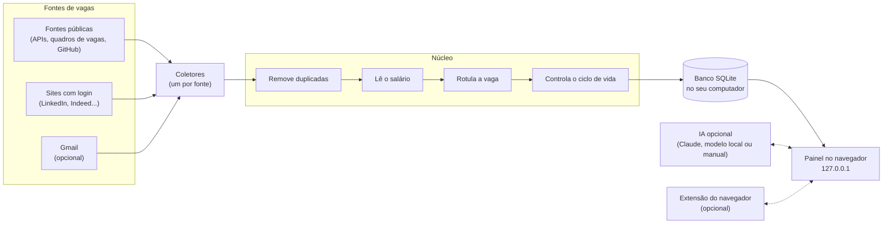

<div align="center">

# joBot

**Seu assistente pessoal de busca de vagas.**<br>
Ele junta, filtra e organiza vagas de muitos sites num painel bonito que roda no seu próprio computador.

[](LICENSE)
[](#roteiro)
[](#requisitos-e-instalacao)
[](#requisitos-e-instalacao)
<br>
[](#como-funciona)
[](#como-funciona)
[](#como-funciona)
[](#fontes-de-vagas)
[](#requisitos-e-instalacao)
<br>
[](#como-contribuir)
[](#como-contribuir)
[](#como-contribuir)
<br>
[](#privacidade-e-seguranca)
[](#privacidade-e-seguranca)
[](#inteligencia-artificial)

**Português** · [English](README.en.md)

[Como funciona](#como-funciona) · [Instalação](#requisitos-e-instalacao) · [Roteiro](#roteiro) · [Perguntas frequentes](#perguntas-frequentes)

</div>

> [!IMPORTANT]
> **A fase 1 do joBot (a base) está pronta: versão 0.1.0.** Ele busca vagas em fontes públicas, guarda tudo no seu computador e mostra num painel. Já dá para [instalar e usar](#requisitos-e-instalacao).
> O resto (sites com login, IA, extensão do navegador, Gmail e áudio) ainda é plano. Veja o [roteiro](#roteiro). Antes de ligar as fontes, leia os [avisos de uso e de termos](#licenca-e-avisos).

## 📑 Sumário

- [O que é o joBot](#o-que-e)
- [Histórico de estrelas](#historico-de-estrelas)
- [O que ele não faz](#o-que-nao-faz)
- [Como funciona](#como-funciona)
- [As duas versões](#as-duas-versoes)
- [Fontes de vagas](#fontes-de-vagas)
- [O painel](#o-painel)
- [Inteligência artificial](#inteligencia-artificial)
- [Usando o Claude Code que você já tem](#usando-o-claude-code)
- [Privacidade e segurança](#privacidade-e-seguranca)
- [Requisitos e instalação](#requisitos-e-instalacao)
- [Roteiro](#roteiro)
- [Perguntas frequentes](#perguntas-frequentes)
- [Decisões do projeto](#decisoes-do-projeto)
- [Como contribuir](#como-contribuir)
- [Apoie o projeto](#apoie-o-projeto)
- [Licença e avisos](#licenca-e-avisos)

<a id="o-que-e"></a>
## 🤖 O que é o joBot

O joBot nasceu para ajudar jovens universitários a encontrar o primeiro emprego. Depois a ideia cresceu: hoje ele quer ajudar todo mundo que procura vaga.

Procurar vaga hoje cansa. É preciso abrir muitos sites, repetir os mesmos filtros e torcer para não perder um prazo.
O joBot faz esse trabalho repetitivo por você. Ele visita os sites de vagas, junta tudo num lugar só e mostra o que combina com o que você procura.
Tudo roda no seu computador. Uma instalação serve a uma pessoa, que pode ter várias buscas salvas.

O que ele faz hoje (fase 1):

- 🔎 **Buscar** vagas em dezenas de fontes públicas: sites, APIs e quadros de vagas de empresas.
- 🧹 **Limpar**: remove vagas repetidas, lê o salário e marca área, nível, modalidade, região e tipo de contrato.
- 🎯 **Ranquear**: mostra o quanto cada vaga combina com a sua busca (● bom, ◐ médio, ○ fraco) e explica o porquê. Na fase 1 isso é feito por regras, sem IA.
- 🗂️ **Organizar**: cada vaga tem um status, de "nova" até "oferta".
- 📌 **Acompanhar páginas** de programas, como trainee e escola de verão, e avisar quando o texto muda.

O que vem nas próximas fases:

- 🔐 **Sites que exigem login**, com o seu login feito à mão (fase 2).
- ✍️ **Preparar candidatura**: carta de apresentação, resumo do currículo ajustado à vaga e lista do que você tem e do que falta, sempre no idioma da vaga (fase 3, com IA opcional).
- 🧩 **Ajudar nos formulários**: uma extensão do navegador sugere respostas, e você confirma (fase 4).
- 📬 **Ler o Gmail** (opcional): traz vagas dos e-mails de alerta e sugere mudanças de status quando um recrutador responde (fase 5).

Serve para todo tipo de vaga e toda área: CLT, PJ, estágio, trainee, temporário, aprendiz, pesquisa e bolsa, programas e escolas de verão, concursos e editais.
Toda função pode ser ligada ou desligada.

<a id="historico-de-estrelas"></a>
## ⭐ Histórico de estrelas

Se o joBot te ajudar, deixe uma estrela no repositório.

<a href="https://www.star-history.com/?repos=fezarosa-dev%2FjoBot&type=date&legend=top-left">
 <picture>
   <source media="(prefers-color-scheme: dark)" srcset="https://api.star-history.com/chart?repos=fezarosa-dev/joBot&type=date&theme=dark&legend=top-left" />
   <source media="(prefers-color-scheme: light)" srcset="https://api.star-history.com/chart?repos=fezarosa-dev/joBot&type=date&legend=top-left" />
   
 </picture>
</a>

<a id="o-que-nao-faz"></a>
## 🚫 O que ele não faz

O joBot não faz, e foi planejado para nunca fazer:

- **Não se candidata em massa.** Não existe "aplicar em 200 vagas com um clique".
- **Não envia nada sozinho.** Quem envia a candidatura é sempre você.
- **Não digita a sua senha.** Nos sites com login, você entra com as próprias mãos.
- **Não contorna CAPTCHA.** Se aparecer um, ele para e avisa você.
- **Não manda telemetria.** O joBot não envia dados de uso para ninguém.
- **Não inventa experiência.** A IA só usa o que está no seu perfil.

<a id="como-funciona"></a>
## ⚙️ Como funciona



Um ciclo de busca, passo a passo:

1. **Na hora marcada**, o joBot acorda. Fontes públicas: a cada 3 horas. Ou quando você aperta "Buscar agora". (Os sites com login chegam na fase 2, com duas buscas por dia.)
2. **Cada coletor** visita a sua fonte com calma e traz as vagas num formato único.
3. **O núcleo** junta vagas repetidas, entende o salário, coloca rótulos e marca como fechadas as vagas que sumiram.
4. **Tudo vai para o banco** SQLite, um arquivo que fica no seu computador.
5. **O painel** mostra o resultado no seu navegador. Ele só funciona no seu computador (endereço 127.0.0.1).
6. **Quando a IA chegar** (fase 3) e você ligá-la, ela vai calcular o encaixe com o seu perfil e ajudar a preparar candidaturas. Até lá, o encaixe vem das regras da sua busca.

Se uma fonte falhar, as outras continuam. Se o computador estava desligado na hora marcada, a busca perdida roda quando ele liga.

<a id="as-duas-versoes"></a>
## 🖥️ As duas versões

O joBot vai ter um núcleo só e duas "caras". A **versão local** é o foco. A **versão no navegador** (GitHub Pages) é para quem não quer instalar nada e chega na fase 7.

| | 💻 Versão local | 🌐 Versão no navegador (GitHub Pages) |
|---|---|---|
| **Instalação** | Nativa, com o uv ([como instalar](#requisitos-e-instalacao)) | Nenhuma: é só abrir o site |
| **Fontes** | Todas | Só fontes públicas |
| **Sites com login** | Sim, com o seu login manual | Não |
| **IA** | Automática (Claude, modelo local) ou manual | Manual (copiar e colar); rótulos só por regras |
| **Extensão do navegador** | Sim | Não |
| **Gmail** | Sim (opcional) | Não |
| **Áudio** | Sim, transcrição no seu computador | Não |
| **Onde ficam os dados** | No banco SQLite do seu computador | Seu perfil fica no seu navegador (localStorage) |
| **Atualização** | A cada 3 h (públicas) e 2x por dia (login) | Uma vez por dia, com aviso "atualizado em &lt;data&gt;" |

Na versão no navegador, você pode exportar o perfil num arquivo e importar depois na versão local. Há também um botão "baixar versão completa".
Ela nunca usa logins nem segredos.

<a id="fontes-de-vagas"></a>
## 🌎 Fontes de vagas

Cada fonte tem uma chave liga/desliga, em Configurações, Fontes. Na fase 1 funcionam as fontes públicas; os sites com login chegam na fase 2.
Três portais brasileiros pedem cuidado, por causa dos termos de uso deles: Eureca, Abler e Gupy. Leia o aviso em [Licença e avisos](#licenca-e-avisos).

| Grupo | Exemplos |
|---|---|
| Repositórios de vagas no GitHub | backend-br, frontendbr, soujava, remotejobsbr, developersRJ |
| Sites e APIs internacionais | Jobicy, Hacker News "Who is hiring", Remotive, RemoteOK, Himalayas, We Work Remotely |
| Quadros de vagas de empresas (sistemas de recrutamento, os "ATS") | Greenhouse, Lever, Ashby, SmartRecruiters, Workday, Eightfold, Oracle HCM, InHire, Quickin, Recrutei |
| Portais brasileiros | Gupy, CIEE, Sólides, IEL, Super Estágios, Cia de Talentos, Eureca, Abler |
| Carreiras de grandes empresas | Google, Amazon, Microsoft, NVIDIA |
| Murais de estágio | Murais públicos, como o da USP |
| 🔐 Sites com login (fase 2, primeiro) | LinkedIn, Indeed, Catho, Vagas.com |
| 🔐 Sites com login (fase 2, depois, um de cada vez) | InfoJobs, Glassdoor, Programathor, GeekHunter, Remotar, Trampos, Revelo, Coodesh |

Também na fase 1:

- **Lista de empresas própria**, feita só de fatos públicos (nome da empresa e identificador do quadro de vagas), cada um conferido no endereço real. Você acrescenta as suas em Empresas.
- **Descoberta semanal** de novos quadros de vagas pelo Common Crawl (um arquivo público da web). Os achados vão para Sugeridas, e nada entra na sua busca até você aprovar. Pode desligar em Configurações.
- **Acompanhar páginas de programas**, como trainee e escola de verão, pela tela Sites. A mudança aparece na aba Programas.

**Coleta educada.** O robô se identifica, espera entre um pedido e outro e espera mais quando o site pede calma.

**Saúde de cada fonte.** A cada busca, cada fonte fica marcada como ok, parcial ou falhou. Você vê isso no painel.

> [!WARNING]
> **Sites com login têm risco.** LinkedIn, Indeed e outros podem restringir contas que acessam de forma automática, e isso pode ir contra os termos de uso deles.
> O joBot reduz o risco: abre um Chrome visível, você faz o login, ele só lê (não clica em "candidatar", não manda mensagem), visita poucas vezes e devagar.
> Mesmo assim, o risco existe. **Você decide se liga cada site.**

<a id="o-painel"></a>
## 📋 O painel

O painel abre no seu navegador, em `http://127.0.0.1:47615`. O menu tem Vagas, Buscas, Fontes, Empresas, Sugeridas, Sites e Configurações.

- **Abas:** Destaques de hoje (as melhores novas, uma por empresa), Todas, Novas, Fecham logo, Salvas, Candidatei, Programas e Ocultas.
- **Filtros** em "chips" (botõezinhos) com contagem. O filtro atual fica no endereço da página, então dá para salvar o link. Busca rápida com a tecla `/`.
- **Status de cada vaga:** nova → salva → candidatei → entrevista → recusada ou oferta.
- **Encaixe com a sua busca:** ● bom, ◐ médio, ○ fraco, sempre com os motivos.
- **Calendário de 12 meses** em cada vaga, para ver prazos de relance.
- **Vagas ocultas** por regra podem voltar. O painel mostra quantas foram escondidas por cada motivo.
- **"Algo errado nesta vaga?"**: um botão para corrigir um rótulo ou dado.
- **Visual inspirado no estilo da Apple:** translucidez, animações suaves, modo claro e escuro seguindo o sistema. Fonte SF no Mac e Inter nos outros sistemas.
- **Idiomas:** português e inglês.

<a id="inteligencia-artificial"></a>
## 🧠 Inteligência artificial

A IA é **opcional** e chega na fase 3. Sem ela, o joBot funciona com regras e palavras-chave, e é assim que a fase 1 funciona.

> **Regra de ouro:** a IA só usa os dados do seu perfil. Ela nunca inventa experiência, curso ou habilidade, e mostra quais dados usou.
> Se faltar informação, ela faz uma pergunta, e a sua resposta fica salva no perfil.

### Opções

| Opção | Custo | Onde roda | Para onde vão os dados | Precisa de internet? |
|---|---|---|---|---|
| **Sessão do Claude Code** ([detalhes](#usando-o-claude-code)) | Usa a sua assinatura do Claude | Na Anthropic | Anthropic | Sim |
| **Chave da API da Anthropic** | Pago por uso | Na Anthropic | Anthropic | Sim |
| **Modelo local (Qwen)** | Grátis | No seu computador | Não saem do computador | Não (depois de baixar) |
| **Palavras-chave** (sem IA) | Grátis | No seu computador | Não saem do computador | Não |
| **IA manual** (copiar e colar) | Grátis no joBot; depende da IA de chat que você usar | Na IA de chat que você escolher | Para onde você colar | Depende da IA de chat |

Para não ter de configurar tarefa por tarefa, há três atalhos:

- **Tudo Claude**: usa o Claude em todas as tarefas.
- **Tudo offline**: usa o Qwen, que roda no seu computador, em todas as tarefas.
- **Personalizado**: você escolhe a opção e o modelo de cada tarefa.

### Modelos padrão com o Claude

O app usa só dois modelos: Haiku 5.5 (`claude-haiku-5-5`), mais rápido e barato, e Sonnet 5.5 (`claude-sonnet-5-5`), mais capaz.
**O modelo Opus nunca é usado**, para poupar custo e o seu limite de uso.

| Tarefa | Modelo |
|---|---|
| Ler o currículo e montar o perfil | Sonnet 5.5 |
| Nota de encaixe com a vaga | Haiku 5.5 |
| Preparar candidatura | Sonnet 5.5 |
| Extensão do navegador | Sonnet 5.5 |
| Perguntas extras do questionário | Sonnet 5.5 |
| E-mails de alerta de vagas | Haiku 5.5 |
| Respostas de recrutadores | Palavras-chave + Haiku 5.5 |

### Pacote offline

Na instalação, o joBot vai perguntar uma vez se você quer o pacote offline. Ele permite usar IA sem internet e sem pagar nada.

| Item | Tamanho | Observação |
|---|---|---|
| llama-server (programa do llama.cpp que roda o modelo) | ~23 MB Linux · ~25 MB Windows · ~17 MB macOS com chip Apple | Versão fixa, conferida por checksum |
| Qwen3.5-2B (modelo de IA) | 1,28 GB | Para computadores com 8 GB de RAM |
| Qwen3.5-4B (modelo de IA) | 2,74 GB | Para computadores com 12 GB ou mais |
| Transcrição de áudio (faster-whisper "small") | 484 MB | Para responder falando |
| Transcrição de áudio "medium" | 1,53 GB | Opcional, mais precisa |

Um "checksum" é uma impressão digital do arquivo: o joBot confere se o arquivo baixado é exatamente o esperado.

<a id="usando-o-claude-code"></a>
## ✨ Usando o Claude Code que você já tem

> Esta seção descreve a fase 3. A fase 1 não usa IA.

Se você já usa o Claude Code no seu computador, o joBot pode usar o Claude **sem nenhum login extra**.
Você não faz login do Claude dentro do joBot. Nunca.

### Passo a passo

1. **Instale o Claude Code** seguindo as instruções do [site oficial do Claude Code](https://code.claude.com/docs/en/setup#install-claude-code).
2. **Entre uma vez pelo terminal.** Abra o terminal, digite `claude` e aperte Enter. Dentro dele, digite `/login` e siga as instruções, que abrem o site da Anthropic. Esse login é feito na própria Anthropic ([como funciona o login](https://code.claude.com/docs/en/authentication)).
3. **Abra o joBot.** No passo 0 da primeira execução, ele percebe sozinho que o Claude Code está pronto e oferece essa opção.

Pronto. A conta, a assinatura, os limites e o custo continuam sendo seus.

### O que o joBot faz

- Pergunta ao Claude Code se você está logado (`claude auth status`).
- Manda os pedidos pelo modo sem tela do Claude Code (`claude -p`, [documentação](https://code.claude.com/docs/en/headless)), pedindo a resposta num formato fixo (JSON).
- Usa só Haiku 5.5 ou Sonnet 5.5.
- Se der erro, mostra no painel. Se você não estiver logado, explica como entrar pelo terminal.

### O que o joBot nunca faz

- Nunca lê, copia, guarda ou repassa a sua credencial ou token do Claude.
- Nunca mostra uma tela de login do Claude dentro dele.
- Nunca empacota nem modifica o Claude Code.
- Nunca usa o modelo Opus.

### Cuidados técnicos

- Chamada sem nenhuma ferramenta (`--tools ""`), sem servidores MCP (`--strict-mcp-config`) e sem guardar a sessão (`--no-session-persistence`). Detalhes na [referência de comandos](https://code.claude.com/docs/en/cli-reference).
- Roda numa pasta temporária vazia, para não carregar configurações de algum projeto. As suas configurações pessoais em `~/.claude` continuam valendo.
- Tira `ANTHROPIC_API_KEY` e `ANTHROPIC_AUTH_TOKEN` do ambiente da chamada (exceto no modo "chave da API"). Sem isso, o Claude Code usaria a chave e a cobrança iria para a API sem você perceber. Pelo mesmo motivo, tira as variáveis de provedor de nuvem (`CLAUDE_CODE_USE_BEDROCK`, `CLAUDE_CODE_USE_VERTEX` e `CLAUDE_CODE_USE_FOUNDRY`).
- Antes de cada chamada, confere com `claude auth status` se o login ativo é o da assinatura. Se outro método estiver ativo (por exemplo, um `apiKeyHelper` nas suas configurações), o painel avisa e não faz a chamada.
- Não usa `--bare`, porque esse modo não lê o login da assinatura.
- Não usa nem pede `CLAUDE_CODE_OAUTH_TOKEN`.
- A credencial fica onde o Claude Code guarda: `~/.claude/.credentials.json` no Linux, `%USERPROFILE%\.claude\.credentials.json` no Windows e o Keychain no macOS. Se a variável `CLAUDE_CONFIG_DIR` estiver definida, a pasta muda. O joBot nunca abre nada disso.

### Sobre as regras da Anthropic

A Anthropic não permite que apps de terceiros ofereçam login do Claude, mandem pedidos usando a assinatura das pessoas em nome delas, nem coletem, guardem ou repassem credenciais e tokens. O login precisa acontecer no fluxo da própria Anthropic ([política oficial](https://code.claude.com/docs/en/legal-and-compliance)). Apps que rodam o Claude Code também ficam sob os Termos Comerciais da Anthropic: o Claude Code não pode ser modificado e cada pessoa entra com a própria conta.
O joBot não oferece login, não empacota nem modifica o Claude Code e nunca toca na sua credencial: cada pessoa usa a própria, no próprio computador.

Ele também não compartilha assinatura entre pessoas: cada um roda o próprio Claude Code e gasta só o limite da própria assinatura.
Detalhes na [ADR 0010](docs/decisions/0010-claude-code-da-pessoa.md).

<sub>Claude e Claude Code são marcas da Anthropic. O joBot não é afiliado à Anthropic.</sub>

<a id="privacidade-e-seguranca"></a>
## 🔒 Privacidade e segurança

> Estas regras valem para a fase 1. As que falam de IA, Gmail, extensão, áudio e cofre de senhas descrevem as próximas fases.

- **Não existe servidor do joBot.** Seus dados ficam no seu computador.
- **Sem telemetria.** Nenhum dado de uso é enviado.
- **Só pedidos de busca e conferência.** O joBot só faz pedidos de rede nestes casos: às fontes públicas de vagas que você deixa ligadas (vêm todas ligadas), incluindo a página de cada vaga; ao Banco Central, para pegar a cotação do dólar, com a conversão de moeda ligada (vem ligada); ao Common Crawl, uma vez por semana, para descobrir empresas novas, e depois aos quadros de vagas dessas empresas, para conferir (vem ligada); às páginas que você manda acompanhar (vem ligada, mas sem páginas na lista não há pedido); ao site de uma empresa, só quando você cola o endereço dela, testa ou aceita uma sugestão; à internet pelo git e pelo uv, para baixar a versão nova do joBot, só quando você pede para atualizar (comando jobot atualizar). Se você ligar o aviso de versão (próximo item), também pergunta ao GitHub (vem desligado). Quem recebe o pedido vê o IP do seu computador, como em qualquer pedido na internet.
- **Aviso de versão desligado por padrão.** Se você ligar (Configurações, Privacidade), uma vez por dia o joBot pergunta ao `api.github.com` qual é a versão mais nova. O pedido leva só o user agent fixo do joBot (que traz o número da versão) e o IP do seu computador, como todo pedido na internet. Não leva busca nem dado seu. Desligado, não faz pedido nenhum.
- **Segredos no cofre do sistema.** Token do Gmail, chave da API e token do Telegram ficam no cofre de senhas do sistema operacional. Sem cofre, vão para um arquivo que só o seu usuário lê, e o painel avisa.
- **Dados pessoais protegidos.** CPF e data de nascimento ficam no banco, numa pasta que só o seu usuário acessa e que não é sincronizada com nuvem. O painel recomenda ligar a criptografia de disco (LUKS, BitLocker ou FileVault).
- **Exportar o perfil não leva documentos** como o CPF, a menos que você marque essa opção.
- **Painel fechado para fora.** Ele só aceita conexões do próprio computador (127.0.0.1) e confere cada pedido.
- **Extensão pareada.** A extensão só conversa com o joBot depois de um pareamento. Ela nunca toca em campos de senha ou de cartão.
- **Áudio apagado.** A gravação é transcrita no seu computador e apagada logo depois.
- **Gmail só leitura.** O acesso é só de leitura, com um projeto Google criado por você.
- **Seus dados só saem** para os serviços que você ligar: Anthropic, Google ou Telegram, e outros serviços opcionais (veja as ADRs [0009](docs/decisions/0009-ia-backends-e-modelos.md) e [0014](docs/decisions/0014-seguranca-e-privacidade.md)).
- **Achou uma falha de segurança?** Não abra issue pública. Siga a [política de segurança](.github/SECURITY.md).

<a id="requisitos-e-instalacao"></a>
## 📦 Requisitos e instalação

> Esta é a instalação da fase 1 (versão 0.1.0): você baixa o código e roda com o uv. O instalador de um comando só chega na fase 8.

### Requisitos

- **Sistema:** Linux. O Windows e o macOS ainda não foram testados, e o segundo plano só existe no Linux.
- **Programas:** [git](https://git-scm.com/) e [uv](https://docs.astral.sh/uv/). O uv baixa sozinho o Python 3.14 e as bibliotecas.
- **Memória:** um computador comum serve. Os 8 GB de RAM só contam quando a IA local chegar (fase 3).
- **Placa de vídeo e Docker:** não precisa. A instalação é nativa.
- **Internet:** para baixar o joBot e para buscar as vagas.

### Instalar e abrir

```bash
git clone https://github.com/fezarosa-dev/joBot.git
cd joBot
uv sync --locked
uv run jobot
```

O último comando sobe o joBot e abre o painel no seu navegador, em `http://127.0.0.1:47615`. Sem nada depois de `jobot`, vale o comando `abrir`.
Se outro programa já usa a porta 47615, o joBot avisa e não abre nada. Defina `JOBOT_PORTA` com outra porta e rode de novo.

### Comandos

Rode todos de dentro da pasta `joBot`, com `uv run` na frente (por exemplo, `uv run jobot buscar`).

| Comando | O que faz |
|---|---|
| `jobot abrir` | Abre o painel no navegador e sobe o servidor, se ele ainda não estiver no ar. É o padrão. |
| `jobot sair` | Encerra o servidor. |
| `jobot serve` | Sobe só o servidor, sem abrir o navegador. |
| `jobot buscar` | Faz uma busca no terminal e mostra como foi cada fonte. |
| `jobot segundo-plano ligar` | Liga o segundo plano, para o joBot iniciar sozinho junto com o seu usuário. Com `desligar` tira o serviço, e com `status` mostra como está. Só no Linux. |
| `jobot atualizar` | Atualiza o joBot para a versão mais nova e religa o que estava ligado. |
| `jobot avaliar-rotulos` | Para quem mantém o projeto: mede as regras de rótulo contra um arquivo de exemplos seu. |

### Onde ficam os dados

- Tudo fica na pasta `~/.local/share/jobot`, só com acesso do seu usuário. Para usar outra pasta, defina `JOBOT_DADOS`.
- O banco é o arquivo `jobot.db`, e o registro do que aconteceu fica em `logs/jobot.log`.
- Nada sai dessa pasta, a não ser os pedidos de rede listados em [Privacidade e segurança](#privacidade-e-seguranca).

### Se você usa distrobox

O joBot também roda dentro de um container distrobox, como no Fedora Silverblue.

- **O navegador:** dentro do container quase nunca há navegador. O joBot chama o do sistema de fora, com `distrobox-host-exec xdg-open`.
- **O segundo plano:** o serviço mora no systemd do seu usuário, no sistema de fora, e o joBot chega lá pelo `distrobox-host-exec` e pelo `distrobox-enter`. Os dois precisam estar disponíveis dentro do container.
- **A pasta pessoal:** a do container precisa ser a mesma do sistema. Se não for, o painel recusa ligar o segundo plano e diz o motivo.
- Rode todos os comandos de dentro do container.

### Primeira execução

Na primeira vez, o painel faz duas perguntas. Tudo é opcional.

| Passo | O que acontece |
|---|---|
| **1. O que você procura?** | Cargos ou palavras-chave, cidades, modalidades, níveis, salário mínimo e idiomas das vagas. Isso vira a sua primeira busca. Se você pular, as vagas aparecem por data, sem nota de encaixe. Dá para mudar depois, em Buscas. |
| **2. Segundo plano** | Escolha se o joBot inicia sozinho com o seu usuário e busca vagas a cada 3 horas, mesmo com o painel fechado. Dá para mudar depois, em Configurações. |

Depois, aperte **Buscar agora**, no topo do painel, ou espere a próxima busca da agenda.

### Atualizar

Rode `uv run jobot atualizar`. O aviso de versão é opcional e vem **desligado por padrão**: para ligar, vá em Configurações, Privacidade. Os detalhes estão em [Privacidade e segurança](#privacidade-e-seguranca).

### O que as próximas fases vão baixar

Na fase 1, o `uv sync` só baixa o Python 3.14 (se faltar) e as bibliotecas do joBot. Não há modelo de IA, navegador controlado nem arquivo grande. Estes itens chegam depois, e são opcionais:

| Item | Tamanho | Quando |
|---|---|---|
| Navegador controlado pelo Playwright | A definir | Fase 2, só para sites com login |
| llama-server | ~17 a 25 MB, conforme o sistema | Fase 3 (pacote offline) |
| Modelo Qwen3.5-2B **ou** Qwen3.5-4B | 1,28 GB ou 2,74 GB | Fase 3 (pacote offline) |
| Transcrição de áudio "small" | 484 MB | Fase 5 |
| Transcrição de áudio "medium" | 1,53 GB | Fase 5, opcional |
| Modelo multilingual-e5-small | ~120 MB | Só se algum rótulo ficar abaixo de 90% de acerto |

<a id="roteiro"></a>
## 🗺️ Roteiro

Cada fase só começa depois que a anterior passa nos testes. Não há datas prometidas.

| Fase | O que entra | Status |
|---|---|---|
| **1. Base** | Núcleo comum, fontes públicas, banco, painel e agenda | 🟢 Pronta (versão 0.1.0) |
| **2. Navegador com login** | Chrome visível, mapeamento dos sites, tratamento de CAPTCHA | ⚪ Planejada |
| **3. IA local** | Pacote offline (llama-server + Qwen) | ⚪ Planejada |
| **4. Extensão do navegador** | Extensão do navegador para formulários | ⚪ Planejada |
| **5. Áudio e Gmail** | Respostas por voz e leitura de e-mails | ⚪ Planejada |
| **6. Treino** | Aprender com o que você salva e descarta | ⚪ Planejada |
| **7. Versão GitHub Pages** | Versão GitHub Pages, sem instalação | ⚪ Planejada |
| **8. Publicação** | Instaladores, README com selos e revisão de segurança | ⚪ Planejada |

<a id="perguntas-frequentes"></a>
## ❓ Perguntas frequentes

As perguntas e respostas mais comuns ficam na [página de perguntas frequentes da wiki](https://github.com/fezarosa-dev/joBot/wiki/Perguntas-frequentes).

<a id="decisoes-do-projeto"></a>
## 📚 Decisões do projeto

Cada decisão importante está registrada num documento curto, chamado ADR (registro de decisão de arquitetura).

- **Índice:** [docs/decisions/README.md](docs/decisions/README.md)
- **Dúvidas (abertas e resolvidas):** [duvidas.md](duvidas.md)

| Nº | Decisão |
|---|---|
| 0001 | [Escopo: o que o joBot é e o que não é](docs/decisions/0001-escopo-do-jobot.md) |
| 0002 | [Duas versões, um núcleo](docs/decisions/0002-duas-versoes-um-nucleo.md) |
| 0003 | [Tecnologias e instalação nativa (sem Docker)](docs/decisions/0003-stack-e-instalacao-nativa.md) |
| 0004 | [Fontes públicas de vagas e coleta educada](docs/decisions/0004-fontes-publicas.md) |
| 0005 | [Sites que exigem login](docs/decisions/0005-sites-com-login.md) |
| 0006 | [Agenda das buscas e segundo plano](docs/decisions/0006-agenda-e-segundo-plano.md) |
| 0007 | [Tratamento das vagas: duplicadas, ciclo de vida, salário e rótulos](docs/decisions/0007-tratamento-dos-dados.md) |
| 0008 | [Painel e visual](docs/decisions/0008-painel-e-visual.md) |
| 0009 | [Inteligência artificial: opções, modelos e pacote offline](docs/decisions/0009-ia-backends-e-modelos.md) |
| 0010 | [Usar o Claude Code que a pessoa já tem (sem login dentro do joBot)](docs/decisions/0010-claude-code-da-pessoa.md) |
| 0011 | [Perfil, currículo, primeira execução e áudio](docs/decisions/0011-perfil-e-primeira-execucao.md) |
| 0012 | [Extensão do navegador](docs/decisions/0012-extensao-do-navegador.md) |
| 0013 | [Gmail e avisos](docs/decisions/0013-gmail-e-avisos.md) |
| 0014 | [Segurança e privacidade](docs/decisions/0014-seguranca-e-privacidade.md) |
| 0015 | [Treino de modelos (fase 6)](docs/decisions/0015-treino.md) |
| 0016 | [Licença, sala limpa e processo de trabalho](docs/decisions/0016-licenca-clean-room-e-processo.md) |
| 0017 | [Fases do projeto](docs/decisions/0017-fases.md) |
| 0018 | [Manutenção pela comunidade e CI aberto a todo PR](docs/decisions/0018-manutencao-pela-comunidade.md) |
| 0019 | [Wiki do projeto e formulário de dúvida](docs/decisions/0019-wiki-do-projeto.md) |
| 0020 | [Apoio financeiro: só doação](docs/decisions/0020-apoio-financeiro.md) |
| 0021 | [Sem Dependabot: atualização de dependência à mão](docs/decisions/0021-sem-dependabot.md) |

<a id="como-contribuir"></a>
## 🤝 Como contribuir

O repositório está no GitHub. A fase 1 está pronta, e as próximas estão em planejamento.

- **Sugestões e fontes de vagas** já podem ser enviadas pelas issues, com formulários prontos.
- **Dúvidas** vão pelo [formulário de dúvida](https://github.com/fezarosa-dev/joBot/issues/new?template=duvida.yml). Leia antes as [perguntas frequentes](https://github.com/fezarosa-dev/joBot/wiki/Perguntas-frequentes).
- **Código** só depois da publicação (fase 8).
- A wiki é editada por PR na pasta `wiki/` do repositório.
- As regras completas estão no guia de contribuição.

Links úteis:

- [Guia de contribuição](.github/CONTRIBUTING.md)
- [Código de Conduta](.github/CODE_OF_CONDUCT.md)
- [Política de segurança](.github/SECURITY.md)
- [Suporte](.github/SUPPORT.md)
- [Histórico de mudanças](CHANGELOG.md)

<a id="apoie-o-projeto"></a>
## 💛 Apoie o projeto

O joBot é grátis e é mantido por uma pessoa. Se ele te ajudar e você quiser contribuir com a manutenção, pode doar:

- **Pix** (só Brasil), chave aleatória:

  ```text
  65c34f26-c646-431f-af90-e5b1d2808ad4
  ```

- **Buy Me a Coffee:** <https://buymeacoffee.com/zanoni.dev>

Doar é opcional. O joBot continua inteiro grátis, sem anúncio, sem afiliado e sem rastreio (veja a [decisão 0020](docs/decisions/0020-apoio-financeiro.md)).

Outras formas de ajudar e mais detalhes estão na [página Apoie da wiki](https://github.com/fezarosa-dev/joBot/wiki/Apoie).

<a id="licenca-e-avisos"></a>
## ⚖️ Licença e avisos

- **Licença:** MIT. Veja o arquivo [`LICENSE`](LICENSE).
- **Marcas:** Claude e Claude Code são marcas da Anthropic. O joBot não é afiliado à Anthropic. As demais marcas citadas pertencem aos seus donos.
- **Termos de uso:** respeite os termos de uso de cada site que você ligar. O joBot é gentil com as fontes (espera entre os pedidos, sem login, sem contornar bloqueio), mas quem decide o que ligar é você, por sua conta e risco.
- **Uso pessoal:** o joBot é feito para uma pessoa organizar a própria busca de vagas, no próprio computador. Não use para montar site de vagas nem para repassar as vagas a outras pessoas: várias fontes proíbem isso.
- **Eureca, Abler e Gupy:** estes três portais brasileiros não têm uma API aberta, com regras de uso publicadas, para um programa como o joBot. Ele lê só o que os próprios portais mostram sem login, devagar, e sempre com o link para a vaga original. Os termos de uso deles podem restringir esse uso, e cada um tem a sua chave liga/desliga.
- **Eureca e consentimento prévio:** os termos da Eureca pedem consentimento prévio, e a Eureca vem ligada como as outras fontes. Quem preferir respeitar esse pedido desliga a Eureca em Configurações, Fontes, desmarcando a Eureca e salvando.

---

<div align="center">
<sub>[Read this in English](README.en.md)</sub>
</div>
