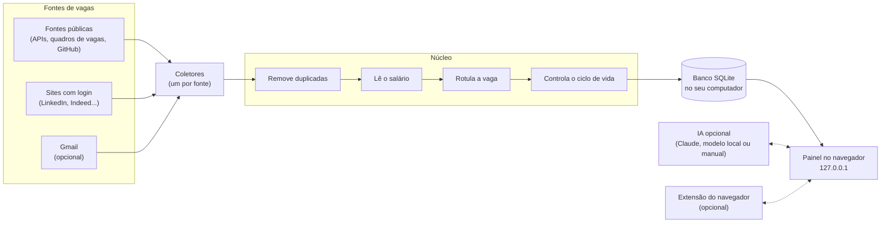

# joBot

**Seu assistente pessoal de busca de vagas.** 
Ele junta, filtra e organiza vagas de muitos sites num painel bonito que roda no seu próprio computador.

 

 

 

[Como funciona](#como-funciona) · [Instalação](#requisitos-e-instalacao) · [Roteiro](#roteiro) · [Perguntas frequentes](#perguntas-frequentes)

> [!IMPORTANT]
> **O joBot está em desenvolvimento.** As decisões principais já foram tomadas e registradas. A fase 1 está em desenho.
> Ainda **não há código** e ainda **não há nada para instalar**. Tudo o que está descrito aqui é o plano, não um produto pronto.

## 📑 Sumário

- [O que é o joBot](#o-que-e)
- [O que ele não faz](#o-que-nao-faz)
- [Como funciona](#como-funciona)
- [As duas versões](#as-duas-versoes)
- [Fontes de vagas](#fontes-de-vagas)
- [O painel](#o-painel)
- [Inteligência artificial](#inteligencia-artificial)
- [Usando o Claude Code que você já tem](#usando-o-claude-code)
- [Privacidade e segurança](#privacidade-e-seguranca)
- [Requisitos e instalação (planejada)](#requisitos-e-instalacao)
- [Roteiro](#roteiro)
- [Perguntas frequentes](#perguntas-frequentes)
- [Decisões do projeto](#decisoes-do-projeto)
- [Como contribuir](#como-contribuir)
- [Licença e avisos](#licenca-e-avisos)

## 🤖 O que é o joBot

Procurar vaga hoje cansa. É preciso abrir muitos sites, repetir os mesmos filtros e torcer para não perder um prazo.
O joBot vai fazer esse trabalho repetitivo por você. Ele vai visitar os sites de vagas, juntar tudo num lugar só e mostrar o que combina com o seu perfil.
Tudo vai rodar no seu computador. Uma instalação serve a uma pessoa, que pode ter várias buscas salvas.

O que ele vai fazer:

- 🔎 **Buscar** vagas em dezenas de fontes: sites públicos, quadros de vagas de empresas e, se você quiser, sites que exigem login.
- 🧹 **Limpar**: remove vagas repetidas, lê o salário e marca área, nível, modalidade, região e tipo de contrato.
- 🎯 **Ranquear**: mostra o quanto cada vaga combina com você (● bom, ◐ médio, ○ fraco) e explica o porquê.
- 🗂️ **Organizar**: cada vaga tem um status, de "nova" até "oferta".
- ✍️ **Preparar candidatura**: carta de apresentação, resumo do currículo ajustado à vaga e lista do que você tem e do que falta, sempre no idioma da vaga.
- 🧩 **Ajudar nos formulários**: uma extensão do navegador sugere respostas, e você confirma.
- 📬 **Ler o Gmail** (opcional): traz vagas dos e-mails de alerta e sugere mudanças de status quando um recrutador responde.

Serve para todo tipo de vaga e toda área: CLT, PJ, estágio, trainee, temporário, aprendiz, pesquisa e bolsa, programas e escolas de verão, concursos e editais.
Toda função pode ser ligada ou desligada.

## 🚫 O que ele não faz

O joBot foi planejado para não fazer:

- **Não se candidata em massa.** Não existe "aplicar em 200 vagas com um clique".
- **Não envia nada sozinho.** Quem envia a candidatura é sempre você.
- **Não digita a sua senha.** Nos sites com login, você entra com as próprias mãos.
- **Não contorna CAPTCHA.** Se aparecer um, ele para e avisa você.
- **Não manda telemetria.** O joBot não envia dados de uso para ninguém.
- **Não inventa experiência.** A IA só usa o que está no seu perfil.

## ⚙️ Como funciona

Um ciclo de busca, passo a passo:

1. **Na hora marcada**, o joBot acorda. Fontes públicas: a cada 3 horas. Sites com login: duas vezes por dia (9h e 18h, ajustável). Ou quando você aperta "buscar agora".
2. **Cada coletor** visita a sua fonte com calma e traz as vagas num formato único.
3. **O núcleo** junta vagas repetidas, entende o salário, coloca rótulos e marca como fechadas as vagas que sumiram.
4. **Tudo vai para o banco** SQLite, um arquivo que fica no seu computador.
5. **O painel** mostra o resultado no seu navegador. Ele só funciona no seu computador (endereço 127.0.0.1).
6. **Se você ligou a IA**, ela calcula o encaixe com o seu perfil e ajuda a preparar candidaturas.

Se uma fonte falhar, as outras continuam. Se o computador estava desligado na hora marcada, a busca perdida roda quando ele liga.

## 🖥️ As duas versões

O joBot vai ter um núcleo só e duas "caras". A **versão local** é o foco. A **versão no navegador** (GitHub Pages) é para quem não quer instalar nada e chega na fase 7.

| | 💻 Versão local | 🌐 Versão no navegador (GitHub Pages) |
|---|---|---|
| **Instalação** | Nativa, com um comando (planejada) | Nenhuma: é só abrir o site |
| **Fontes** | Todas | Só fontes públicas |
| **Sites com login** | Sim, com o seu login manual | Não |
| **IA** | Automática (Claude, modelo local) ou manual | Manual (copiar e colar); rótulos só por regras |
| **Extensão do navegador** | Sim | Não |
| **Gmail** | Sim (opcional) | Não |
| **Áudio** | Sim, transcrição no seu computador | Não |
| **Onde ficam os dados** | No banco SQLite do seu computador | Seu perfil fica no seu navegador (localStorage) |
| **Atualização** | A cada 3 h (públicas) e 2x por dia (login) | Uma vez por dia, com aviso "atualizado em &lt;data&gt;" |

Na versão no navegador, você pode exportar o perfil num arquivo e importar depois na versão local. Há também um botão "baixar versão completa".
Ela nunca usa logins nem segredos.

## 🌎 Fontes de vagas

Cada fonte tem uma chave liga/desliga.

| Grupo | Exemplos |
|---|---|
| Repositórios de vagas no GitHub | backend-br, frontendbr, soujava, remotejobsbr, developersRJ |
| Sites e APIs internacionais | Jobicy, Hacker News "Who is hiring", Remotive, RemoteOK, Himalayas, We Work Remotely |
| Quadros de vagas de empresas (sistemas de recrutamento, os "ATS") | Greenhouse, Lever, Ashby, SmartRecruiters, Workday, Eightfold, Oracle HCM, InHire, Quickin, Recrutei |
| Portais brasileiros | Gupy, CIEE, Sólides, IEL, Super Estágios, Cia de Talentos, Eureca, Abler |
| Carreiras de grandes empresas | Google, Amazon, Microsoft, NVIDIA, Meta |
| Murais de estágio | Murais públicos, como o da USP |
| 🔐 Sites com login (primeiro) | LinkedIn, Indeed, Catho, Vagas.com |
| 🔐 Sites com login (depois, um de cada vez) | InfoJobs, Glassdoor, Programathor, GeekHunter, Remotar, Trampos, Revelo, Coodesh |

Também está previsto:

- **Lista de empresas própria**, feita só de fatos públicos (nome da empresa e identificador do quadro de vagas), cada um conferido no endereço real.
- **Descoberta semanal** de novos quadros de vagas pelo Common Crawl (um arquivo público da web). Pode desligar.
- **Acompanhar páginas de programas**, como trainee e escola de verão, pela função "adicionar site".

**Coleta educada.** O robô se identifica, espera entre um pedido e outro e espera mais quando o site pede calma.

**Saúde de cada fonte.** A cada busca, cada fonte fica marcada como ok, parcial ou falhou. Você vê isso no painel.

> [!WARNING]
> **Sites com login têm risco.** LinkedIn, Indeed e outros podem restringir contas que acessam de forma automática, e isso pode ir contra os termos de uso deles.
> O joBot reduz o risco: abre um Chrome visível, você faz o login, ele só lê (não clica em "candidatar", não manda mensagem), visita poucas vezes e devagar.
> Mesmo assim, o risco existe. **Você decide se liga cada site.**

## 📋 O painel

O painel abre no seu navegador. O desenho das telas ainda vai ser feito, na fase 1. Por isso não há imagens aqui.

- **Abas:** Destaques de hoje (as melhores novas, uma por empresa), Todas, Novas, Fecham logo, Salvas, Candidatei, Programas e Ocultas.
- **Filtros** em "chips" (botõezinhos) com contagem. O filtro atual fica no endereço da página, então dá para salvar o link. Busca rápida com a tecla `/`.
- **Status de cada vaga:** nova → salva → candidatei → entrevista → recusada ou oferta.
- **Encaixe com o seu perfil:** ● bom, ◐ médio, ○ fraco, sempre com os motivos. Mostra as habilidades que você tem (✓) e as que faltam.
- **Calendário de 12 meses** em cada vaga, para ver prazos de relance.
- **Vagas ocultas** por regra podem voltar. O painel mostra quantas foram escondidas por cada motivo.
- **"Algo errado nesta vaga?"**: um botão para corrigir um rótulo ou dado.
- **Visual inspirado no estilo da Apple:** translucidez, animações suaves, modo claro e escuro seguindo o sistema. Fonte SF no Mac e Inter nos outros sistemas.
- **Idiomas:** português e inglês.

## 🧠 Inteligência artificial

A IA é **opcional**. Sem ela, o joBot funciona com regras e palavras-chave.

> **Regra de ouro:** a IA só usa os dados do seu perfil. Ela nunca inventa experiência, curso ou habilidade, e mostra quais dados usou.
> Se faltar informação, ela faz uma pergunta, e a sua resposta fica salva no perfil.

### Opções

| Opção | Custo | Onde roda | Para onde vão os dados | Precisa de internet? |
|---|---|---|---|---|
| **Sessão do Claude Code** ([detalhes](#usando-o-claude-code)) | Usa a sua assinatura do Claude | Na Anthropic | Anthropic | Sim |
| **Chave da API da Anthropic** | Pago por uso | Na Anthropic | Anthropic | Sim |
| **Modelo local (Qwen)** | Grátis | No seu computador | Não saem do computador | Não (depois de baixar) |
| **Palavras-chave** (sem IA) | Grátis | No seu computador | Não saem do computador | Não |
| **IA manual** (copiar e colar) | Grátis no joBot; depende da IA de chat que você usar | Na IA de chat que você escolher | Para onde você colar | Depende da IA de chat |

Para não ter de configurar tarefa por tarefa, há três atalhos:

- **Tudo Claude**: usa o Claude em todas as tarefas.
- **Tudo offline**: usa o Qwen, que roda no seu computador, em todas as tarefas.
- **Personalizado**: você escolhe a opção e o modelo de cada tarefa.

### Modelos padrão com o Claude

O app usa só dois modelos: Haiku 5.5 (`claude-haiku-5-5`), mais rápido e barato, e Sonnet 5.5 (`claude-sonnet-5-5`), mais capaz.
**O modelo Opus nunca é usado**, para poupar custo e o seu limite de uso.

| Tarefa | Modelo |
|---|---|
| Ler o currículo e montar o perfil | Sonnet 5.5 |
| Nota de encaixe com a vaga | Haiku 5.5 |
| Preparar candidatura | Sonnet 5.5 |
| Extensão do navegador | Sonnet 5.5 |
| Perguntas extras do questionário | Sonnet 5.5 |
| E-mails de alerta de vagas | Haiku 5.5 |
| Respostas de recrutadores | Palavras-chave + Haiku 5.5 |

### Pacote offline

Na instalação, o joBot vai perguntar uma vez se você quer o pacote offline. Ele permite usar IA sem internet e sem pagar nada.

| Item | Tamanho | Observação |
|---|---|---|
| llama-server (programa do llama.cpp que roda o modelo) | ~23 MB Linux · ~25 MB Windows · ~17 MB macOS com chip Apple | Versão fixa, conferida por checksum |
| Qwen3.5-2B (modelo de IA) | 1,28 GB | Para computadores com 8 GB de RAM |
| Qwen3.5-4B (modelo de IA) | 2,74 GB | Para computadores com 12 GB ou mais |
| Transcrição de áudio (faster-whisper "small") | 484 MB | Para responder falando |
| Transcrição de áudio "medium" | 1,53 GB | Opcional, mais precisa |

Um "checksum" é uma impressão digital do arquivo: o joBot confere se o arquivo baixado é exatamente o esperado.

## ✨ Usando o Claude Code que você já tem

Se você já usa o Claude Code no seu computador, o joBot pode usar o Claude **sem nenhum login extra**.
Você não faz login do Claude dentro do joBot. Nunca.

### Passo a passo

1. **Instale o Claude Code** seguindo as instruções do [site oficial do Claude Code](https://code.claude.com/docs/en/setup#install-claude-code).
2. **Entre uma vez pelo terminal.** Abra o terminal, digite `claude` e aperte Enter. Dentro dele, digite `/login` e siga as instruções, que abrem o site da Anthropic. Esse login é feito na própria Anthropic ([como funciona o login](https://code.claude.com/docs/en/authentication)).
3. **Abra o joBot.** No passo 0 da primeira execução, ele percebe sozinho que o Claude Code está pronto e oferece essa opção.

Pronto. A conta, a assinatura, os limites e o custo continuam sendo seus.

### O que o joBot faz

- Pergunta ao Claude Code se você está logado (`claude auth status`).
- Manda os pedidos pelo modo sem tela do Claude Code (`claude -p`, [documentação](https://code.claude.com/docs/en/headless)), pedindo a resposta num formato fixo (JSON).
- Usa só Haiku 5.5 ou Sonnet 5.5.
- Se der erro, mostra no painel. Se você não estiver logado, explica como entrar pelo terminal.

### O que o joBot nunca faz

- Nunca lê, copia, guarda ou repassa a sua credencial ou token do Claude.
- Nunca mostra uma tela de login do Claude dentro dele.
- Nunca empacota nem modifica o Claude Code.
- Nunca usa o modelo Opus.

### Cuidados técnicos

- Chamada sem nenhuma ferramenta (`--tools ""`), sem servidores MCP (`--strict-mcp-config`) e sem guardar a sessão (`--no-session-persistence`). Detalhes na [referência de comandos](https://code.claude.com/docs/en/cli-reference).
- Roda numa pasta temporária vazia, para não carregar configurações de algum projeto. As suas configurações pessoais em `~/.claude` continuam valendo.
- Tira `ANTHROPIC_API_KEY` e `ANTHROPIC_AUTH_TOKEN` do ambiente da chamada (exceto no modo "chave da API"). Sem isso, o Claude Code usaria a chave e a cobrança iria para a API sem você perceber. Pelo mesmo motivo, tira as variáveis de provedor de nuvem (`CLAUDE_CODE_USE_BEDROCK`, `CLAUDE_CODE_USE_VERTEX` e `CLAUDE_CODE_USE_FOUNDRY`).
- Antes de cada chamada, confere com `claude auth status` se o login ativo é o da assinatura. Se outro método estiver ativo (por exemplo, um `apiKeyHelper` nas suas configurações), o painel avisa e não faz a chamada.
- Não usa `--bare`, porque esse modo não lê o login da assinatura.
- Não usa nem pede `CLAUDE_CODE_OAUTH_TOKEN`.
- A credencial fica onde o Claude Code guarda: `~/.claude/.credentials.json` no Linux, `%USERPROFILE%\.claude\.credentials.json` no Windows e o Keychain no macOS. Se a variável `CLAUDE_CONFIG_DIR` estiver definida, a pasta muda. O joBot nunca abre nada disso.

### Sobre as regras da Anthropic

A Anthropic não permite que apps de terceiros ofereçam login do Claude, mandem pedidos usando a assinatura das pessoas em nome delas, nem coletem, guardem ou repassem credenciais e tokens. O login precisa acontecer no fluxo da própria Anthropic ([política oficial](https://code.claude.com/docs/en/legal-and-compliance)). Apps que rodam o Claude Code também ficam sob os Termos Comerciais da Anthropic: o Claude Code não pode ser modificado e cada pessoa entra com a própria conta.
O joBot não oferece login, não empacota nem modifica o Claude Code e nunca toca na sua credencial: cada pessoa usa a própria, no próprio computador.

Mas há um ponto em aberto: o joBot chama o Claude Code de forma automática e agendada, usando a sua assinatura, e não está claro se isso conta como "mandar pedidos em nome da pessoa". Por enquanto, a decisão é manter essa opção com os cuidados acima.
**A política da Anthropic será relida antes da publicação.** Se esse uso não for permitido, o padrão passa a ser a chave da API ou o modelo local.
Detalhes na [ADR 0010](docs/decisions/0010-claude-code-da-pessoa.md) e em [duvidas.md](duvidas.md) (D1).

Claude e Claude Code são marcas da Anthropic. O joBot não é afiliado à Anthropic.

## 🔒 Privacidade e segurança

> Estas são as regras planejadas. O joBot ainda não tem código.

- **Não existe servidor do joBot.** Seus dados ficam no seu computador.
- **Sem telemetria.** Nenhum dado de uso é enviado.
- **Segredos no cofre do sistema.** Token do Gmail, chave da API e token do Telegram ficam no cofre de senhas do sistema operacional. Sem cofre, vão para um arquivo que só o seu usuário lê, e o painel avisa.
- **Dados pessoais protegidos.** CPF e data de nascimento ficam no banco, numa pasta que só o seu usuário acessa e que não é sincronizada com nuvem. O painel recomenda ligar a criptografia de disco (LUKS, BitLocker ou FileVault).
- **Exportar o perfil não leva documentos** como o CPF, a menos que você marque essa opção.
- **Painel fechado para fora.** Ele só aceita conexões do próprio computador (127.0.0.1) e confere cada pedido.
- **Extensão pareada.** A extensão só conversa com o joBot depois de um pareamento. Ela nunca toca em campos de senha ou de cartão.
- **Áudio apagado.** A gravação é transcrita no seu computador e apagada logo depois.
- **Gmail só leitura.** O acesso é só de leitura, com um projeto Google criado por você.
- **Seus dados só saem** para os serviços que você ligar: Anthropic, Google ou Telegram, e outros serviços opcionais (veja as ADRs [0009](docs/decisions/0009-ia-backends-e-modelos.md) e [0014](docs/decisions/0014-seguranca-e-privacidade.md)).

## 📦 Requisitos e instalação (planejada)

> Ainda não há nada para instalar. O comando exato de instalação sai na fase 8.

### Requisitos

- **Memória:** 8 GB de RAM (16 GB deixam tudo mais folgado).
- **Placa de vídeo:** não precisa.
- **Sistema:** Linux, Windows ou macOS.
- **Docker:** não precisa. A instalação é nativa.

### O que o instalador vai baixar

| Item | Tamanho | Obrigatório? |
|---|---|---|
| joBot e o que ele precisa para rodar (Python 3.14 e bibliotecas, via uv) | A definir no desenho da fase 8 | Sim |
| Navegador controlado pelo Playwright | A definir no desenho da fase 8 | Só para sites com login |
| llama-server | ~17 a 25 MB, conforme o sistema | Opcional (pacote offline) |
| Modelo Qwen3.5-2B **ou** Qwen3.5-4B | 1,28 GB ou 2,74 GB | Opcional (pacote offline) |
| Transcrição de áudio "small" | 484 MB | Opcional (pacote offline) |
| Transcrição de áudio "medium" | 1,53 GB | Opcional |
| Modelo multilingual-e5-small | ~120 MB | Só se algum rótulo ficar abaixo de 90% de acerto |

### Primeira execução

Um assistente vai guiar você em passos:

| Passo | O que acontece |
|---|---|
| **0. Escolher a IA** | Claude, modelo local, palavras-chave ou IA manual. Se o Claude Code estiver pronto, ele aparece sozinho. |
| **1. Currículo** | Você envia o PDF, a IA extrai os dados e você revisa antes de salvar. |
| **2. Questionário** | Cerca de 25 perguntas, mais algumas para cobrir lacunas. Responda digitando, escolhendo ou falando. |
| **3. Logins nos sites** | Se quiser, entre nos sites com login, com as próprias mãos. |
| **4. Gmail** | Opcional. Um assistente guiado de cerca de 15 minutos. |
| **5. Segundo plano** | Escolha se o joBot inicia com o computador e os horários dos sites com login. |

## 🗺️ Roteiro

Cada fase só começa depois que a anterior passa nos testes. Não há datas prometidas.

| Fase | O que entra | Status |
|---|---|---|
| **1. Base** | Núcleo comum, fontes públicas, banco, painel e agenda | 🟡 Em desenho |
| **2. Navegador com login** | Chrome visível, mapeamento dos sites, tratamento de CAPTCHA | ⚪ Planejada |
| **3. IA local** | Pacote offline (llama-server + Qwen) | ⚪ Planejada |
| **4. Extensão do navegador** | Extensão do navegador para formulários | ⚪ Planejada |
| **5. Áudio e Gmail** | Respostas por voz e leitura de e-mails | ⚪ Planejada |
| **6. Treino** | Aprender com o que você salva e descarta | ⚪ Planejada |
| **7. Versão GitHub Pages** | Versão GitHub Pages, sem instalação | ⚪ Planejada |
| **8. Publicação** | Instaladores, README com selos, revisão de segurança e versão em inglês do README | ⚪ Planejada |

## ❓ Perguntas frequentes

<strong>Por que não usar Docker?</strong>

O público é leigo e usa computadores comuns. O Docker Desktop é pesado e, no Windows e no macOS, roda dentro de uma máquina virtual.
O joBot precisa abrir um Chrome visível para você fazer login e resolver CAPTCHA, usar o microfone, iniciar com o sistema e criar atalhos. Tudo isso é difícil dentro de um container.
E o login do Claude Code teria de ser feito de novo lá dentro (no macOS ele fica no Keychain, que o container não enxerga). Veja a [ADR 0003](docs/decisions/0003-stack-e-instalacao-nativa.md).

<strong>Preciso fazer login do Claude dentro do joBot?</strong>

Não. Você entra uma vez no Claude Code, pelo terminal, no fluxo da própria Anthropic. O joBot só detecta que está pronto e usa.
Ele nunca vê a sua senha nem o seu token. Veja [Usando o Claude Code que você já tem](#usando-o-claude-code) e a [ADR 0010](docs/decisions/0010-claude-code-da-pessoa.md).

<strong>Preciso pagar alguma coisa?</strong>

O joBot é grátis e de código aberto. O Claude é opcional e pago, por assinatura ou pela API.
O modelo local, as palavras-chave e a IA manual são grátis.

<strong>Funciona sem IA? E sem internet?</strong>

Sem IA, sim: o joBot usa regras e palavras-chave.
Sem internet, vagas novas não chegam. Mas o painel continua funcionando, e o modelo local também.

<strong>O joBot se candidata sozinho?</strong>

Não. Ele prepara a candidatura e ajuda a preencher formulários, mas quem revisa e envia é sempre você.

<strong>Minha conta do LinkedIn pode ser restringida?</strong>

Pode. O risco existe, e não dá para zerar.
O joBot reduz o risco: você faz o login com as próprias mãos, ele só lê, visita poucas vezes por dia, vai devagar e nunca contorna CAPTCHA.
Cada site com login tem uma chave. Você decide se liga.

<strong>E se aparecer um CAPTCHA?</strong>

O painel mostra um aviso vermelho e o computador mostra uma notificação. A janela do navegador fica parada na página, esperando você resolver.
As outras fontes continuam normalmente. O joBot nunca tenta passar pelo CAPTCHA sozinho.

<strong>Meus dados vão para algum servidor?</strong>

Não existe servidor do joBot. Seus dados ficam no seu computador.
Eles só vão para os serviços que você ligar: Anthropic (se usar o Claude), Google (se ligar o Gmail) e Telegram (se ligar o resumo diário). Também podem ir para o Jev (se escolher essa opção na classificação de e-mail) e para o RunPod (só no treino da fase 6). Na IA manual, vão para a IA de chat onde você colar.

<strong>Roda no meu computador?</strong>

A ideia é rodar em computadores comuns, com 8 a 16 GB de RAM e sem placa de vídeo dedicada, com Linux, Windows ou macOS.

## 📚 Decisões do projeto

Cada decisão importante está registrada num documento curto, chamado ADR (registro de decisão de arquitetura).

- **Índice:** [docs/decisions/README.md](docs/decisions/README.md)
- **Dúvidas em aberto:** [duvidas.md](duvidas.md)

| Nº | Decisão |
|---|---|
| 0001 | [Escopo: o que o joBot é e o que não é](docs/decisions/0001-escopo-do-jobot.md) |
| 0002 | [Duas versões, um núcleo](docs/decisions/0002-duas-versoes-um-nucleo.md) |
| 0003 | [Tecnologias e instalação nativa (sem Docker)](docs/decisions/0003-stack-e-instalacao-nativa.md) |
| 0004 | [Fontes públicas de vagas e coleta educada](docs/decisions/0004-fontes-publicas.md) |
| 0005 | [Sites que exigem login](docs/decisions/0005-sites-com-login.md) |
| 0006 | [Agenda das buscas e segundo plano](docs/decisions/0006-agenda-e-segundo-plano.md) |
| 0007 | [Tratamento das vagas: duplicadas, ciclo de vida, salário e rótulos](docs/decisions/0007-tratamento-dos-dados.md) |
| 0008 | [Painel e visual](docs/decisions/0008-painel-e-visual.md) |
| 0009 | [Inteligência artificial: opções, modelos e pacote offline](docs/decisions/0009-ia-backends-e-modelos.md) |
| 0010 | [Usar o Claude Code que a pessoa já tem (sem login dentro do joBot)](docs/decisions/0010-claude-code-da-pessoa.md) |
| 0011 | [Perfil, currículo, primeira execução e áudio](docs/decisions/0011-perfil-e-primeira-execucao.md) |
| 0012 | [Extensão do navegador](docs/decisions/0012-extensao-do-navegador.md) |
| 0013 | [Gmail e avisos](docs/decisions/0013-gmail-e-avisos.md) |
| 0014 | [Segurança e privacidade](docs/decisions/0014-seguranca-e-privacidade.md) |
| 0015 | [Treino de modelos (fase 6)](docs/decisions/0015-treino.md) |
| 0016 | [Licença, sala limpa e processo de trabalho](docs/decisions/0016-licenca-clean-room-e-processo.md) |
| 0017 | [Fases do projeto](docs/decisions/0017-fases.md) |

## 🤝 Como contribuir

O repositório já está no GitHub, mas ainda não tem código. Contribuições externas vão ser aceitas depois da publicação (fase 8).

Quando abrir, as regras serão:

- **TDD em todo código:** escrever o teste, ver falhar, implementar, ver passar.
- **Commits em português**, no formato `tipo(escopo): descrição`.
- **Ramos** `feat/`, `fix/`, `docs/` ou `ci/` saindo da `dev`. A `main` só recebe PR vindo da `dev`.
- **Qualidade:** ruff para estilo, mypy no modo estrito para tipos, pytest para testes.
- **Sala limpa:** ideias e fatos públicos podem ser usados; código e dados de teste de terceiros nunca são copiados.
- **Dependência nova** só com justificativa e licença compatível com MIT.

## ⚖️ Licença e avisos

- **Licença:** MIT. Veja o arquivo [`LICENSE`](LICENSE).
- **Marcas:** Claude e Claude Code são marcas da Anthropic. O joBot não é afiliado à Anthropic. As demais marcas citadas pertencem aos seus donos.
- **Termos de uso:** respeite os termos de uso de cada site que você ligar.
- **Uso pessoal:** o joBot é feito para uma pessoa organizar a própria busca de vagas.

---

Versão em inglês deste README: na publicação (fase 8).

