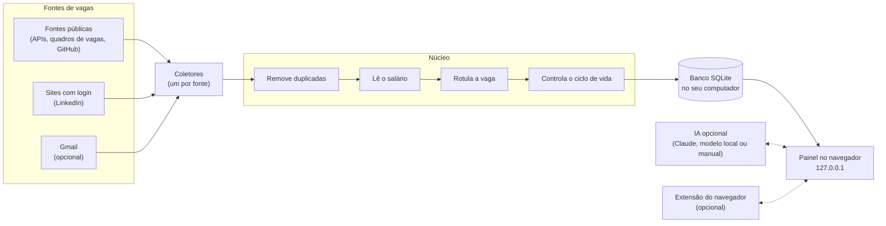

<div align="center">

# joBot

**Seu assistente pessoal de busca de vagas.**<br>
Ele junta, filtra e organiza vagas de muitos sites num painel bonito que roda no seu próprio computador.

[](LICENSE)
[](#roteiro)
[](#requisitos-e-instalacao)
[](#requisitos-e-instalacao)
<br>
[](#como-funciona)
[](#como-funciona)
[](#como-funciona)
[](#fontes-de-vagas)
[](#requisitos-e-instalacao)
<br>
[](#como-contribuir)
[](#como-contribuir)
[](#como-contribuir)
<br>
[](#privacidade-e-seguranca)
[](#privacidade-e-seguranca)
[](#inteligencia-artificial)

**Português** · [English](README.en.md)

[Como funciona](#como-funciona) · [Instalação](#requisitos-e-instalacao) · [Roteiro](#roteiro) · [Perguntas frequentes](#perguntas-frequentes)

</div>

> [!IMPORTANT]
> **As fases 1, 2, 3 e 4 do joBot (a base, o navegador com login, o instalador e a IA local) estão prontas; a versão para instalar agora é a 0.6.0, que fecha a fase 4 (a IA opcional).** Ele busca vagas em fontes públicas, guarda tudo no seu computador e mostra num painel. Já dá para [instalar e usar](#requisitos-e-instalacao).
> O LinkedIn é o site com login de hoje (outros podem vir pelo [molde de site novo](docs/site-novo.md)); já está aqui desde a versão 0.3.0 e vem desligado (você liga em Configurações, Contas). O cartão do Gmail já está em Configurações, Contas. A IA chega na versão 0.5.0, desligada por padrão, para listar as habilidades que cada vaga pede, e a 0.6.0 traz o perfil completo, a leitura do currículo e a preparação de candidaturas ([detalhes](#inteligencia-artificial)); a leitura dos e-mails, o áudio e o resto (os outros sites com login, a IA nos e-mails e a extensão do navegador) ainda são plano. Veja o [roteiro](#roteiro). Antes de ligar as fontes, leia os [avisos de uso e de termos](#licenca-e-avisos).

## 📑 Sumário

- [O que é o joBot](#o-que-e)
- [Histórico de estrelas](#historico-de-estrelas)
- [O que ele não faz](#o-que-nao-faz)
- [Como funciona](#como-funciona)
- [As duas versões](#as-duas-versoes)
- [Fontes de vagas](#fontes-de-vagas)
- [O painel](#o-painel)
- [Inteligência artificial](#inteligencia-artificial)
- [Usando o Claude Code que você já tem](#usando-o-claude-code)
- [Privacidade e segurança](#privacidade-e-seguranca)
- [Requisitos e instalação](#requisitos-e-instalacao)
- [Roteiro](#roteiro)
- [Perguntas frequentes](#perguntas-frequentes)
- [Decisões do projeto](#decisoes-do-projeto)
- [Como contribuir](#como-contribuir)
- [Apoie o projeto](#apoie-o-projeto)
- [Licença e avisos](#licenca-e-avisos)

<a id="o-que-e"></a>
## 🤖 O que é o joBot

O joBot nasceu para ajudar jovens universitários a encontrar o primeiro emprego. Depois a ideia cresceu: hoje ele quer ajudar todo mundo que procura vaga.

Procurar vaga hoje cansa. É preciso abrir muitos sites, repetir os mesmos filtros e torcer para não perder um prazo.
O joBot faz esse trabalho repetitivo por você. Ele visita os sites de vagas, junta tudo num lugar só e mostra o que combina com o que você procura.
Tudo roda no seu computador. Uma instalação serve a uma pessoa, que pode ter várias buscas salvas.

O que ele faz hoje (fases 1, 2 e 3):

- 🔎 **Buscar** vagas em dezenas de fontes públicas: sites, APIs e quadros de vagas de empresas.
- 🧹 **Limpar**: remove vagas repetidas, lê o salário e marca área, nível, modalidade, região e tipo de contrato.
- 🎯 **Ranquear**: mostra o quanto cada vaga combina com a sua busca (● bom, ◐ médio, ○ fraco) e explica o porquê. Na fase 1 isso é feito por regras, sem IA.
- 🗂️ **Organizar**: cada vaga tem um status, de "nova" até "oferta".
- 📌 **Acompanhar páginas** de programas, como trainee e escola de verão, e avisar quando o texto muda.

O que vem nas próximas fases:

- 🔐 **Sites que exigem login**: você entra numa janela comum do navegador, sem automação, e o joBot lê as vagas (fase 2; o LinkedIn é o site com login de hoje; outros podem vir pelo molde, em [`docs/site-novo.md`](docs/site-novo.md)).
- ✍️ **Preparar candidatura**: carta de apresentação, resumo do currículo ajustado à vaga e lista do que você tem e do que falta, sempre no idioma da vaga (fase 4, com IA opcional).
- 🧩 **Ajudar nos formulários**: uma extensão do navegador sugere respostas, e você confirma (fase 5).
- 📬 **Ler o Gmail** (opcional): traz vagas dos e-mails de alerta e sugere mudanças de status quando um recrutador responde (fase 6).

Serve para todo tipo de vaga e toda área: CLT, PJ, estágio, trainee, temporário, aprendiz, pesquisa e bolsa, programas e escolas de verão, concursos e editais.
Toda função pode ser ligada ou desligada.

<a id="historico-de-estrelas"></a>
## ⭐ Histórico de estrelas

Se o joBot te ajudar, deixe uma estrela no repositório.

<a href="https://www.star-history.com/?repos=fezarosa-dev%2FjoBot&type=date&legend=top-left">
 <picture>
   <source media="(prefers-color-scheme: dark)" srcset="https://api.star-history.com/chart?repos=fezarosa-dev/joBot&type=date&theme=dark&legend=top-left" />
   <source media="(prefers-color-scheme: light)" srcset="https://api.star-history.com/chart?repos=fezarosa-dev/joBot&type=date&legend=top-left" />
   
 </picture>
</a>

<a id="o-que-nao-faz"></a>
## 🚫 O que ele não faz

O joBot não faz, e foi planejado para nunca fazer:

- **Não se candidata em massa.** Não existe "aplicar em 200 vagas com um clique".
- **Não envia nada sozinho.** Quem envia a candidatura é sempre você.
- **Não digita a sua senha.** Nos sites com login, você entra com as próprias mãos, numa janela comum do navegador: como quiser (Google, e-mail e senha) e depois fecha a janela. O joBot confere a sessão sozinho.
- **Não contorna CAPTCHA sozinho.** Se aparecer um, ele para e avisa você. Nas fontes públicas, é sempre assim. Na navegação com login, a única exceção é o seu 2Captcha: só se você puser a sua chave e ligar o interruptor em Configurações, Serviços (vem desligado).
- **Não manda telemetria.** O joBot não envia dados de uso para ninguém.
- **Não inventa experiência.** A IA só usa o que está no seu perfil.

<a id="como-funciona"></a>
## ⚙️ Como funciona



Um ciclo de busca, passo a passo:

1. **Na hora marcada**, o joBot acorda. Fontes públicas: a cada 3 horas. Ou quando você aperta "Buscar agora". (Os sites com login, em Configurações, Contas, são lidos duas vezes por dia.)
2. **Cada coletor** visita a sua fonte com calma e traz as vagas num formato único.
3. **O núcleo** junta vagas repetidas, entende o salário, coloca rótulos e marca como fechadas as vagas que sumiram.
4. **Tudo vai para o banco** SQLite, um arquivo que fica no seu computador.
5. **O painel** mostra o resultado no seu navegador. Ele só funciona no seu computador (endereço 127.0.0.1).
6. **Se você ligar a IA** (a partir da versão 0.5.0), ela lista as habilidades que cada vaga pede, e o joBot compara com as do seu perfil e soma isso ao encaixe. A IA não dá nota. A partir da 0.6.0, ela também lê o seu currículo para preencher o perfil, sugere perguntas sobre o que falta nele e prepara a carta e o resumo de uma candidatura, sempre quando você pede. Sem IA, o encaixe vem das regras da sua busca.

Se uma fonte falhar, as outras continuam. Se o computador estava desligado na hora marcada, a busca perdida roda quando ele liga.

Quer ver o joBot por dentro, com pastas, camadas, banco e diagramas? Veja a [Arquitetura na wiki](https://github.com/fezarosa-dev/joBot/wiki/Arquitetura).

<a id="as-duas-versoes"></a>
## 🖥️ As duas versões

O joBot vai ter um núcleo só e duas "caras". A **versão local** é o foco. A **versão no navegador** (GitHub Pages) é para quem não quer instalar nada e chega na fase 8.

| | 💻 Versão local | 🌐 Versão no navegador (GitHub Pages) |
|---|---|---|
| **Instalação** | Nativa, com o uv ([como instalar](#requisitos-e-instalacao)) | Nenhuma: é só abrir o site |
| **Fontes** | Todas | Só fontes públicas |
| **Sites com login** | Sim, você entra numa janela comum do navegador | Não |
| **IA** | Automática (modelo local ou serviço com a sua chave: Anthropic, OpenAI, Gemini ou um endereço compatível) ou manual | Manual (copiar e colar); rótulos só por regras |
| **Extensão do navegador** | Sim | Não |
| **Gmail** | Sim (opcional) | Não |
| **Áudio** | Sim, transcrição no seu computador | Não |
| **Onde ficam os dados** | No banco SQLite do seu computador | Seu perfil fica no seu navegador (localStorage) |
| **Atualização** | A cada 3 h (públicas) e 2x por dia (login) | Uma vez por dia, com aviso "atualizado em &lt;data&gt;" |

Na versão no navegador, você pode exportar o perfil num arquivo e importar depois na versão local. Há também um botão "baixar versão completa".
Ela nunca usa logins nem segredos.

<a id="fontes-de-vagas"></a>
## 🌎 Fontes de vagas

Cada fonte tem uma chave liga/desliga, em Configurações, Fontes. Na fase 1 funcionam as fontes públicas. Os sites com login (por enquanto, o LinkedIn) ficam em Configurações, Contas, que mostra se o joBot ainda está conectado em cada um.
Três portais brasileiros pedem cuidado, por causa dos termos de uso deles: Eureca, Abler e Gupy. Leia o aviso em [Licença e avisos](#licenca-e-avisos).

| Grupo | Exemplos |
|---|---|
| Repositórios de vagas no GitHub | backend-br, frontendbr, soujava, remotejobsbr, developersRJ |
| Sites e APIs internacionais | Jobicy, Hacker News "Who is hiring", Remotive, RemoteOK, Himalayas, We Work Remotely |
| Quadros de vagas de empresas (sistemas de recrutamento, os "ATS") | Greenhouse, Lever, Ashby, SmartRecruiters, Workday, Eightfold, Oracle HCM, InHire, Quickin, Recrutei |
| Portais brasileiros | Gupy, CIEE, Sólides, IEL, Super Estágios, Cia de Talentos, Eureca, Abler |
| Carreiras de grandes empresas | Google, Amazon, Microsoft, NVIDIA |
| Murais de estágio | Murais públicos, como o da USP |
| 🔐 Site com login (fase 2, o único por enquanto) | LinkedIn |
| 🔐 Sites com login (ideias para o futuro, ainda sem data) | Vagas.com, Catho, Indeed |
| 🔐 Sites com login (ideias para o futuro, um de cada vez) | InfoJobs, Glassdoor, Remotar, Trampos |
| 🔐 Sites com login só de tecnologia (ideias para o futuro, por último, um de cada vez) | Programathor, GeekHunter, Revelo, Coodesh |

Também na fase 1:

- **Lista de empresas própria**, feita só de fatos públicos (nome da empresa e identificador do quadro de vagas), cada um conferido no endereço real. Você acrescenta as suas em Empresas.
- **Descoberta semanal** de novos quadros de vagas pelo Common Crawl (um arquivo público da web). Os achados vão para Sugeridas, e nada entra na sua busca até você aprovar. Pode desligar em Configurações.
- **Acompanhar páginas de programas**, como trainee e escola de verão, pela tela Sites. A mudança aparece na aba Programas.

**Coleta educada.** O robô se identifica, espera entre um pedido e outro e espera mais quando o site pede calma.

**Saúde de cada fonte.** A cada busca, cada fonte fica marcada como ok, parcial ou falhou. Você vê isso no painel.

> [!WARNING]
> **Sites com login têm risco.** O LinkedIn e outros sites com login que venham a entrar podem restringir contas que acessam de forma automática, e isso pode ir contra os termos de uso deles.
> O joBot reduz o risco: você entra numa janela comum do navegador, com as próprias mãos; depois ele só lê (não clica em "candidatar", não manda mensagem), visita poucas vezes e devagar.
> Mesmo assim, o risco existe. **Você decide se liga cada site.**

<a id="o-painel"></a>
## 📋 O painel

O painel roda em `http://127.0.0.1:47615`. Quando o joBot acha o Chrome, o Edge ou o Chromium no seu computador, ele abre numa **janela própria**, sem abas nem barra de endereço, como um aplicativo; sem nenhum deles, usa o Chromium que ele instalou, e só então uma aba comum do navegador. Pelo instalador, o painel abre no seu navegador padrão, pelo botão **Abrir joBot** da janela do joBot.

- **Barra lateral:** à esquerda, a seção Vagas (Destaques de hoje e as abas, cada uma com a contagem) e a seção Onde buscar (Buscas, Empresas, Sugeridas, Fontes e Sites), mais Configurações. Dá para recolhê-la e arrastar a borda para mudar a largura.
- **Lista com detalhe:** a lista de vagas fica de um lado e o detalhe da vaga escolhida, do outro. Em janela estreita o detalhe sobe por cima da lista.

- **Abas:** Destaques de hoje (as melhores novas, uma por empresa), Todas, Novas, Fecham logo, Salvas, Candidatei, Programas e Ocultas.
- **Filtros** em "chips" (botõezinhos) com contagem: país e há quantos dias a vaga foi publicada ficam à vista; salário, cidade, empresa e palavras que a vaga não pode ter ficam em "Mais filtros". O filtro atual fica no endereço da página, então dá para salvar o link. Busca rápida com a tecla `/`.
- **Status de cada vaga:** nova → salva → candidatei → entrevista → recusada ou oferta.
- **Encaixe com a sua busca:** ● bom, ◐ médio, ○ fraco, sempre com os motivos.
- **Calendário de 12 meses** em cada vaga, para ver prazos de relance.
- **Panorama e fila de candidaturas:** o Panorama, na barra lateral, junta o dia: o que fecha logo, as candidaturas e a busca. Quando você abre o link de candidatura de uma vaga, o painel pergunta "Você se candidatou?" ("Sim, me candidatei" ou "Ainda não", com Desfazer); a linha do tempo da vaga mostra a data de cada passo e a aba Candidatei mostra o "desde". Se a descrição traz um e-mail de candidatura, o botão "Candidatar-se por e-mail" só abre o seu programa de e-mail: o joBot não envia nada.
- **Vagas ocultas** por regra podem voltar. O painel mostra quantas foram escondidas por cada motivo.
- **"Algo errado nesta vaga?"**: um botão para corrigir um rótulo ou dado.
- **Desfazer:** ocultar uma vaga, descartar uma sugestão ou remover uma empresa acontece na hora, e uma faixa com o botão **Desfazer** fica na tela até você fechá-la. O que apaga de verdade (como apagar uma busca) pede confirmação antes.
- **Teclado e paleta de comandos:** `⌘K` (`Ctrl+K` fora do Mac) abre a paleta, que leva a qualquer tela e muda tema, idioma e tamanho do texto; há também um botão para ela na barra. Veja todos os atalhos em [Atalhos de teclado](https://github.com/fezarosa-dev/joBot/wiki/Atalhos-de-teclado).
- **Tamanho do texto:** Padrão, Grande ou Maior, em Configurações, Geral.
- **Andamento da busca:** ao apertar "Buscar agora", o topo mostra uma barra de progresso e a etapa em que o joBot está (por exemplo, "Lendo Greenhouse · 13 de 20 consultas"), inclusive quando ele espera uma fonte liberar mais pedidos. "Ver detalhes" abre o resumo.
- **Visual de aplicativo do Mac:** translucidez, animações suaves, modo claro e escuro seguindo o sistema, e movimento reduzido para quem pede. Fonte SF no Mac e Inter nos outros sistemas. Ícones do [Lucide](https://lucide.dev) (licença ISC, em `src/jobot/painel/static/icones/LICENSE`).
- **Idiomas:** português e inglês.

<a id="inteligencia-artificial"></a>
## 🧠 Inteligência artificial

A IA é **opcional** e chega na versão 0.5.0 (fase 4), **desligada por padrão**. Sem ela, o joBot funciona com regras e palavras-chave, como desde a fase 1.

> **Regra de ouro:** a IA nunca inventa. No Encaixe ela nem recebe o seu perfil: cada habilidade que ela lista precisa estar escrita na vaga.
> Nas tarefas que usam o perfil (currículo, perguntas e candidatura, desde a 0.6.0), ela só usa os dados do seu perfil e mostra quais usou. O que ela tira do currículo e não está escrito nele vem marcado para você conferir. Se faltar informação, ela sugere uma pergunta, que só vira dado do perfil quando você a responde.

### O que a 0.5.0 traz

- **As habilidades de cada vaga.** Com a tarefa **Encaixe** ligada em Configurações › IA e ao menos uma habilidade no seu perfil, depois de cada busca a IA lê até 20 vagas ainda não lidas que já combinam com uma busca, das mais novas para as mais velhas, e lista o que cada uma pede. Trocar de serviço ou de modelo faz a IA ler tudo de novo, 20 por rodada. Cada item precisa estar escrito na vaga. A IA não vê o seu perfil e não dá nota: o joBot compara a lista com as habilidades que você põe em Configurações › Perfil, mostra no detalhe da vaga as que você tem e as que faltam, e soma isso ao encaixe, ao lado do cargo, do local e do resto.
- **Onde a IA roda:** no modelo local (grátis, no seu computador) ou num serviço com a sua chave: a API da Anthropic, a OpenAI, o Google Gemini ou um endereço compatível com a OpenAI (Ollama, LM Studio, OpenRouter e outros). As chaves ficam no cofre do sistema, em Configurações › Serviços.
- **Teste ao ligar.** Ligar a tarefa ou trocar o serviço manda um pedido curto, com uma vaga de exemplo. Se falhar, a tarefa fica desligada e a tela diz o motivo.
- **Custo à vista.** Serviço pago aparece como "cobrado por uso", ligar o Encaixe nele pede confirmação, e o joBot faz no máximo 200 pedidos por dia a cada serviço de fora, fora o teste ao ligar.

### O que a 0.6.0 traz

- **O perfil completo**, em Configurações › Perfil: contato, cargo, anos de experiência, formação, resumo, links, idiomas com o nível, habilidades e até 10 experiências e 10 cursos. Cada parte tem o seu Salvar. Salvar uma parte não apaga o que foi digitado nas outras, também sem JavaScript. Os campos de contato (nome, e-mail, telefone e cidade) nunca entram nos pedidos à IA. **Apagar perfil** apaga tudo isso, as respostas e as candidaturas preparadas.
- **Ler o currículo em PDF.** Você envia o PDF (até 5 MB) na aba Perfil, o joBot lê as 20 primeiras páginas no seu computador, e a tarefa **Currículo** preenche o formulário para você conferir. O que a IA põe e não está escrito no currículo vem marcado "Não achei no currículo" e fica fora do **Aprovar todas**. O e-mail, o telefone e o CPF são tirados do texto antes de ir à IA; o e-mail e o telefone são preenchidos no seu computador, e o CPF não é guardado. O resto do texto vai como está, inclusive o nome e a cidade, se estiverem escritos nele. Nada é gravado antes de você salvar, e o PDF e o texto dele não são guardados. Ler o currículo precisa do JavaScript ligado no navegador; sem ele, você preenche o perfil à mão.
- **Questionário do perfil.** Perguntas sobre você (onde mora, cargo, experiência, estudo, habilidades, idiomas, contato e links) que gravam o perfil; você abre o questionário pela aba Perfil. Com a tarefa **Perguntas** ligada, a IA sugere até 5 perguntas sobre o que falta no perfil, cada uma com o porquê.
- **Preparar candidatura**, no detalhe da vaga, com a tarefa ligada: a IA escreve a carta de apresentação e um resumo do perfil para a vaga, no idioma da vaga, e o joBot mostra o que você tem e o que falta do que a vaga pede e os dados do perfil que a IA usou. A carta e o resumo vêm em caixas que você edita e copia, com o aviso "Confira antes de usar: a IA pode errar." e, se a carta citar algo que não está no seu perfil, um aviso com o item. O joBot nunca envia nada: quem usa a carta é você.
- **Perguntas sugeridas.** As perguntas que a IA sugere ao preparar uma candidatura esperam você aceitar ou descartar na aba Perfil (até 20 esperam; a mais velha sai), e só a resposta de uma pergunta aceita vai nos pedidos seguintes.
- **IA manual**, no currículo e na candidatura: o joBot mostra o pedido, você copia e cola no chat de IA que quiser, e cola a resposta de volta. A resposta passa pelas mesmas conferências, e o joBot não manda nada a ninguém.
- **Primeira execução com IA e perfil.** O assistente ganha dois passos opcionais antes da busca: onde a IA roda (o modelo local, a API da Anthropic com a sua chave, ou seguir sem IA) e o seu perfil (o currículo e o questionário). Os dois têm "Pular", e a busca chega com o cargo e a cidade do perfil.
- **O Laya como modelo local padrão.** O modelo baixado é o Laya 2B, um ajuste do Qwen3.5 2B para as vagas (veja o pacote offline, abaixo).

As tarefas que você aciona (Currículo, Perguntas e Preparar candidatura) fazem um pedido por clique e não entram no teto de 200 pedidos por dia, que é do Encaixe. As três são experimentais: confira sempre o que a IA devolve. No modelo local (o Laya), nos ensaios do projeto, a leitura do currículo preencheu só o nível de formação e os cursos: o cargo, as experiências, as habilidades e os idiomas vieram vazios. As Perguntas e o Preparar candidatura também erraram: perguntas repetidas ou sobre o que o perfil já diz, e cartas com "[Nome]" para preencher e com ferramentas que não estão no perfil. O acerto do Laya medido no projeto (79 de 82 itens) é só do Encaixe. A sessão do Claude Code e a do Codex esperam a decisão do dono sobre os termos de uso e ainda não foram construídas.

### Opções

| Opção | Custo | Onde roda | Para onde vão os dados | Precisa de internet? | Situação |
|---|---|---|---|---|---|
| **Modelo local** (o Laya, por padrão) | Grátis | No seu computador | Não saem do computador | Não (depois de baixar) | Desde a 0.5.0; o Laya desde a 0.6.0 |
| **Chave da API da Anthropic** | Pago por uso | Na Anthropic | Anthropic | Sim | Desde a 0.5.0, experimental |
| **Chave da OpenAI** | Pago por uso | Na OpenAI | OpenAI | Sim | Desde a 0.5.0, experimental |
| **Chave do Google Gemini** | Pode ser cobrado por uso, conforme o plano da sua conta no Google AI Studio | No Google | Google | Sim | Desde a 0.5.0, experimental |
| **Endereço compatível com a OpenAI** (Ollama, LM Studio, OpenRouter) | Depende do serviço | Onde o endereço apontar | Para esse endereço | Depende do endereço | Desde a 0.5.0, experimental |
| **Palavras-chave** (sem IA) | Grátis | No seu computador | Não saem do computador | Não | Desde a 0.1.0 |
| **IA manual** (copiar e colar) | Grátis no joBot; depende da IA de chat que você usar | Na IA de chat que você escolher | Para onde você colar | Depende da IA de chat | Desde a 0.6.0, no currículo e na candidatura |
| **Sessão do Claude Code** ([detalhes](#usando-o-claude-code)) | Usa a sua assinatura do Claude | Na Anthropic | Anthropic | Sim | Espera o dono |

**Experimental, ainda não provado:** o CI do joBot não tem chave de serviço pago, então a API da Anthropic, a OpenAI e o Gemini só foram testados com um serviço falso. Eles aparecem com essa marca na aba IA até serem provados com uma chave de verdade. O modelo local só foi provado no CI: ele rodou nos computadores do GitHub (Linux, Windows e Mac, só no processador); no ensaio da 0.6.0, o Laya levou até 24 s pela vaga mais longa (o Qwen3.5 4B, até 60 s). Ainda não foram provados: o endereço compatível contra um Ollama, um LM Studio ou um OpenRouter de verdade (o mesmo cliente só rodou contra o `llama-server` do modelo local, no CI), o instalador baixando o Modelo local de verdade, a retomada de um download cortado contra os servidores de verdade, os avisos do Windows Defender e do SmartScreen no `llama-server.exe` e a velocidade num computador comum.

Para não ter de configurar tarefa por tarefa, há atalhos na aba IA:

- **Desligar a IA**: nada sai do seu computador. É o padrão.
- **Tudo Claude**: usa o Claude, pela API da Anthropic (cobrada por uso), em todas as tarefas.
- **Tudo offline**: usa o modelo local (o Laya, por padrão), que roda no seu computador, em todas as tarefas.
- **Personalizado**: você escolhe a opção e o modelo de cada tarefa. Quem estava em **Tudo Claude** ou **Tudo offline** na 0.5.0 passa a ver **Personalizado** na 0.6.0, porque as tarefas novas nascem desligadas.

### Modelos padrão com o Claude

O app usa só dois modelos: Haiku 5.5 (`claude-haiku-5-5`), mais rápido e barato, e Sonnet 5.5 (`claude-sonnet-5-5`), mais capaz.
**O modelo Opus nunca é usado**, para poupar custo e o seu limite de uso.

| Tarefa | Modelo |
|---|---|
| Ler o currículo e montar o perfil | Sonnet 5.5 |
| Habilidades que a vaga pede (Encaixe, já na 0.5.0) | Haiku 5.5 |
| Preparar candidatura | Sonnet 5.5 |
| Extensão do navegador | Sonnet 5.5 |
| Perguntas extras do questionário | Sonnet 5.5 |
| E-mails de alerta de vagas | Haiku 5.5 |
| Respostas de recrutadores | Palavras-chave + Haiku 5.5 |

### Pacote offline

Desde a versão 0.5.0, o pacote offline é o **Modelo local**: o `llama-server` do llama.cpp e um modelo de IA. Ele não vem dentro do instalador: o joBot o baixa da fonte oficial, só quando você pede, e confere o checksum de cada arquivo. Há dois jeitos de pedir: marcar **Modelo local** no passo Ferramentas do instalador (vem desmarcado) ou apertar **Baixar** no cartão do modelo em Configurações › Ferramentas. O modelo padrão é o **Laya 2B**, um ajuste do Qwen3.5 2B para as vagas, o mesmo em todo computador; com menos de 7 GiB de memória o joBot avisa que ele pode ficar lento. No mesmo cartão você troca para o Qwen3.5 2B ou o 4B originais, atualiza ou remove. Depois de baixado, ele funciona sem internet e sem pagar nada.

| Item | Tamanho | De onde vem | Observação |
|---|---|---|---|
| llama-server (programa do llama.cpp que roda o modelo) | ~23 MB Linux · ~25 MB Windows · ~17 MB macOS com chip Apple · ~13 MB Mac com Intel | GitHub, release do llama.cpp | Versão fixa, conferida por checksum; licença MIT |
| Laya-2B (modelo de IA, o padrão) | 1,29 GB | GitHub, versões do joBot (`modelo-laya-2b-1`) | Ajuste do Qwen3.5 2B para as vagas; licença Apache-2.0 |
| Qwen3.5-2B (modelo de IA, opcional) | 1,28 GB | Hugging Face, da Unsloth | O original, trocado em Configurações › Ferramentas; licença Apache-2.0 |
| Qwen3.5-4B (modelo de IA, opcional) | 2,74 GB | Hugging Face, da Unsloth | O original, trocado em Configurações › Ferramentas; licença Apache-2.0 |

O áudio (a transcrição para responder falando) não entra no pacote offline: ele fica para a fase 6.

Um "checksum" é uma impressão digital do arquivo: o joBot confere se o arquivo baixado é exatamente o esperado.

### O que funciona sem internet

| O que | Sem internet? |
|---|---|
| Ver as vagas já salvas, filtrar, marcar o status e mudar as configurações | Sim |
| Encaixe pelas regras da sua busca | Sim |
| Habilidades das vagas pelo modelo local (Tudo offline) | Sim, depois de baixar o modelo |
| Habilidades das vagas por um serviço (Anthropic, OpenAI, Gemini) | Não |
| Ler o currículo, sugerir perguntas e preparar candidatura pelo modelo local | Sim, depois de baixar o modelo |
| Essas tarefas por um serviço ou pela IA manual | Não |
| Buscar vagas novas, conferir empresas e páginas, pegar a cotação das moedas | Não |
| Ler os sites com login | Não |
| Baixar o modelo local, o navegador ou uma versão nova do joBot | Não |

<a id="usando-o-claude-code"></a>
## ✨ Usando o Claude Code que você já tem

> Esta seção descreve uma opção que ainda espera a decisão do dono sobre os termos de uso da Anthropic: ela não vem na 0.5.0 nem na 0.6.0. Até lá, o Claude entra pela chave da API da Anthropic.

Se você já usa o Claude Code no seu computador, o joBot pode usar o Claude **sem nenhum login extra**.
Você não faz login do Claude dentro do joBot. Nunca.

### Passo a passo

1. **Instale o Claude Code** seguindo as instruções do [site oficial do Claude Code](https://code.claude.com/docs/en/setup#install-claude-code).
2. **Entre uma vez pelo terminal.** Abra o terminal, digite `claude` e aperte Enter. Dentro dele, digite `/login` e siga as instruções, que abrem o site da Anthropic. Esse login é feito na própria Anthropic ([como funciona o login](https://code.claude.com/docs/en/authentication)).
3. **Abra o joBot.** No passo 0 da primeira execução, ele percebe sozinho que o Claude Code está pronto e oferece essa opção.

Pronto. A conta, a assinatura, os limites e o custo continuam sendo seus.

### O que o joBot faz

- Pergunta ao Claude Code se você está logado (`claude auth status`).
- Manda os pedidos pelo modo sem tela do Claude Code (`claude -p`, [documentação](https://code.claude.com/docs/en/headless)), pedindo a resposta num formato fixo (JSON).
- Usa só Haiku 5.5 ou Sonnet 5.5.
- Se der erro, mostra no painel. Se você não estiver logado, explica como entrar pelo terminal.

### O que o joBot nunca faz

- Nunca lê, copia, guarda ou repassa a sua credencial ou token do Claude.
- Nunca mostra uma tela de login do Claude dentro dele.
- Nunca empacota nem modifica o Claude Code.
- Nunca usa o modelo Opus.

### Cuidados técnicos

- Chamada sem nenhuma ferramenta (`--tools ""`), sem servidores MCP (`--strict-mcp-config`) e sem guardar a sessão (`--no-session-persistence`). Detalhes na [referência de comandos](https://code.claude.com/docs/en/cli-reference).
- Roda numa pasta temporária vazia, para não carregar configurações de algum projeto. As suas configurações pessoais em `~/.claude` continuam valendo.
- Tira `ANTHROPIC_API_KEY` e `ANTHROPIC_AUTH_TOKEN` do ambiente da chamada (exceto no modo "Chave da API"). Sem isso, o Claude Code usaria a chave e a cobrança iria para a API sem você perceber. Pelo mesmo motivo, tira as variáveis de provedor de nuvem (`CLAUDE_CODE_USE_BEDROCK`, `CLAUDE_CODE_USE_VERTEX` e `CLAUDE_CODE_USE_FOUNDRY`).
- Antes de cada chamada, confere com `claude auth status` se o login ativo é o da assinatura. Se outro método estiver ativo (por exemplo, um `apiKeyHelper` nas suas configurações), o painel avisa e não faz a chamada.
- Não usa `--bare`, porque esse modo não lê o login da assinatura.
- Não usa nem pede `CLAUDE_CODE_OAUTH_TOKEN`.
- A credencial fica onde o Claude Code guarda: `~/.claude/.credentials.json` no Linux, `%USERPROFILE%\.claude\.credentials.json` no Windows e o Keychain no macOS. Se a variável `CLAUDE_CONFIG_DIR` estiver definida, a pasta muda. O joBot nunca abre nada disso.

### Sobre as regras da Anthropic

A Anthropic não permite que apps de terceiros ofereçam login do Claude, mandem pedidos usando a assinatura das pessoas em nome delas, nem coletem, guardem ou repassem credenciais e tokens. O login precisa acontecer no fluxo da própria Anthropic ([política oficial](https://code.claude.com/docs/en/legal-and-compliance)). Apps que rodam o Claude Code também ficam sob os Termos Comerciais da Anthropic: o Claude Code não pode ser modificado e cada pessoa entra com a própria conta.
O joBot não oferece login, não empacota nem modifica o Claude Code e nunca toca na sua credencial: cada pessoa usa a própria, no próprio computador.

Ele também não compartilha assinatura entre pessoas: cada um roda o próprio Claude Code e gasta só o limite da própria assinatura.
Detalhes na [ADR 0010](docs/decisions/0010-claude-code-da-pessoa.md).

<sub>Claude e Claude Code são marcas da Anthropic. O joBot não é afiliado à Anthropic.</sub>

<a id="privacidade-e-seguranca"></a>
## 🔒 Privacidade e segurança

> Estas regras valem para o que as fases 1 e 2 trouxeram e para a IA das versões 0.5.0 e 0.6.0. As que falam de Telegram, extensão e áudio descrevem as próximas fases. Do Gmail, já vale o cartão em Configurações, Contas, que guarda a senha de app no cofre do sistema e só abre a caixa para leitura, para conferir o login; a leitura dos e-mails vem na fase 6.

- **Não existe servidor do joBot.** Seus dados ficam no seu computador.
- **Sem telemetria.** Nenhum dado de uso é enviado.
- **Registro local da abertura.** O joBot guarda, só no seu computador, quando você abriu a candidatura de cada vaga; isso não sai daqui.
- **Só pedidos de busca e conferência.** O joBot só faz pedidos de rede nestes casos: às fontes públicas de vagas que você deixa ligadas (vêm todas ligadas), incluindo a página de cada vaga; ao Banco Central, para pegar a cotação das moedas das vagas e mostrar o salário na moeda de exibição que você escolhe, com a conversão de moeda ligada (vem ligada); ao Common Crawl, uma vez por semana, para descobrir empresas novas, e depois aos quadros de vagas dessas empresas, para conferir (vem ligada); às páginas que você manda acompanhar (vem ligada, mas sem páginas na lista não há pedido); aos sites com login que você liga (vêm desligados), pelo navegador, com a sua conta; aos servidores do Playwright, para baixar o navegador, só quando você aperta "Baixar" em Ferramentas ou, no app de desktop, o marca na instalação (o joBot não distribui o navegador; ele vem do Playwright) ou atualiza o joBot com ele já baixado; ao 2Captcha, só quando você testa a chave em Configurações, Serviços, ou, na navegação com login, com a chave posta e o interruptor ligado (vem desligado); ao Gmail (Google), pela conexão IMAP só de leitura, só quando você salva ou confere a senha de app em Configurações, Contas (sem senha de app, não há pedido); aos serviços de IA que você configura (API da Anthropic, OpenAI, Google Gemini ou o endereço compatível que você digita), com o título e o texto das vagas, o seu perfil sem nome, contato e cidade e o texto do currículo sem e-mail, telefone e CPF, conforme a tarefa, só quando você liga uma tarefa de IA num deles em Configurações, IA (as tarefas vêm desligadas), e no teste ao ligar, e o currículo, as perguntas e a candidatura só quando você os pede; o modelo local não faz pedido de rede; ao GitHub e ao Hugging Face, com os CDNs deles, para baixar o modelo local (o llama-server e o modelo: o Laya, das versões do joBot no GitHub, ou um Qwen, do Hugging Face), só quando você aperta "Baixar", "Trocar" ou "Atualizar" no cartão do modelo em Ferramentas, o marca na instalação ou roda jobot ferramentas baixar (ou atualizar) ia-local; ao site de uma empresa, só quando você cola o endereço dela, testa ou aceita uma sugestão; à internet pelo git e pelo uv (ou ao GitHub, quando o joBot veio pelo instalador), para baixar a versão nova do joBot, só quando você pede para atualizar (botão Atualizar agora ou comando jobot atualizar). Com o aviso de versão (próximo item) ligado, também pergunta ao GitHub (vem ligado; você pode desligar). Quem recebe o pedido vê o IP do seu computador, como em qualquer pedido na internet.
- **Aviso de versão ligado por padrão.** Uma vez por dia o joBot pergunta ao `api.github.com` qual é a versão mais nova. O pedido leva só o user agent fixo do joBot (que traz o número da versão) e o IP do seu computador, como todo pedido na internet. Não leva busca nem dado seu. Para desligar, vá em Configurações, Privacidade; desligado, não faz pedido nenhum.
- **O que vai para a IA, tarefa por tarefa.** O Encaixe manda ao serviço só o título e o texto da vaga (o começo e o fim, quando ele é longo). O Currículo manda o texto do PDF sem e-mail, telefone e CPF, que o joBot tira antes; o nome e a cidade escritos no currículo vão junto. As Perguntas mandam o seu perfil sem nome, e-mail, telefone e cidade (nem os links); o que você escreveu nos campos de texto do perfil, como o resumo e as experiências, vai como você escreveu, menos e-mail, telefone, CPF e o seu nome, quando escrito como está no perfil. Preparar candidatura manda o mesmo perfil e o texto da vaga, só quando você clica no botão. Uma pergunta que a IA sugere só entra nos pedidos depois que você a aceita e responde. Cada tarefa diz, na aba IA e junto do botão ou do envio, o que vai e para onde. Na IA manual o joBot não manda nada: você copia o pedido, montado com as mesmas regras, e cola no chat de IA que escolher. O modelo local roda no seu computador e só atende o próprio computador (127.0.0.1).
- **O currículo não é guardado.** O PDF é lido no seu computador, num processo à parte, e nem ele nem o texto dele ficam na pasta de dados ou no banco: só o que você aprova e salva entra no perfil.
- **Segredos no cofre do sistema.** A senha de app do Gmail, as chaves dos serviços de IA e o token do Telegram ficam no cofre de senhas do sistema operacional. Sem cofre, vão para um arquivo que só o seu usuário lê, e o painel avisa.
- **Dados pessoais protegidos.** O perfil fica no banco, numa pasta que só o seu usuário acessa e que não é sincronizada com nuvem. O joBot não guarda CPF nem data de nascimento. O painel recomenda ligar a criptografia de disco (LUKS, BitLocker ou FileVault).
- **Painel fechado para fora.** Ele só aceita conexões do próprio computador (127.0.0.1) e confere cada pedido.
- **Extensão pareada.** A extensão só conversa com o joBot depois de um pareamento. Ela nunca toca em campos de senha ou de cartão.
- **Áudio apagado.** A gravação é transcrita no seu computador e apagada logo depois.
- **Gmail só leitura.** O joBot abre a caixa só para leitura, com uma senha de app que você cria na sua conta Google e cola no painel. Atenção: a senha de app em si dá acesso total ao e-mail (ler, apagar e enviar) a quem a tiver; só o joBot se limita a ler. Veja o [passo a passo](https://github.com/fezarosa-dev/joBot/wiki/Gmail-senha-de-app).
- **Seus dados só saem** para os serviços que você ligar: Anthropic, OpenAI, Google (Gemini ou Gmail), o endereço de IA que você digitar ou Telegram, e outros serviços opcionais (veja as ADRs [0009](docs/decisions/0009-ia-backends-e-modelos.md), [0014](docs/decisions/0014-seguranca-e-privacidade.md) e [0026](docs/decisions/0026-ia-da-fase-4.md)).
- **Achou uma falha de segurança?** Não abra issue pública. Siga a [política de segurança](.github/SECURITY.md).

<a id="requisitos-e-instalacao"></a>
## 📦 Requisitos e instalação

> Há dois jeitos de instalar. **Pelo instalador** (a partir da versão 0.4.0): você baixa um arquivo, abre e tem a janela do joBot, um controle pequeno que liga o joBot e abre o painel no seu navegador, sem terminal. **Pelo código**: você baixa o código e roda com o uv, como nas versões 0.1.0 a 0.3.0. O passo a passo com mais detalhes está na [página Instalar da wiki](https://github.com/fezarosa-dev/joBot/wiki/Instalar).

### Requisitos

- **Sistema, pelo instalador:** Windows 10 ou 11 de 64 bits, Linux de 64 bits (Ubuntu 22.04 ou mais novo, ou uma distro da mesma época) ou Mac com Apple Silicon ou Intel. O Mac é experimental: o instalador dele só foi testado no CI.
- **Sistema, pelo código:** Linux. O Windows e o macOS rodam o joBot, mas por esse caminho ainda não foram testados.
- **Programas, pelo código:** [git](https://git-scm.com/) e [uv](https://docs.astral.sh/uv/). O uv baixa sozinho o Python 3.14 e as bibliotecas. O instalador não precisa de nada disso: ele já traz tudo.
- **Memória:** um computador comum serve. O modelo local de IA (opcional, desde a 0.5.0) roda com 8 GB de RAM e usa o modelo maior a partir de 12 GB.
- **Placa de vídeo e Docker:** não precisa. A instalação é nativa.
- **Espaço em disco:** de cerca de 100 a 200 MB para baixar o instalador, conforme o sistema, e a instalação ocupa bem mais (o navegador, se você o marcar, fica sozinho com cerca de 420 MB, e o modelo local, com até uns 2,8 GB); a tela de instalação mostra quanto ela vai usar.
- **Internet:** para baixar o instalador (ou o código) e para buscar as vagas. A instalação pelo instalador só usa a internet para baixar o navegador e o modelo local, se você os marcar.

### Pelo instalador

Baixe o arquivo do seu sistema na [página da versão mais nova](https://github.com/fezarosa-dev/joBot/releases/latest). Cada um tem de cerca de 100 a 200 MB (o do Windows uns 120 MB, os do Mac uns 105 MB, o `.deb` e o `.rpm` uns 125 MB e o AppImage uns 200 MB), porque já traz o Python 3.14, as bibliotecas e o joBot. O navegador dos sites com login não vem no arquivo: ele vem da internet, se você o marcar na instalação.

| Sistema | Arquivo | Como abrir |
|---|---|---|
| Windows | o que termina em `-setup.exe` | Dois cliques. Instala só para o seu usuário, sem pedir senha de administrador. |
| Linux, qualquer distro | o que termina em `.AppImage` | Marque como executável (`chmod +x` no arquivo, ou Propriedades, Permissões) e abra. |
| Linux, Debian e Ubuntu | o que termina em `.deb` | `sudo apt install ./` e o nome do arquivo. |
| Linux, Fedora | o que termina em `.rpm` | `sudo dnf install ./` e o nome do arquivo. Experimental: o `.rpm` ainda não foi testado no CI. |
| Mac com Apple Silicon (M1 ou mais novo) | o que termina em `_aarch64.dmg` | Abra o `.dmg` e arraste o joBot para Aplicativos. Experimental. |
| Mac com Intel | o que termina em `_x64.dmg` | Abra o `.dmg` e arraste o joBot para Aplicativos. Experimental. |

Na primeira vez que você abre, a janela do joBot mostra a tela de instalação:

1. **Ferramentas.** joBot e Python 3.14 vêm marcados e travados (são necessários). Só dois itens vêm da internet: o navegador para sites com login, que vem marcado, e o **Modelo local** de IA, que vem desmarcado. O joBot baixa o navegador pelo Playwright, dos servidores do Playwright (uns 210 MB), e o Modelo local do GitHub (o `llama-server` e o Laya, uns 1,3 GB, das versões do llama.cpp e do joBot), com o sha256 conferido. Se você desmarcar o navegador, ou não marcar o modelo, dá para baixar depois em Configurações › Ferramentas.
2. **Instalando.** O resto sai de dentro do instalador: nada mais é baixado na instalação além do navegador e do Modelo local, se marcados. O joBot confere o sha256 de cada arquivo contra a lista gravada quando o instalador foi feito, e o de cada biblioteca; se algum não bater, nada é instalado. O navegador fica fora dessa conferência: o Playwright não publica o sha256 dele, e o download vem por HTTPS. Sem internet, a instalação funciona igual sem o navegador: se o download dele falhar, a tela oferece seguir sem ele. O Modelo local é baixado depois que o joBot já está instalado: se o download dele falhar, o joBot fica instalado e a tela diz o motivo.
3. **Pronto.** A janela vira o controle do joBot. Aperte **Ligar** e depois **Abrir joBot**: o painel abre no seu navegador padrão, com as perguntas da primeira execução (abaixo).

Depois disso, a janela do joBot é sempre o controle. Ela mostra se o joBot está **Ligado** ou **Parado**, o endereço do painel (com o botão **Copiar**) e os botões **Ligar**, **Parar** e **Abrir joBot**, que só aparece com o joBot ligado. Ao abrir, ela só mostra o estado: não liga nem abre nada sozinha. Se o segundo plano já ligou o joBot, ela aparece como Ligado.

Fechar a janela com o joBot ligado pergunta **Deixar o joBot ligado?**. **Deixar ligado** fecha só a janela, e o painel segue no navegador até você abrir a janela de novo e apertar **Parar**. **Desligar** para o joBot e fecha a janela. Com o joBot parado, a janela fecha direto. O segundo plano serve para o joBot ligar sozinho quando o computador inicia. Pelo painel, **Encerrar o joBot**, em Configurações › Geral, também para tudo.

No Windows, a janela usa o WebView2 da Microsoft, que o Windows 11 e o Windows 10 atualizado já trazem. Num Windows sem ele, o instalador não baixa nada: avisa, com o link oficial da Microsoft (https://developer.microsoft.com/microsoft-edge/webview2/), e cancela. Instale o WebView2 por esse link e abra o instalador de novo.

### Avisos do Windows e do Mac

Os instaladores ainda não têm selo (assinatura de código), então o sistema avisa que não reconhece o programa. Os arquivos são gerados pelo GitHub Actions a partir deste código. O `SHA256SUMS` da versão traz o sha256 de cada um: ele confere que o download não veio quebrado, mas, como sai da mesma release, não prova a origem. Isso fica para a assinatura de código, quando vier.

- **Windows:** aparece "O Windows protegeu o computador". Clique em **Mais informações** e depois em **Executar assim mesmo**.
- **Mac:** aparece que a Apple não conseguiu verificar o joBot. Feche o aviso, abra Ajustes do Sistema › Privacidade e Segurança, desça até a mensagem sobre o joBot e clique em **Abrir Mesmo Assim**. Confirme com a sua senha. Isso só acontece na primeira vez.
- **Linux:** não há aviso.

### Pelo código

```bash
git clone https://github.com/fezarosa-dev/joBot.git
cd joBot
uv sync --locked
uv run jobot
```

O último comando sobe o joBot e abre o painel em `http://127.0.0.1:47615`. Se o computador tem Chrome, Edge ou Chromium, o painel abre numa janela própria, sem abas nem barra de endereço; sem eles, usa o Chromium que o joBot instalou, e só então uma aba do seu navegador. Sem nada depois de `jobot`, vale o comando `abrir`.
Se outro programa já usa a porta 47615, o joBot avisa e não abre nada. Defina `JOBOT_PORTA` com outra porta e rode de novo.

### Comandos

Quem instalou pelo código roda todos de dentro da pasta `joBot`, com `uv run` na frente (por exemplo, `uv run jobot buscar`). Pelo instalador, o painel tem botão para o que você precisa e o terminal não é necessário.

| Comando | O que faz |
|---|---|
| `jobot abrir` | Abre o painel no navegador e sobe o servidor, se ele ainda não estiver no ar. É o padrão. |
| `jobot sair` | Encerra o servidor. |
| `jobot serve` | Sobe só o servidor, sem abrir o navegador. |
| `jobot buscar` | Faz uma busca no terminal e mostra como foi cada fonte. |
| `jobot segundo-plano ligar` | Liga o segundo plano, para o joBot iniciar sozinho junto com o seu usuário. Com `desligar` tira o serviço, e com `status` mostra como está. No Linux usa o systemd; no Windows, o Agendador de Tarefas; no Mac, um LaunchAgent (experimental). |
| `jobot atualizar` | Atualiza o joBot para a versão mais nova e religa o que estava ligado. |
| `jobot ferramentas baixar navegador` | Baixa o navegador dos sites com login (o mesmo do botão "Baixar" em Ferramentas). |
| `jobot ferramentas baixar ia-local` | Baixa o modelo local de IA da fonte oficial (o `llama-server` do llama.cpp e o modelo), com o sha256 conferido. Com `--modelo auto` (o padrão) baixa o modelo padrão, o Laya, das versões do joBot no GitHub; `--modelo laya`, `2b` ou `4b` escolhe à mão (o 2B e o 4B são os Qwen3.5 da Unsloth). `atualizar ia-local` baixa o que mudou; `remover ia-local` apaga tudo e desliga as tarefas que usavam o modelo local. |
| `jobot avaliar-rotulos` | Para quem mantém o projeto: mede as regras de rótulo contra um arquivo de exemplos seu. |

### Onde ficam os dados

Os dados ficam numa pasta só com acesso do seu usuário. Para usar outra pasta, defina `JOBOT_DADOS`. O banco é o arquivo `jobot.db`, e o registro do que aconteceu fica em `logs/jobot.log`. Pelo instalador, a janela guarda à parte o Python e as bibliotecas dela (a pasta da janela).

| Sistema | Dados | Pasta da janela (só pelo instalador) |
|---|---|---|
| Linux | `~/.local/share/jobot` | `~/.local/share/jobot-app` |
| Windows | `%LOCALAPPDATA%\joBot` | `%LOCALAPPDATA%\joBot\app` |
| Mac | `~/Library/Application Support/joBot` | `~/Library/Application Support/joBot/app` |

O navegador dos sites com login fica na pasta que o Playwright usa: `~/.cache/ms-playwright` no Linux, `%LOCALAPPDATA%\ms-playwright` no Windows e `~/Library/Caches/ms-playwright` no Mac. Nada sai dessas pastas, a não ser os pedidos de rede listados em [Privacidade e segurança](#privacidade-e-seguranca).

### Desinstalar

Desinstalar nunca apaga os seus dados: as vagas, as buscas e as configurações ficam na pasta de dados, e voltam se você instalar de novo. O navegador também fica, porque a pasta do Playwright pode servir a outro programa; para tirá-lo, aperte **Remover** em Configurações › Ferramentas antes de desinstalar. O modelo local também fica, na pasta `ferramentas` dentro da pasta de dados, e ocupa até uns 2,8 GB (o modelo maior sozinho tem 2,7 GB); para tirá-lo, aperte **Remover** no cartão do modelo, na mesma tela, antes de desinstalar, ou apague a pasta `ferramentas` depois.

- **Windows:** em Configurações › Aplicativos (ou no Painel de Controle), escolha joBot e **Desinstalar**. O desinstalador desliga o segundo plano, encerra o joBot e apaga a pasta da janela.
- **Linux:** primeiro desligue o segundo plano (Configurações › Segundo plano) e use **Encerrar o joBot**. Depois remova o pacote pelo gerenciador de programas (`sudo apt remove` ou `sudo dnf remove`) ou apague o arquivo `.AppImage`. O pacote não alcança a sua pasta pessoal: apague à mão a pasta `~/.local/share/jobot-app`.
- **Mac:** primeiro desligue o segundo plano e use **Encerrar o joBot**. Depois arraste o joBot de Aplicativos para o Lixo e apague à mão a pasta `~/Library/Application Support/joBot/app`.
- **Pelo código:** apague a pasta `joBot` que o `git clone` criou.

Para apagar também os dados, apague a pasta de dados do seu sistema (tabela acima). Isso não tem volta.

### Se você usa distrobox

O joBot também roda dentro de um container distrobox, como no Fedora Silverblue.

- **O navegador:** dentro do container quase nunca há navegador. O joBot chama o do sistema de fora, com `distrobox-host-exec xdg-open`.
- **O segundo plano:** o serviço mora no systemd do seu usuário, no sistema de fora, e o joBot chega lá pelo `distrobox-host-exec` e pelo `distrobox-enter`. Os dois precisam estar disponíveis dentro do container.
- **A pasta pessoal:** a do container precisa ser a mesma do sistema. Se não for, o painel recusa ligar o segundo plano e diz o motivo.
- Rode todos os comandos de dentro do container.

### Primeira execução

Na primeira vez, o painel faz algumas perguntas. Tudo é opcional, e todo passo tem **Pular tudo**.

| Passo | O que acontece |
|---|---|
| **Quer usar IA?** | Onde a IA roda: o modelo local (grátis, depois de baixado), um serviço pago com a sua chave da API da Anthropic, ou seguir sem IA, que é o padrão. Dá para mudar depois, em Configurações › IA. |
| **Seu perfil** | O currículo em PDF e as perguntas sobre você, que gravam o perfil. Tem também **Pular este passo**. Dá para completar depois, em Configurações › Perfil. |
| **O que você procura?** | Cargos ou palavras-chave, cidades, modalidades, níveis, salário mínimo e idiomas das vagas, já com o cargo e a cidade do seu perfil. Isso vira a sua primeira busca. Se você pular, as vagas aparecem por data, sem nota de encaixe. Dá para mudar depois, em Buscas. |
| **Sites com login** | Só aparece quando há um site com login para ligar. Dá para ligar depois, em Configurações. |
| **Segundo plano** | Escolha se o joBot inicia sozinho com o seu usuário e busca vagas a cada 3 horas, mesmo com o painel fechado. Dá para mudar depois, em Configurações. |

Depois, aperte **Buscar agora**, no topo do painel, ou espere a próxima busca da agenda.

### Atualizar

Quando sai uma versão nova, o painel avisa numa faixa no topo. O aviso de versão vem **ligado por padrão**: para desligar, vá em Configurações, Privacidade. Os detalhes estão em [Privacidade e segurança](#privacidade-e-seguranca).

- **Pelo instalador:** aperte **Atualizar agora**, na faixa ou em Configurações › Geral. O joBot baixa o pacote da versão nova, confere o sha256 de cada arquivo, monta a versão nova ao lado da que você usa e só troca quando ela abre; se algo falhar, nada muda. A atualização troca só o joBot, não a janela. Quando a janela também tem versão nova, ela mostra **Há uma versão nova desta janela.** e o botão **Baixar a janela nova**, que abre a página da versão: baixe o instalador de novo e abra, e os seus dados ficam. Quem ainda tem a janela da 0.4.0 vê esse aviso numa faixa do painel.
- **Pelo código:** rode `uv run jobot atualizar` na pasta `joBot`.
  Clonou antes de 2026-11-24? O histórico do git foi reescrito nessa data, e a atualização comum recusa, porque o histórico novo não continua o antigo. Rode uma vez, na pasta do clone, `git fetch origin && git reset --hard origin/main && uv sync --locked`, ou clone de novo. O reset descarta qualquer mudança local do clone; os seus dados ficam na pasta de dados, fora dele, e não mudam. Fork ou clone de trabalho: veja o [CONTRIBUTING](.github/CONTRIBUTING.md).

### O que as próximas fases vão baixar

O `uv sync` só baixa o Python 3.14 (se faltar) e as bibliotecas do joBot. Ele não baixa modelo de IA, navegador controlado nem arquivo grande. Estes itens vêm à parte, e são opcionais:

| Item | Tamanho | Quando |
|---|---|---|
| Navegador controlado pelo Playwright (Chromium, opcional) | uns 210 MB de download e 420 MB no disco | Fase 2, só para sites com login; baixa e remove em Configurações, Ferramentas |
| llama-server | ~13 a 25 MB, conforme o sistema | Desde a 0.5.0, só se você pedir o Modelo local; baixa e remove em Configurações, Ferramentas |
| Modelo Laya-2B (o padrão), Qwen3.5-2B **ou** Qwen3.5-4B | 1,29 GB, 1,28 GB ou 2,74 GB | Desde a 0.5.0, junto do llama-server; o Laya é o padrão desde a 0.6.0 |
| Transcrição de áudio "small" | 484 MB | Fase 6 |
| Transcrição de áudio "medium" | 1,53 GB | Fase 6, opcional |

<a id="roteiro"></a>
## 🗺️ Roteiro

Cada fase só começa depois que a anterior passa nos testes. Não há datas prometidas.

| Fase | O que entra | Status |
|---|---|---|
| **1. Base** | Núcleo comum, fontes públicas, banco, painel e agenda | 🟢 Pronta (versão 0.1.0) |
| **2. Navegador com login** | Login pela janela comum, LinkedIn primeiro, mapeamento dos sites, tratamento de CAPTCHA | 🟢 Pronta (versão 0.3.0) |
| **3. Instalador** | Instalador de 64 bits, com lista de ferramentas para marcar (Windows e Linux primeiro, Mac depois) | 🟢 Pronta (versão 0.4.0) |
| **4. IA local** | Pacote offline (llama-server + Qwen) | 🟢 Pronta (versão 0.6.0) |
| **5. Extensão do navegador** | Extensão do navegador para formulários | ⚪ Planejada |
| **6. Áudio e Gmail** | Respostas por voz e leitura de e-mails | ⚪ Planejada |
| **7. Treino** | Aprender com o que você salva e descarta | ⚪ Planejada |
| **8. Versão GitHub Pages** | Versão GitHub Pages, sem instalação | ⚪ Planejada (a próxima, em desenho) |
| **9. Publicação** | README com selos e revisão de segurança | ⚪ Planejada |

A versão 0.3.0 saiu entre a fase 2 e a fase 3, com a tela "Panorama" e a fila de candidaturas completa. A versão 0.4.0 fecha a fase 3, com a janela própria e o instalador. A versão 0.4.1 corrige o Linux: a janela vira um controle e o painel abre no seu navegador. A versão 0.5.0 traz a primeira parte da fase 4: a IA opcional, desligada por padrão, que lista as habilidades que cada vaga pede. A versão 0.6.0 fecha a fase 4, com o perfil completo, a leitura do currículo, as perguntas, a preparação de candidaturas, a IA manual e o Laya como modelo local padrão. A próxima é a fase 8, a versão GitHub Pages, construída antes da fase 5 a pedido do dono.

<a id="perguntas-frequentes"></a>
## ❓ Perguntas frequentes

As perguntas e respostas mais comuns ficam na [página de perguntas frequentes da wiki](https://github.com/fezarosa-dev/joBot/wiki/Perguntas-frequentes).

<a id="decisoes-do-projeto"></a>
## 📚 Decisões do projeto

Cada decisão importante está registrada num documento curto, chamado ADR (registro de decisão de arquitetura).

- **Índice:** [docs/decisions/README.md](docs/decisions/README.md)
- **Dúvidas (abertas e resolvidas):** [duvidas.md](duvidas.md)

| Nº | Decisão |
|---|---|
| 0001 | [Escopo: o que o joBot é e o que não é](docs/decisions/0001-escopo-do-jobot.md) |
| 0002 | [Duas versões, um núcleo](docs/decisions/0002-duas-versoes-um-nucleo.md) |
| 0003 | [Tecnologias e instalação nativa (sem Docker)](docs/decisions/0003-stack-e-instalacao-nativa.md) |
| 0004 | [Fontes públicas de vagas e coleta educada](docs/decisions/0004-fontes-publicas.md) |
| 0005 | [Sites que exigem login](docs/decisions/0005-sites-com-login.md) |
| 0006 | [Agenda das buscas e segundo plano](docs/decisions/0006-agenda-e-segundo-plano.md) |
| 0007 | [Tratamento das vagas: duplicadas, ciclo de vida, salário e rótulos](docs/decisions/0007-tratamento-dos-dados.md) |
| 0008 | [Painel e visual](docs/decisions/0008-painel-e-visual.md) |
| 0009 | [Inteligência artificial: opções, modelos e pacote offline](docs/decisions/0009-ia-backends-e-modelos.md) |
| 0010 | [Usar o Claude Code que a pessoa já tem (sem login dentro do joBot)](docs/decisions/0010-claude-code-da-pessoa.md) |
| 0011 | [Perfil, currículo, primeira execução e áudio](docs/decisions/0011-perfil-e-primeira-execucao.md) |
| 0012 | [Extensão do navegador](docs/decisions/0012-extensao-do-navegador.md) |
| 0013 | [Gmail e avisos](docs/decisions/0013-gmail-e-avisos.md) |
| 0014 | [Segurança e privacidade](docs/decisions/0014-seguranca-e-privacidade.md) |
| 0015 | [Treino de modelos (fase 7)](docs/decisions/0015-treino.md) |
| 0016 | [Licença, sala limpa e processo de trabalho](docs/decisions/0016-licenca-clean-room-e-processo.md) |
| 0017 | [Fases do projeto](docs/decisions/0017-fases.md) |
| 0018 | [Manutenção pela comunidade e CI aberto a todo PR](docs/decisions/0018-manutencao-pela-comunidade.md) |
| 0019 | [Wiki do projeto e formulário de dúvida](docs/decisions/0019-wiki-do-projeto.md) |
| 0020 | [Apoio financeiro: só doação](docs/decisions/0020-apoio-financeiro.md) |
| 0021 | [Sem Dependabot: atualização de dependência à mão](docs/decisions/0021-sem-dependabot.md) |
| 0022 | [CAPTCHA resolvido pelo serviço que a pessoa liga](docs/decisions/0022-captcha-pelo-servico-da-pessoa.md) |
| 0023 | [Tudo pelo painel: ferramentas, atualização e encerramento](docs/decisions/0023-tudo-pelo-painel.md) |
| 0024 | [Gmail por senha de app](docs/decisions/0024-gmail-por-senha-de-app.md) |
| 0025 | [App de desktop e instalador](docs/decisions/0025-app-de-desktop-e-instalador.md) |
| 0026 | [IA da fase 4: tarefas, backends e modelo local](docs/decisions/0026-ia-da-fase-4.md) |
| 0027 | [A casca só controla; o painel abre no navegador da pessoa](docs/decisions/0027-casca-so-controla.md) |

<a id="como-contribuir"></a>
## 🤝 Como contribuir

O repositório está no GitHub. As fases 1, 2, 3 e 4 estão prontas, a fase 8 está em desenho e é a próxima, e as outras estão em planejamento.

- **Sugestões e fontes de vagas** já podem ser enviadas pelas issues, com formulários prontos.
- **Dúvidas** vão pelo [formulário de dúvida](https://github.com/fezarosa-dev/joBot/issues/new?template=duvida.yml). Leia antes as [perguntas frequentes](https://github.com/fezarosa-dev/joBot/wiki/Perguntas-frequentes).
- **Código** só depois da publicação (fase 9).
- A wiki é editada por PR na pasta `wiki/` do repositório.
- As regras completas estão no guia de contribuição.

Links úteis:

- [Guia de contribuição](.github/CONTRIBUTING.md)
- [Código de Conduta](.github/CODE_OF_CONDUCT.md)
- [Política de segurança](.github/SECURITY.md)
- [Suporte](.github/SUPPORT.md)
- [Histórico de mudanças](CHANGELOG.md)

<a id="apoie-o-projeto"></a>
## 💛 Apoie o projeto

O joBot é grátis e é mantido por uma pessoa. Se ele te ajudar e você quiser contribuir com a manutenção, pode doar:

- **Pix** (só Brasil), chave aleatória:

  ```text
  65c34f26-c646-431f-af90-e5b1d2808ad4
  ```

- **GitHub Sponsors:** <https://github.com/sponsors/fezarosa-dev>

- **Buy Me a Coffee:** <https://buymeacoffee.com/zanoni.dev>

Doar é opcional. O joBot continua inteiro grátis, sem anúncio, sem afiliado e sem rastreio (veja a [decisão 0020](docs/decisions/0020-apoio-financeiro.md)).

Outras formas de ajudar e mais detalhes estão na [página Apoie da wiki](https://github.com/fezarosa-dev/joBot/wiki/Apoie).

<a id="licenca-e-avisos"></a>
## ⚖️ Licença e avisos

- **Licença:** MIT. Veja o arquivo [`LICENSE`](LICENSE).
- **Marcas:** Claude e Claude Code são marcas da Anthropic. O joBot não é afiliado à Anthropic. As demais marcas citadas pertencem aos seus donos.
- **Termos de uso:** respeite os termos de uso de cada site que você ligar. O joBot é gentil com as fontes (espera entre os pedidos e não contorna bloqueio; nos sites públicos não usa login, e nos sites com login só usa a sessão que você abriu, e nunca digita senha), mas quem decide o que ligar é você, por sua conta e risco.
- **Uso pessoal:** o joBot é feito para uma pessoa organizar a própria busca de vagas, no próprio computador. Não use para montar site de vagas nem para repassar as vagas a outras pessoas: várias fontes proíbem isso.
- **Eureca, Abler e Gupy:** estes três portais brasileiros não têm uma API aberta, com regras de uso publicadas, para um programa como o joBot. Ele lê só o que os próprios portais mostram sem login, devagar, e sempre com o link para a vaga original. Os termos de uso deles podem restringir esse uso, e cada um tem a sua chave liga/desliga.
- **Eureca e consentimento prévio:** os termos da Eureca pedem consentimento prévio, e a Eureca vem ligada como as outras fontes. Quem preferir respeitar esse pedido desliga a Eureca em Configurações, Fontes, desmarcando a Eureca e salvando.

---

<div align="center">
<sub>[Read this in English](README.en.md)</sub>
</div>
