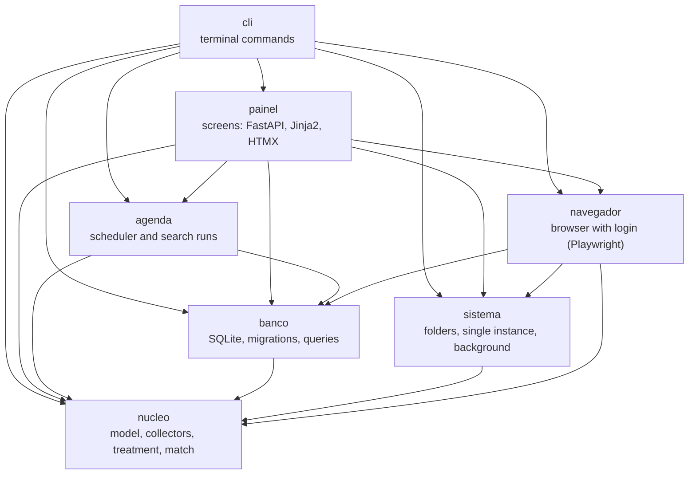
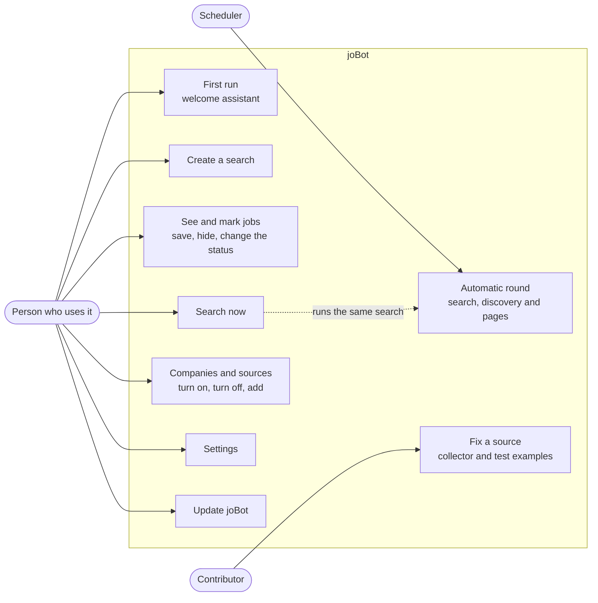
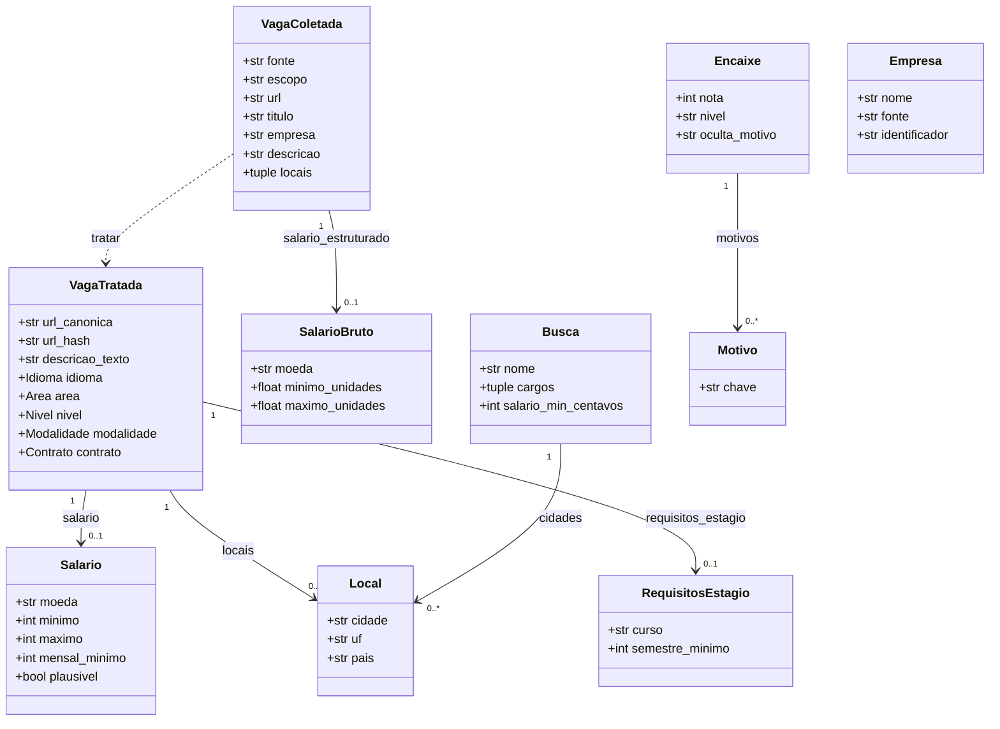

🌐 [Português](Arquitetura) · **English**

# 🏗️ Architecture

**How the joBot code is organized: folders, layers, database, the path of a search, what each person does and the main types.**

The flowchart of the path of a job, from the source to the dashboard, is in [How it works](How-it-works). This page shows what is inside. The test `tests/unidade/test_arquitetura.py` checks the database (tables, keys and triggers), the layers, the collector folders and the names of the search functions. The use cases and the class fields are not checked: if the code changes there, the page may go stale.

---

## 📁 Folders

```text
src/jobot/
├── nucleo/                   pure: imports no other layer
│   ├── coletores/            one file per job source
│   │   ├── plataformas/      recruiting systems (ATS) used by many companies, e.g. greenhouse, lever
│   │   ├── agregadores/      sites that gather jobs from many companies, e.g. remotive, remoteok
│   │   ├── portais/          internship and first-job portals, e.g. ciee, iel
│   │   ├── carreiras/        career sites of a single company, e.g. amazon, google
│   │   └── (root)            base, executor, registro, paginas, descoberta_cc
│   ├── tratamento/           duplicates, salary, labels, places, life cycle
│   └── dados/                JSON lists: sources, companies, labels, salary
├── banco/                    SQLite: connection, migrations (migracoes/), writing and queries
├── agenda/                   scheduler and search runs
├── sistema/                  data folders, single instance, background, opening the browser
├── painel/                   FastAPI, Jinja2 and HTMX
│   ├── rotas/                one route per screen
│   ├── templates/            HTML of the screens
│   ├── static/               CSS, JavaScript and local fonts
│   └── i18n/                 texts in pt and en
└── cli/                      terminal commands (jobot serve, buscar, atualizar...)
tests/                        unit, integration, screen (Playwright), fixtures and support
scripts/                      capture examples, source watcher, check companies
docs/decisions/               the architecture decisions (ADRs)
wiki/                         the text of this wiki
```

## 🧱 Layers

The arrow `A --> B` means "A may import B". There is no arrow back: the `nucleo` knows nobody, and the `painel` does not import `httpx` (only the `nucleo` uses `httpx`).



The test `tests/unidade/test_camadas.py` fails if someone breaks this rule.

## 🗄️ Database

A SQLite file on your computer. The schema comes from the migrations in `src/jobot/banco/migracoes/` (numbered `.sql` files). The `vaga_fts` table is the text search (FTS5); it only exists when the SQLite on the computer has FTS5, and its creation is in `src/jobot/banco/migrar.py`. The triggers of `vaga_fts` are `vaga_fts_insert` and `vaga_fts_update`.

```mermaid
erDiagram
    fonte ||--o{ empresa : "fonte"
    fonte ||--o{ empresa_sugerida : "fonte"
    fonte ||--o{ saude : "fonte"
    fonte ||--o{ ocorrencia : "fonte"
    fonte ||--o{ execucao_fonte : "fonte"
    execucao ||--o{ saude : "execucao_id"
    execucao ||--o{ execucao_fonte : "execucao_id"
    execucao ||--o| andamento : "execucao_id"
    execucao ||--o{ andamento_fonte : "execucao_id"
    fonte ||--o{ andamento_fonte : "fonte"
    vaga ||--o{ local_vaga : "vaga_id"
    vaga ||--o{ ocorrencia : "vaga_id"
    vaga ||--o{ encaixe : "vaga_id"
    vaga ||--o{ correcao : "vaga_id"
    vaga ||--o{ evento : "vaga_id"
    vaga ||--o| vaga_fts : "rowid = id"
    busca ||--o{ encaixe : "busca_id"
    pagina_acompanhada ||--o{ mudanca_pagina : "pagina_id"

    fonte {
        TEXT chave PK
        TEXT leva
        INTEGER ligada
        INTEGER intervalo_min
    }
    empresa {
        INTEGER id PK
        TEXT nome
        TEXT fonte FK
        TEXT identificador
        INTEGER ativa
        TEXT origem
    }
    empresa_sugerida {
        INTEGER id PK
        TEXT fonte FK
        TEXT identificador
        TEXT estado
    }
    execucao {
        INTEGER id PK
        TEXT tipo
        TEXT motivo
        TEXT iniciada_em
        TEXT terminada_em
        TEXT estado
        TEXT parada
    }
    execucao_fonte {
        INTEGER execucao_id PK, FK
        TEXT fonte PK, FK
        TEXT comecou_em
        TEXT terminou_em
    }
    andamento {
        INTEGER execucao_id PK, FK
        TEXT etapas
        TEXT etapa
        INTEGER feitas
        INTEGER total
        INTEGER total_planejado
        REAL partida
        TEXT mudou_em
    }
    andamento_fonte {
        INTEGER execucao_id PK, FK
        TEXT fonte PK, FK
        TEXT estado
        INTEGER feitas
        INTEGER total
        TEXT espera_ate
        TEXT espera_motivo
    }
    saude {
        INTEGER execucao_id PK, FK
        TEXT fonte PK, FK
        TEXT escopo PK
        TEXT estado
        INTEGER vagas
        TEXT motivo
    }
    vaga {
        INTEGER id PK
        TEXT url_hash UK
        TEXT titulo
        TEXT empresa
        TEXT area
        TEXT nivel
        TEXT modalidade
        TEXT contrato
        INTEGER sal_mensal_min_brl
        TEXT status
        TEXT fechada_em
    }
    local_vaga {
        INTEGER vaga_id FK
        TEXT cidade
        TEXT uf
        TEXT pais
    }
    ocorrencia {
        INTEGER id PK
        INTEGER vaga_id FK
        TEXT fonte FK
        TEXT escopo
        TEXT url
        TEXT coletada
        TEXT sumiu_em
    }
    busca {
        INTEGER id PK
        TEXT nome
        INTEGER ativa
        TEXT cargos
        TEXT cidades
        TEXT criada_em
    }
    encaixe {
        INTEGER busca_id PK, FK
        INTEGER vaga_id PK, FK
        INTEGER nota
        TEXT nivel
        TEXT oculta_motivo
    }
    correcao {
        INTEGER id PK
        INTEGER vaga_id FK
        TEXT campo
        TEXT valor_novo
        TEXT criada_em
    }
    evento {
        INTEGER id PK
        INTEGER vaga_id FK
        TEXT acao
        TEXT de
        TEXT para
        TEXT criado_em
    }
    cotacao {
        TEXT moeda PK
        TEXT data PK
        TEXT venda
    }
    cache_http {
        TEXT url PK
        TEXT etag
        TEXT last_modified
    }
    enriquecimento {
        TEXT url_hash PK
        TEXT buscado_em
        TEXT conteudo
    }
    pagina_acompanhada {
        INTEGER id PK
        TEXT url UK
        TEXT nome
        TEXT hash_texto
        TEXT estado
        TEXT motivo
    }
    mudanca_pagina {
        INTEGER id PK
        INTEGER pagina_id FK
        TEXT detectada_em
        TEXT diferenca
        INTEGER vista
    }
    config {
        TEXT chave PK
        TEXT valor
    }
    vaga_fts {
        INTEGER rowid PK "text search"
        TEXT titulo
        TEXT empresa
        TEXT descricao_texto
    }
```



**Nothing is deleted.** The trigger `vaga_sem_delete` refuses any `DELETE` on `vaga`: a job that disappears from the source only gets `fechada_em`. The `evento` table (the history of what you did in the dashboard) only receives additions: `evento_sem_update` and `evento_sem_delete` refuse to change or delete a row. Writing always uses `INSERT ... ON CONFLICT DO UPDATE`, never `INSERT OR REPLACE`. The tables `cotacao`, `cache_http`, `enriquecimento` and `config` have no foreign key: `enriquecimento` links to the job only through the value of `url_hash`.

## 🔎 One search, step by step

From the scheduler to the dashboard showing the job. The names are the ones in the code.

```mermaid
sequenceDiagram
    autonumber
    actor Pessoa
    participant Painel as painel
    participant Agenda as agenda
    participant Servir as cli.servir
    participant Executor as nucleo.coletores.executor
    participant Coletor as collector of the source
    participant Http as nucleo.http
    participant Site as site or API of the source
    participant Tratamento as nucleo.tratamento
    participant Banco as banco

    Note over Agenda: every 60 s the loop checks what is due
    Agenda->>Agenda: laco() calls o_que_roda()
    Agenda->>Servir: rodar() calls the busca() task from cli.servir
    Servir->>Agenda: busca() calls executar_busca()
    Note over Pessoa,Painel: the Search now button comes in through buscar_agora(), which calls _disparar(); its own busca() also calls executar_busca()
    Agenda->>Banco: abrir_execucao() creates the row in execucao
    Agenda->>Executor: _coletar() calls rodar() with the sources that are on
    loop each source that is on and each scope
        Executor->>Coletor: escopos()
        Executor->>Http: escopo() hands over the client of the scope
        Executor->>Coletor: coletar()
        Coletor->>Http: pedir()
        Http->>Site: GET, with a wait per host and the joBot user agent
        Site-->>Http: response
        Http-->>Coletor: text or JSON
        Coletor-->>Executor: ResultadoEscopo with the VagaColetada
        opt the source only lists the addresses
            Executor->>Coletor: detalhar()
        end
        Executor->>Agenda: ao_terminar() receives the finished scope
        Agenda->>Tratamento: tratar() returns the VagaTratada
        Agenda->>Banco: gravar_escopo() writes saude, vaga, local_vaga and ocorrencia
    end
    Agenda->>Banco: fechar_escopos_extintos()
    Agenda->>Banco: reprocessar_se_regras_mudaram(), aplicar_cotacoes() and recalcular_encaixe()
    Agenda->>Banco: fechar_execucao()
    Pessoa->>Painel: opens the job list, GET /vagas
    Painel->>Banco: listar() reads vaga and encaixe
    Banco-->>Painel: the jobs of the page
    Painel-->>Pessoa: HTML with Jinja2 and HTMX
    Pessoa->>Painel: follows the progress, GET /execucao/atual
    Painel->>Painel: atual() reads execucao and execucao_fonte
```

If a source fails, the executor writes its state in `saude` and the others go on.

## 🎭 Use cases

Three actors: the person who uses it, the scheduler and whoever contributes code.



The steps for fixing a source are in the [guide to fix a source](https://github.com/fezarosa-dev/joBot/blob/main/docs/consertar-fonte.en.md).

## 🧩 Main types of the core

The types in `src/jobot/nucleo/modelo.py`. A `VagaColetada` is what the collector brings from the source; `tratar()` turns it into a `VagaTratada`, which is what goes to the database.



The closed lists (`Area`, `Nivel`, `Modalidade`, `Contrato`, `Aviso`) are also in `modelo.py`. Money is in cents of the original currency.
