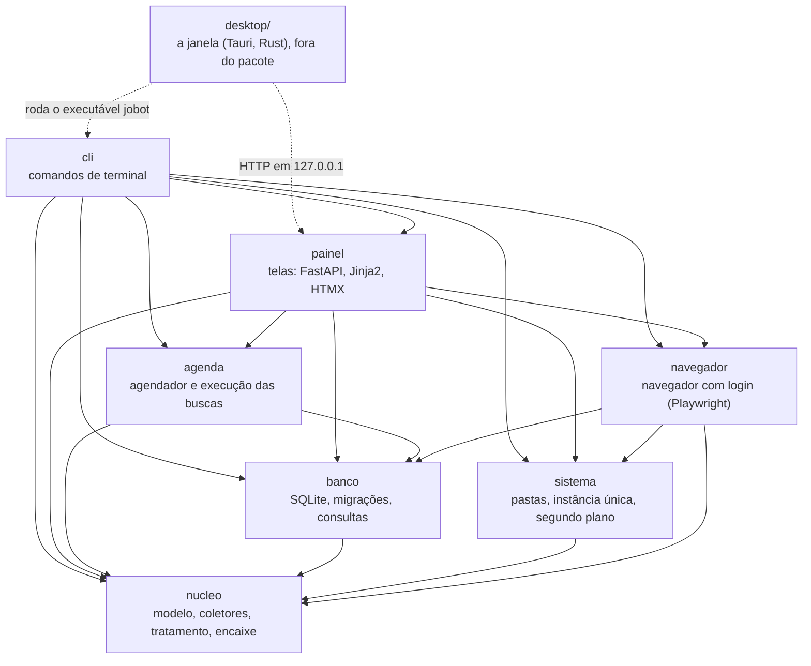
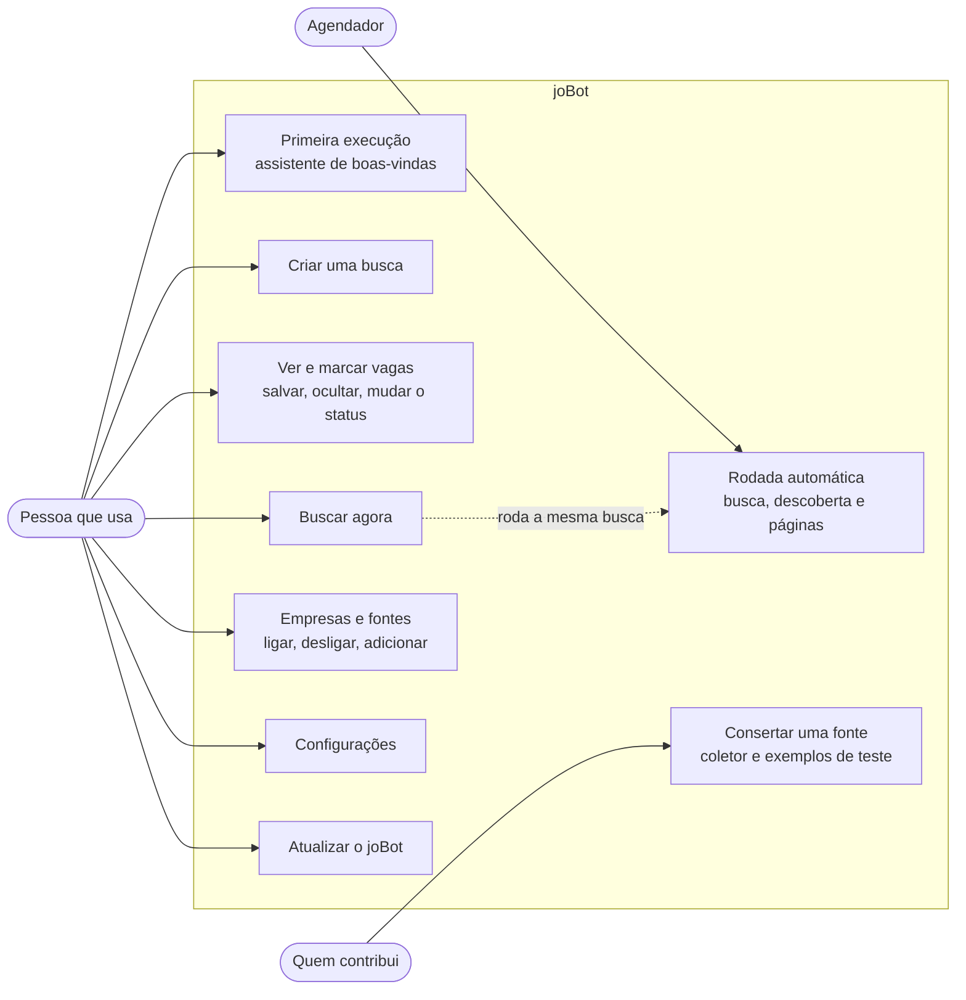
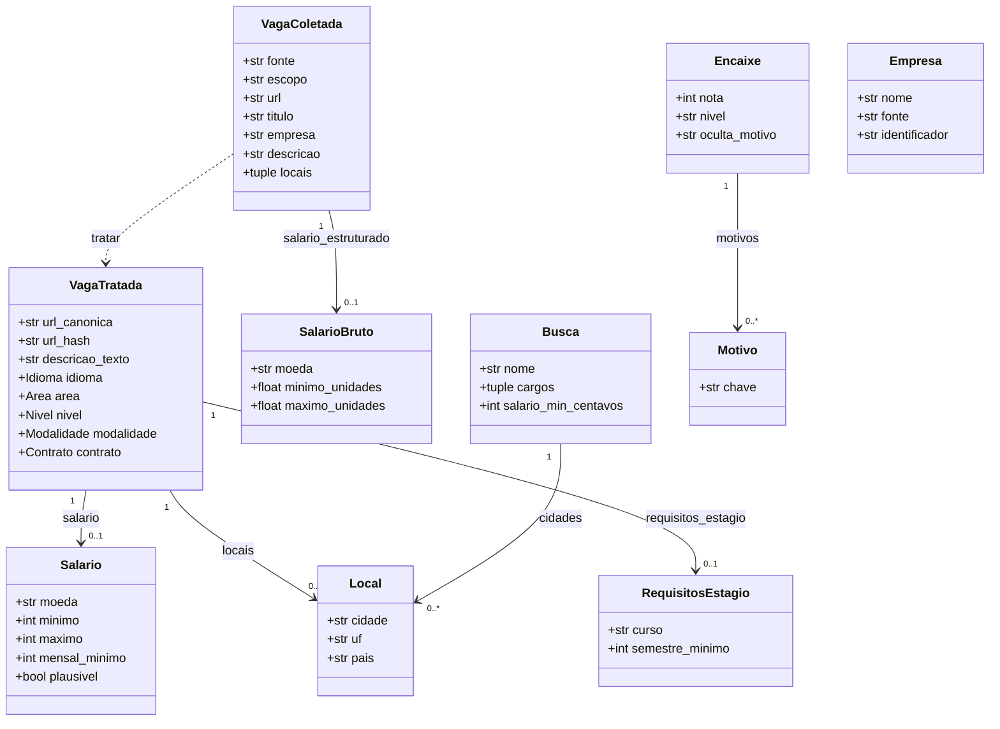

🌐 **Português** · [English](Architecture)

# 🏗️ Arquitetura

**Como o código do joBot está organizado: pastas, camadas, banco, o caminho de uma busca, o que cada pessoa faz e os tipos principais.**

O fluxograma do caminho de uma vaga, da fonte até o painel, está em [Como funciona](Como-funciona). Esta página mostra o que existe por dentro. O teste `tests/unidade/test_arquitetura.py` confere o banco (tabelas, chaves e gatilhos), as camadas, as pastas dos coletores e os nomes das funções da busca. Os casos de uso e os campos das classes não são conferidos: se o código mudar nesses pontos, a página pode ficar desatualizada.

---

## 📁 Pastas

```text
src/jobot/
├── nucleo/                   puro: não importa nenhuma outra camada
│   ├── coletores/            um arquivo por fonte de vagas
│   │   ├── plataformas/      sistemas de recrutamento (ATS) de muitas empresas, ex.: greenhouse, lever
│   │   ├── agregadores/      sites que juntam vagas de várias empresas, ex.: remotive, remoteok
│   │   ├── portais/          portais de estágio e primeiro emprego, ex.: ciee, iel
│   │   ├── carreiras/        sites de carreira de uma empresa só, ex.: amazon, google
│   │   └── (raiz)            base, executor, registro, paginas, descoberta_cc
│   ├── leitores/             os sites com login: o que ler de cada um (um arquivo por site)
│   ├── tratamento/           duplicadas, salário, rótulos, locais, ciclo de vida
│   ├── ia/                   contrato da IA, esquema por serviço, tarefas e montagem dos pedidos
│   └── dados/                listas em JSON: fontes, empresas, rótulos, salário
├── banco/                    SQLite: conexão, migrações (migracoes/), gravação e consultas
├── agenda/                   agendador e execução das buscas
├── sistema/                  pastas de dados, instância única, segundo plano, abrir o navegador
├── painel/                   FastAPI, Jinja2 e HTMX
│   ├── rotas/                uma rota por tela
│   ├── templates/            HTML das telas
│   ├── static/               CSS, JavaScript e fontes locais
│   └── i18n/                 textos em pt e en
└── cli/                      comandos de terminal (jobot serve, buscar, atualizar...)
desktop/                      a janela (casca Tauri 2, em Rust): fora do pacote Python
├── src/                      arranque, achar e subir o servidor, instalar, fechar
├── ui/                       tela de instalação: HTML, CSS e JS puros, textos em pt e en
└── recursos/                 gerado no build: uv, Python, wheels, joBot e manifesto
tests/                        unidade, integração, tela (Playwright), fixtures e apoio
scripts/                      capturar exemplos, vigia de fontes, conferir empresas
docs/decisions/               as decisões de arquitetura (ADRs)
wiki/                         o texto desta wiki
```

## 🧱 Camadas

A seta `A --> B` quer dizer "A pode importar B". Não há seta de volta: o `nucleo` não conhece ninguém, e o `painel` não importa `httpx` (o `httpx` fica no `nucleo` e no `jobot atualizar`, em `sistema/atualizar.py` e `sistema/casca.py`).



O teste `tests/unidade/test_camadas.py` falha se alguém quebrar essa regra. Ele também confere que o contrato da IA (`nucleo/ia/`) só é importado pela `agenda`, pelo `painel`, pelo `cli` e por ele mesmo: o `cli` monta o serviço de IA e o entrega pronto às outras duas.

A casca `desktop/` (a janela do joBot) é um processo à parte, em Rust: não importa nada do pacote Python e nada dele a importa. Ela só fala HTTP com o painel em 127.0.0.1 e roda o executável `jobot` (e o `uv`, para instalar), por isso as linhas dela são pontilhadas. Como ela não é Python, o `test_camadas.py` não a alcança; o `test_arquitetura.py` confere que o nó dela só tem linha pontilhada.

## 🗄️ Banco

Um arquivo SQLite no seu computador. O esquema nasce das migrações em `src/jobot/banco/migracoes/` (arquivos `.sql` numerados). A tabela `vaga_fts` é a busca de texto (FTS5); ela só existe quando o SQLite do computador tem FTS5, e a criação dela está em `src/jobot/banco/migrar.py`. Os gatilhos de `vaga_fts` são `vaga_fts_insert` e `vaga_fts_update`.

```mermaid
erDiagram
    fonte ||--o{ empresa : "fonte"
    fonte ||--o{ empresa_sugerida : "fonte"
    fonte ||--o{ saude : "fonte"
    fonte ||--o{ ocorrencia : "fonte"
    fonte ||--o{ execucao_fonte : "fonte"
    execucao ||--o{ saude : "execucao_id"
    execucao ||--o{ execucao_fonte : "execucao_id"
    execucao ||--o| andamento : "execucao_id"
    execucao ||--o{ andamento_fonte : "execucao_id"
    fonte ||--o{ andamento_fonte : "fonte"
    fonte ||--o| sessao_site : "fonte"
    vaga ||--o{ local_vaga : "vaga_id"
    vaga ||--o{ ocorrencia : "vaga_id"
    vaga ||--o{ encaixe : "vaga_id"
    vaga ||--o{ correcao : "vaga_id"
    vaga ||--o{ evento : "vaga_id"
    vaga ||--o| candidatura : "vaga_id"
    vaga ||--o| habilidades_vaga : "vaga_id"
    vaga ||--o| preparo_candidatura : "vaga_id"
    vaga ||--o| vaga_fts : "rowid = id"
    busca ||--o{ encaixe : "busca_id"
    pagina_acompanhada ||--o{ mudanca_pagina : "pagina_id"

    fonte {
        TEXT chave PK
        TEXT leva
        INTEGER ligada
        INTEGER intervalo_min
    }
    empresa {
        INTEGER id PK
        TEXT nome
        TEXT fonte FK
        TEXT identificador
        INTEGER ativa
        TEXT origem
    }
    empresa_sugerida {
        INTEGER id PK
        TEXT fonte FK
        TEXT identificador
        TEXT estado
    }
    execucao {
        INTEGER id PK
        TEXT tipo
        TEXT motivo
        TEXT iniciada_em
        TEXT terminada_em
        TEXT estado
        TEXT parada
    }
    execucao_fonte {
        INTEGER execucao_id PK, FK
        TEXT fonte PK, FK
        TEXT comecou_em
        TEXT terminou_em
    }
    andamento {
        INTEGER execucao_id PK, FK
        TEXT etapas
        TEXT etapa
        INTEGER feitas
        INTEGER total
        INTEGER total_planejado
        REAL partida
        TEXT mudou_em
    }
    andamento_fonte {
        INTEGER execucao_id PK, FK
        TEXT fonte PK, FK
        TEXT estado
        INTEGER feitas
        INTEGER total
        TEXT espera_ate
        TEXT espera_motivo
    }
    sessao_site {
        TEXT fonte PK, FK
        TEXT estado
        TEXT motivo
        TEXT conferido_em
        TEXT entrou_em
        TEXT avisado_em
    }
    sessao_conta {
        TEXT conta PK
        TEXT estado
        TEXT motivo
        TEXT conferido_em
        TEXT entrou_em
        TEXT avisado_em
    }
    saude {
        INTEGER execucao_id PK, FK
        TEXT fonte PK, FK
        TEXT escopo PK
        TEXT estado
        INTEGER vagas
        TEXT motivo
    }
    vaga {
        INTEGER id PK
        TEXT url_hash UK
        TEXT titulo
        TEXT empresa
        TEXT area
        TEXT nivel
        TEXT modalidade
        TEXT contrato
        INTEGER sal_mensal_min_brl
        TEXT status
        TEXT fechada_em
    }
    local_vaga {
        INTEGER vaga_id FK
        TEXT cidade
        TEXT uf
        TEXT pais
    }
    ocorrencia {
        INTEGER id PK
        INTEGER vaga_id FK
        TEXT fonte FK
        TEXT escopo
        TEXT url
        TEXT coletada
        TEXT sumiu_em
    }
    busca {
        INTEGER id PK
        TEXT nome
        INTEGER ativa
        TEXT cargos
        TEXT cidades
        TEXT criada_em
    }
    encaixe {
        INTEGER busca_id PK, FK
        INTEGER vaga_id PK, FK
        INTEGER nota
        TEXT nivel
        TEXT oculta_motivo
        TEXT nivel_base
    }
    correcao {
        INTEGER id PK
        INTEGER vaga_id FK
        TEXT campo
        TEXT valor_novo
        TEXT criada_em
    }
    evento {
        INTEGER id PK
        INTEGER vaga_id FK
        TEXT acao
        TEXT de
        TEXT para
        TEXT criado_em
    }
    candidatura {
        INTEGER vaga_id PK, FK
        TEXT abriu_em
        INTEGER perguntar
    }
    habilidades_vaga {
        INTEGER vaga_id PK, FK
        TEXT chave
        TEXT pede
        TEXT backend
        TEXT modelo
        TEXT falha
        INTEGER tentativas
    }
    perfil {
        INTEGER id PK
        TEXT habilidades
        TEXT atualizado_em
        TEXT nome
        TEXT email
        TEXT cargo_atual
        TEXT resumo
        TEXT idiomas_falados
    }
    experiencia {
        INTEGER id PK
        TEXT cargo
        TEXT empresa
        TEXT inicio
        TEXT fim
    }
    curso {
        INTEGER id PK
        TEXT nome
        TEXT situacao
    }
    pergunta_perfil {
        INTEGER id PK
        TEXT chave
        TEXT pergunta
        TEXT resposta
        TEXT origem
    }
    preparo_candidatura {
        INTEGER vaga_id PK, FK
        TEXT idioma
        TEXT carta
        TEXT resumo
        TEXT usou
        TEXT feito_em
    }
    cotacao {
        TEXT moeda PK
        TEXT data PK
        TEXT venda
    }
    cache_http {
        TEXT url PK
        TEXT etag
        TEXT last_modified
    }
    enriquecimento {
        TEXT url_hash PK
        TEXT buscado_em
        TEXT conteudo
    }
    pagina_acompanhada {
        INTEGER id PK
        TEXT url UK
        TEXT nome
        TEXT hash_texto
        TEXT estado
        TEXT motivo
    }
    mudanca_pagina {
        INTEGER id PK
        INTEGER pagina_id FK
        TEXT detectada_em
        TEXT diferenca
        INTEGER vista
    }
    config {
        TEXT chave PK
        TEXT valor
    }
    vaga_fts {
        INTEGER rowid PK "busca de texto"
        TEXT titulo
        TEXT empresa
        TEXT descricao_texto
    }
```



**Nada é apagado.** O gatilho `vaga_sem_delete` recusa qualquer `DELETE` em `vaga`: a vaga que some da fonte só ganha `fechada_em`. A tabela `evento` (o histórico do que você fez no painel) só recebe acréscimo: `evento_sem_update` e `evento_sem_delete` recusam mudar ou apagar uma linha. A tabela `candidatura` (quando você abriu a candidatura de cada vaga) é atualizada no lugar, e `candidatura_sem_delete` recusa apagar uma linha. A tabela `habilidades_vaga` (o que cada vaga pede, segundo a IA) também é atualizada no lugar, e uma falha nunca apaga o resultado anterior. As exceções são os dados seus, não de vaga: `perfil` (habilidades, contato e resumo), `experiencia`, `curso`, `pergunta_perfil` e `preparo_candidatura` (a carta e o resumo preparados para cada vaga, refeitos no lugar). "Apagar perfil" apaga as cinco, também nas cópias guardadas de antes das migrações (`jobot.db.antes-vN`), e o SQLite zera o que foi apagado no arquivo (`secure_delete`), sem deixar o texto no `-wal`. Tirar uma experiência ou um curso apaga a linha, e o número dela não volta. O texto do currículo nunca é guardado, e o perfil não tem CPF, data de nascimento nem projetos. A gravação usa sempre `INSERT ... ON CONFLICT DO UPDATE`, nunca `INSERT OR REPLACE`. As tabelas `cotacao`, `cache_http`, `enriquecimento` e `config` não têm chave estrangeira: `enriquecimento` liga à vaga só pelo valor de `url_hash`.

## 🔎 Uma busca, passo a passo

Do agendador até o painel mostrar a vaga. Os nomes são os do código.

```mermaid
sequenceDiagram
    autonumber
    actor Pessoa
    participant Painel as painel
    participant Agenda as agenda
    participant Servir as cli.servir
    participant Executor as nucleo.coletores.executor
    participant Coletor as coletor da fonte
    participant Http as nucleo.http
    participant Site as site ou API da fonte
    participant Tratamento as nucleo.tratamento
    participant Banco as banco

    Note over Agenda: a cada 60 s o laço vê o que venceu
    Agenda->>Agenda: laco() chama o_que_roda()
    Agenda->>Servir: rodar() chama a tarefa busca() de cli.servir
    Servir->>Agenda: busca() chama executar_busca()
    Note over Pessoa,Painel: o botão Buscar agora entra por buscar_agora(), que chama _disparar(); a busca() dela também chama executar_busca()
    Agenda->>Banco: abrir_execucao() cria a linha em execucao
    Agenda->>Executor: _coletar() chama rodar() com as fontes ligadas
    loop cada fonte ligada e cada escopo
        Executor->>Coletor: escopos()
        Executor->>Http: escopo() entrega o cliente do escopo
        Executor->>Coletor: coletar()
        Coletor->>Http: pedir()
        Http->>Site: GET, com espera por host e o user agent do joBot
        Site-->>Http: resposta
        Http-->>Coletor: texto ou JSON
        Coletor-->>Executor: ResultadoEscopo com as VagaColetada
        opt a fonte só lista os endereços
            Executor->>Coletor: detalhar()
        end
        Executor->>Agenda: ao_terminar() recebe o escopo pronto
        Agenda->>Tratamento: tratar() devolve a VagaTratada
        Agenda->>Banco: gravar_escopo() grava saude, vaga, local_vaga e ocorrencia
    end
    Agenda->>Banco: fechar_escopos_extintos()
    Agenda->>Banco: reprocessar_se_regras_mudaram(), aplicar_cotacoes() e recalcular_encaixe()
    Agenda->>Banco: fechar_execucao()
    Pessoa->>Painel: abre a lista de vagas, GET /vagas
    Painel->>Banco: listar() lê vaga e encaixe
    Banco-->>Painel: as vagas da página
    Painel-->>Pessoa: HTML com Jinja2 e HTMX
    Pessoa->>Painel: acompanha o andamento, GET /execucao/atual
    Painel->>Painel: atual() lê execucao e execucao_fonte
```

Se uma fonte falha, o executor grava o estado dela em `saude` e as outras seguem.

## 🎭 Casos de uso

Três atores: a pessoa que usa, o agendador e quem contribui com código.



O passo a passo de quem conserta uma fonte está no [guia para consertar uma fonte](https://github.com/fezarosa-dev/joBot/blob/main/docs/consertar-fonte.md). Para acrescentar um site novo, há o [guia de site novo](https://github.com/fezarosa-dev/joBot/blob/main/docs/site-novo.md).

## 🧩 Tipos principais do núcleo

Os tipos de `src/jobot/nucleo/modelo.py`. Uma `VagaColetada` é o que o coletor traz da fonte; o `tratar()` a transforma numa `VagaTratada`, que é o que vai para o banco.



As listas fechadas (`Area`, `Nivel`, `Modalidade`, `Contrato`, `Aviso`) também ficam em `modelo.py`. Dinheiro vai em centavos da moeda original.
