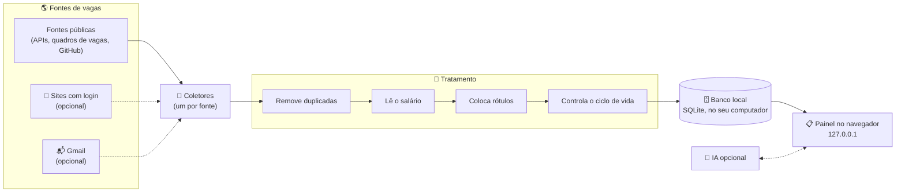

🌐 **Português** · [English](How-it-works)

# ⚙️ Como funciona

**O caminho de uma vaga, do site onde ela foi publicada até o seu painel.**

---

## 🛤️ O caminho da vaga

Um ciclo de busca, passo a passo:

1. ⏰ **Na hora marcada**, o joBot acorda. Ou quando você aperta "Buscar agora".
2. 🤖 **Cada coletor** (o código que lê as vagas de uma fonte) visita a sua fonte com calma e traz as vagas num formato único.
3. 🧹 **O tratamento** junta vagas repetidas, entende o salário, coloca rótulos e marca como fechadas as vagas que sumiram.
4. 🗄️ **Tudo vai para o banco** SQLite, um arquivo que fica no seu computador.
5. 📋 **O painel** mostra o resultado no seu navegador. Ele só funciona no seu computador (endereço 127.0.0.1).
6. 🧠 **Se você ligou a IA** (desde a versão 0.5.0), ela lista as habilidades que cada vaga pede, e o joBot compara com as do seu perfil e soma isso ao encaixe. Na 0.6.0, ela vai ajudar a preparar candidaturas.

> [!TIP]
> Se uma fonte falhar, as outras continuam. Se o computador estava desligado na hora marcada, a busca perdida roda quando ele liga.

> [!NOTE]
> Quer ver o joBot por dentro, com as pastas, as camadas, o banco e os diagramas? Veja a página [Arquitetura](Arquitetura).

## 🧹 O tratamento das vagas

<strong>Duplicadas e ciclo de vida</strong>

- A vaga repetida é encontrada pelo endereço dela, sem os parâmetros de rastreamento.
- A vaga fecha quando some da fonte. Se a fonte estava "parcial", só fecha depois de 30 dias sumida.
- Vaga com prazo vencido sai das listas.
- Nenhuma vaga é apagada. O ciclo de vida marca, não apaga.

<strong>Salário</strong>

- O leitor de salário separa salário de benefícios, confere o período (por hora, mês ou ano) e se o valor é plausível.
- Salário em moeda estrangeira é convertido para a moeda de exibição que você escolhe em Configurações (a do seu país por padrão), pela cotação PTAX do Banco Central, quando houver cotação.
- Sem cotação, a vaga não é eliminada pelo filtro de salário mínimo.

<strong>Rótulos e encaixe</strong>

- Rótulos: área, nível, modalidade (presencial, híbrido, remoto), região e tipo de contrato, além de avisos como "exige visto".
- Encaixe com o seu perfil em três níveis (● bom, ◐ médio, ○ fraco), sempre com os motivos.
- O acerto de cada rótulo é medido num gabarito de 329 vagas reais, de 30 fontes.

## 🖥️ As duas versões

O joBot tem um núcleo só e duas "caras".

| | 💻 Versão para baixar | 🌐 Versão no navegador (GitHub Pages) |
|---|---|---|
| **Instalação** | Nativa, pelo instalador de cada sistema (fase 3) ou pelo código | Nenhuma: é só abrir o site |
| **Fontes** | Todas | Só fontes públicas |
| **Sites com login** | Sim, você entra numa janela comum do navegador | Não |
| **IA** | Automática (modelo local ou serviço com a sua chave: Anthropic, OpenAI, Gemini ou um endereço compatível) ou manual | Manual (copiar e colar); rótulos só por regras |
| **Extensão, Gmail e áudio** | Sim | Não |
| **Onde ficam os dados** | No banco SQLite do seu computador | Seu perfil fica no seu navegador |
| **Atualização** | A cada 3 h (públicas) e 2x por dia (login) | Uma vez por dia |
| **Quando chega** | É o foco do projeto | Fase 8 |

Na versão no navegador, você pode exportar o perfil num arquivo e importar depois na versão para baixar. Ela nunca usa logins nem segredos.

## 🌎 Fontes de vagas

Cada fonte tem uma chave liga/desliga.

| Grupo | Exemplos |
|---|---|
| Repositórios de vagas no GitHub | backend-br, frontendbr, soujava, remotejobsbr, developersRJ |
| Sites e APIs internacionais | Jobicy, Hacker News "Who is hiring", Remotive, RemoteOK, Himalayas, We Work Remotely |
| Quadros de vagas de empresas (sistemas de recrutamento, os "ATS") | Greenhouse, Lever, Ashby, SmartRecruiters, Workday, Eightfold, Oracle HCM, InHire, Quickin, Recrutei |
| Portais brasileiros | Gupy, CIEE, Sólides, IEL, Super Estágios, Cia de Talentos, Eureca, Abler |
| Carreiras de grandes empresas | Google, Amazon, Microsoft, NVIDIA |
| Murais de estágio | Murais públicos, como o da USP |
| 🔐 Site com login (o único por enquanto) | LinkedIn |
| 🔐 Sites com login (ideias para o futuro, ainda sem data) | Vagas.com, Catho, Indeed |
| 🔐 Sites com login (ideias para o futuro, um de cada vez) | InfoJobs, Glassdoor, Remotar, Trampos |
| 🔐 Sites com login só de tecnologia (ideias para o futuro, por último, um de cada vez) | Programathor, GeekHunter, Revelo, Coodesh |

- 🤝 **Coleta educada.** O robô se identifica, espera entre um pedido e outro e espera mais quando o site pede calma.
- 🩺 **Saúde de cada fonte.** A cada busca, cada fonte fica marcada como ok, parcial ou falhou, e você vê isso no painel.
- 🏷️ **Crédito.** Fontes que pedem crédito mostram "via &lt;fonte&gt;" com link para a vaga original.

> [!WARNING]
> **Sites com login têm risco.** Eles podem restringir contas que acessam de forma automática.
> O joBot reduz o risco: você entra numa janela comum do navegador, sem automação, como quiser (Google, e-mail e senha), e fecha a janela; o joBot confere a sessão sozinho e nunca digita a senha. Depois ele só lê e visita poucas vezes, devagar. Mesmo assim, o risco existe. **Você decide se liga cada site.**

## 📋 O painel

O painel roda no seu computador, em `127.0.0.1`. Se o joBot acha o Chrome, o Edge ou o Chromium no sistema, ele abre numa janela própria, sem abas nem barra de endereço; senão usa o Chromium que ele instalou, e só então uma aba comum. Pelo instalador, o botão **Abrir joBot** da janela do joBot abre o painel no seu navegador padrão.

- **Barra lateral:** a seção Vagas (Destaques de hoje e as abas, com a contagem de cada uma), a seção Onde buscar (Buscas, Empresas, Sugeridas, Fontes e Sites) e Configurações. Dá para recolhê-la e mudar a largura.
- **Lista com detalhe:** a lista de vagas de um lado, o detalhe da vaga escolhida do outro; em janela estreita o detalhe sobe por cima da lista.
- **Abas:** Destaques de hoje, Todas, Novas, Fecham logo, Salvas, Candidatei, Programas e Ocultas, todas na barra lateral.
- **Filtros** em "chips" (botõezinhos) com contagem: país e há quantos dias a vaga foi publicada ficam à vista; salário, cidade, empresa e palavras que a vaga não pode ter ficam em "Mais filtros". O filtro atual fica no endereço da página, então dá para salvar o link. Busca rápida com a tecla `/`.
- **Status de cada vaga:** nova → salva → candidatei → entrevista → recusada ou oferta.
- **Calendário de 12 meses** em cada vaga, para ver prazos de relance.
- **Panorama e fila de candidaturas:** o Panorama, na barra lateral, junta o dia: o que fecha logo, as candidaturas e a busca. Quando você abre o link de candidatura de uma vaga, o painel pergunta "Você se candidatou?" ("Sim, me candidatei" ou "Ainda não", com Desfazer); a linha do tempo da vaga mostra a data de cada passo e a aba Candidatei mostra o "desde". Se a descrição traz um e-mail de candidatura, o botão "Candidatar-se por e-mail" só abre o seu programa de e-mail: o joBot não envia nada.
- **"Algo errado nesta vaga?"**: um botão para corrigir um rótulo ou dado.
- **Desfazer:** ocultar uma vaga, descartar uma sugestão ou remover uma empresa acontece na hora, com uma faixa de **Desfazer**. O que apaga de verdade pede confirmação antes.
- **Teclado e paleta de comandos:** `⌘K` (`Ctrl+K` fora do Mac) leva a qualquer tela. Veja todos em [Atalhos de teclado](Atalhos-de-teclado).
- **Tamanho do texto:** Padrão, Grande ou Maior, em Configurações, Geral.
- **Andamento da busca:** ao buscar agora, o topo mostra a etapa em que o joBot está e quanto já foi.
- **Visual de aplicativo do Mac:** translucidez, animações suaves, modo claro e escuro seguindo o sistema, e movimento reduzido para quem pede.
- **Idiomas:** português e inglês.
- **Registro local da abertura:** o joBot guarda, só no seu computador, quando você abriu a candidatura de cada vaga.

## 🌙 Segundo plano

| Fonte | Frequência |
|---|---|
| Fontes públicas | A cada 3 horas |
| Sites com login | Duas vezes por dia (9h e 18h, ajustável) |
| Botão "Buscar agora" | Na hora, respeitando o intervalo mínimo de algumas fontes |

Rodar em segundo plano é escolha sua, no assistente da primeira execução ou nas configurações. Ligado, o joBot inicia com o computador, sem janela, e um atalho "joBot" abre o painel.

## 🧠 Inteligência artificial (opcional)

> **Regra de ouro:** a IA nunca inventa. Na 0.5.0 ela nem recebe o seu perfil: cada habilidade que ela lista precisa estar escrita na vaga. A partir da 0.6.0, nas tarefas que usam o perfil (currículo, questionário, candidatura), ela só usa os dados do seu perfil e mostra quais usou.

Cada tarefa escolhe a sua opção. Na 0.5.0: modelo local (Qwen, grátis e sem internet depois de baixado), chave da API da Anthropic, da OpenAI ou do Google Gemini, ou um endereço compatível com a OpenAI (Ollama, LM Studio, OpenRouter), e as palavras-chave (sem IA) continuam. A IA manual (copiar e colar) chega na 0.6.0, e a sessão do Claude Code que você já tem espera a decisão do dono sobre os termos de uso. Detalhes em [Tecnologias](Tecnologias) e no [README](https://github.com/fezarosa-dev/joBot#inteligencia-artificial).
