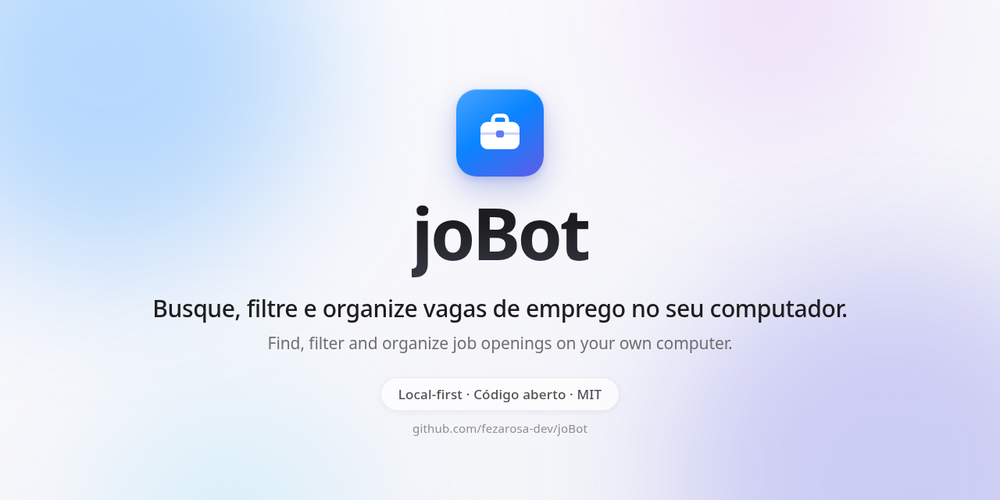

🌐 [Português](Home) · **English**

# 🤖 joBot

**Your personal job search assistant.** 
It gathers, filters and organizes jobs from many sites into a dashboard that runs on your own computer.

 

 

 

[The idea](The-idea-and-the-story) · [How it works](How-it-works) · [Technologies](Technologies) · [Roadmap](Roadmap) · [Support](Support-the-project)

---

## 👋 What joBot is

Looking for a job is tiring: you have to open many sites, repeat the same filters and hope you don't miss a deadline.
joBot will do this repetitive work for you: visit job sites, gather everything in one place and show what matches your profile.
Everything runs on your computer, artificial intelligence is optional, and you are always the one who sends the application.

## 🌱 How it started

joBot was born to help young university students find their first job.
Then the idea grew and became an assistant for everyone looking for a job, in any field. [Read the full story](The-idea-and-the-story).

> [!NOTE]
> **joBot is under development.** Phase 1 of 8 (the base) is in progress.
> There is **nothing to install yet**: what this wiki describes is the plan, not a finished product. See the [roadmap](Roadmap).

## ✨ Highlights

| | What it will do |
|:---:|---|
| 🔎 | **Search** for jobs in dozens of sources: public sites, company job boards and, if you want, sites that require login. |
| 🧹 | **Clean up**: remove duplicate jobs, read the salary and tag the field, level, work mode, region and contract type. |
| 🎯 | **Rank**: show how well each job matches you (● good, ◐ medium, ○ weak) and explain why. |
| 🗂️ | **Organize**: each job has a status, from "new" to "offer". |
| ✍️ | **Prepare the application**: cover letter, a résumé summary adjusted to the job and a list of what you have and what is missing. |
| 🧩 | **Help with forms**: a browser extension suggests answers, and you confirm. |
| 📬 | **Read Gmail** (optional): bring in jobs from alert emails and suggest status changes. |
| 🔒 | **Privacy**: there is no joBot server and it sends no telemetry (usage data). |

It works for every kind of job and every field: full-time employment (CLT), contractor (PJ), internship, trainee, temporary, apprentice, research and scholarships, programs and summer schools, public exams and notices.

## 🧭 Where to start

| Page | What you will find |
|---|---|
| 💡 [The idea and the story](The-idea-and-the-story) | Why joBot exists, what it does, what it does not do and its principles. |
| ⚙️ [How it works](How-it-works) | The path of a job, from the source to the dashboard, and the two versions. |
| 🧰 [Technologies](Technologies) | The tools used and the reason for each one. |
| 📚 [Decisions](Decisions) | Every project decision, each in one line. |
| 🗺️ [Roadmap](Roadmap) | The 8 phases and which one we are in. |
| 💛 [Support the project](Support-the-project) | How to help the project, with or without money. |
| ❓ [Frequently asked questions](Frequently-asked-questions) | The most common questions, answered. |
| 🙋 [Ask a question](Ask-a-question) | How to ask what is not here. |

More links:

- 📦 [Repository on GitHub](https://github.com/fezarosa-dev/joBot)
- 📖 [README](https://github.com/fezarosa-dev/joBot/blob/main/README.en.md), with all the details
- 🤝 [Contribution guide](https://github.com/fezarosa-dev/joBot/blob/main/.github/CONTRIBUTING.en.md)
