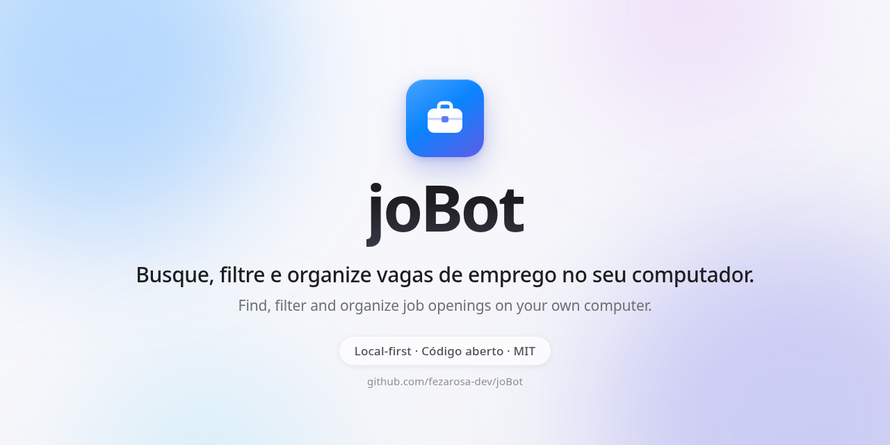

🌐 **Português** · [English](Home-en)

# 🤖 joBot

**Seu assistente pessoal de busca de vagas.** 
Ele junta, filtra e organiza vagas de muitos sites num painel que roda no seu próprio computador.

 

 

 

[A ideia](A-ideia-e-a-historia) · [Como funciona](Como-funciona) · [Tecnologias](Tecnologias) · [Roteiro](Roteiro) · [Apoie](Apoie)

---

## 👋 O que é o joBot

Procurar vaga cansa: é preciso abrir muitos sites, repetir os mesmos filtros e torcer para não perder um prazo.
O joBot vai fazer esse trabalho repetitivo por você: visitar os sites de vagas, juntar tudo num lugar só e mostrar o que combina com o seu perfil.
Tudo roda no seu computador, a inteligência artificial é opcional e quem envia a candidatura é sempre você.

## 🌱 Como nasceu

O joBot nasceu para ajudar jovens universitários a encontrar o primeiro emprego.
Depois a ideia cresceu e virou um assistente para todo mundo que procura vaga, de qualquer área. [Leia a história completa](A-ideia-e-a-historia).

> [!NOTE]
> **O joBot está em desenvolvimento.** A fase 1 de 8 (a base) está em andamento.
> Ainda **não há nada para instalar**: o que esta wiki descreve é o plano, não um produto pronto. Veja o [roteiro](Roteiro).

## ✨ Destaques

| | O que ele vai fazer |
|:---:|---|
| 🔎 | **Buscar** vagas em dezenas de fontes: sites públicos, quadros de vagas de empresas e, se você quiser, sites que exigem login. |
| 🧹 | **Limpar**: remover vagas repetidas, ler o salário e marcar área, nível, modalidade, região e tipo de contrato. |
| 🎯 | **Ranquear**: mostrar o quanto cada vaga combina com você (● bom, ◐ médio, ○ fraco) e explicar o porquê. |
| 🗂️ | **Organizar**: cada vaga tem um status, de "nova" até "oferta". |
| ✍️ | **Preparar candidatura**: carta de apresentação, resumo do currículo ajustado à vaga e lista do que você tem e do que falta. |
| 🧩 | **Ajudar nos formulários**: uma extensão do navegador sugere respostas, e você confirma. |
| 📬 | **Ler o Gmail** (opcional): trazer vagas dos e-mails de alerta e sugerir mudanças de status. |
| 🔒 | **Privacidade**: não existe servidor do joBot e ele não manda telemetria (dados de uso). |

Serve para todo tipo de vaga e toda área: CLT, PJ, estágio, trainee, temporário, aprendiz, pesquisa e bolsa, programas e escolas de verão, concursos e editais.

## 🧭 Por onde começar

| Página | O que você encontra |
|---|---|
| 💡 [A ideia e a história](A-ideia-e-a-historia) | Por que o joBot existe, o que ele faz, o que não faz e os princípios. |
| ⚙️ [Como funciona](Como-funciona) | O caminho de uma vaga, da fonte até o painel, e as duas versões. |
| 🧰 [Tecnologias](Tecnologias) | As ferramentas usadas e o porquê de cada uma. |
| 📚 [Decisões](Decisoes) | Todas as decisões do projeto, cada uma em uma linha. |
| 🗺️ [Roteiro](Roteiro) | As 8 fases e em qual estamos. |
| 💛 [Apoie](Apoie) | Como ajudar o projeto, com ou sem dinheiro. |
| ❓ [Perguntas frequentes](Perguntas-frequentes) | As dúvidas mais comuns, respondidas. |
| 🙋 [Tirar dúvida](Tirar-duvida) | O caminho para perguntar o que não está aqui. |

Mais links:

- 📦 [Repositório no GitHub](https://github.com/fezarosa-dev/joBot)
- 📖 [README](https://github.com/fezarosa-dev/joBot#readme), com todos os detalhes
- 🤝 [Guia de contribuição](https://github.com/fezarosa-dev/joBot/blob/main/.github/CONTRIBUTING.md)
