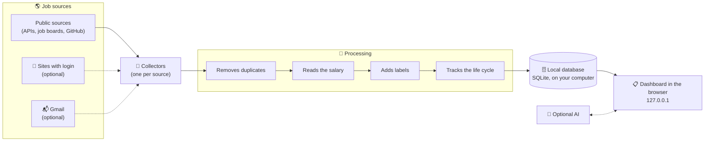

🌐 [Português](Como-funciona) · **English**

# ⚙️ How it works

**The path of a job, from the site where it was posted to your dashboard.**

---

## 🛤️ The path of a job

One search cycle, step by step:

1. ⏰ **At the scheduled time**, joBot wakes up. Or when you press "search now".
2. 🤖 **Each collector** (the code that reads the jobs from a source) visits its source calmly and brings the jobs in a single format.
3. 🧹 **Processing** merges duplicate jobs, understands the salary, adds labels and marks as closed the jobs that disappeared.
4. 🗄️ **Everything goes into the SQLite database**, a file that stays on your computer.
5. 📋 **The dashboard** shows the result in your browser. It only works on your computer (address 127.0.0.1).
6. 🧠 **If you turned on AI**, it calculates the match with your profile and helps prepare applications.

> [!TIP]
> If one source fails, the others continue. If the computer was off at the scheduled time, the missed search runs when it turns on.

> [!NOTE]
> Want to see joBot from the inside, with the folders, the layers, the database and the diagrams? See the [Architecture](Architecture) page.

## 🧹 How jobs are processed

<strong>Duplicates and life cycle</strong>

- A repeated job is found by its address, without the tracking parameters.
- A job closes when it disappears from the source. If the source was "partial", it only closes after 30 days missing.
- A job past its deadline leaves the lists.
- No job is deleted. The life cycle marks, it does not delete.

<strong>Salary</strong>

- The salary reader separates salary from benefits, checks the period (per hour, month or year) and whether the value is plausible.
- A salary in a foreign currency is converted to the display currency you choose in Settings (your country's by default), using the PTAX rate from Brazil's Central Bank, when a rate is available.
- Without a rate, the job is not removed by the minimum salary filter.

<strong>Labels and match</strong>

- Labels: field, level, work mode (on-site, hybrid, remote), region and contract type, plus warnings such as "requires a visa".
- Match with your profile in three levels (● good, ◐ medium, ○ weak), always with the reasons.
- The accuracy of each label is measured on a reference set of 329 real jobs, from 30 sources.

## 🖥️ The two versions

joBot has a single core and two "faces".

| | 💻 Download version | 🌐 Browser version (GitHub Pages) |
|---|---|---|
| **Installation** | Native, with one command (planned) | None: just open the site |
| **Sources** | All | Public sources only |
| **Sites with login** | Yes, you sign in in a regular browser window | No |
| **AI** | Automatic (Claude, local model) or manual | Manual (copy and paste); labels by rules only |
| **Extension, Gmail and audio** | Yes | No |
| **Where the data lives** | In the SQLite database on your computer | Your profile stays in your browser |
| **Updates** | Every 3 h (public) and twice a day (login) | Once a day |
| **When it arrives** | It is the project's focus | Phase 8 |

In the browser version, you can export your profile to a file and import it later into the download version. It never uses logins or secrets.

## 🌎 Job sources

Each source has an on/off switch.

| Group | Examples |
|---|---|
| Job repositories on GitHub | backend-br, frontendbr, soujava, remotejobsbr, developersRJ |
| International sites and APIs | Jobicy, Hacker News "Who is hiring", Remotive, RemoteOK, Himalayas, We Work Remotely |
| Company job boards (recruiting systems, the "ATS") | Greenhouse, Lever, Ashby, SmartRecruiters, Workday, Eightfold, Oracle HCM, InHire, Quickin, Recrutei |
| Brazilian portals | Gupy, CIEE, Sólides, IEL, Super Estágios, Cia de Talentos, Eureca, Abler |
| Careers at big companies | Google, Amazon, Microsoft, NVIDIA |
| Internship boards | Public boards, such as the one at USP |
| 🔐 Site with login (the only one for now) | LinkedIn |
| 🔐 Sites with login (ideas for the future, no date yet) | Vagas.com, Catho, Indeed |
| 🔐 Sites with login (ideas for the future, one at a time) | InfoJobs, Glassdoor, Remotar, Trampos |
| 🔐 Technology-only sites with login (ideas for the future, last, one at a time) | Programathor, GeekHunter, Revelo, Coodesh |

- 🤝 **Polite collection.** The robot identifies itself, waits between one request and the next and waits longer when the site asks for calm.
- 🩺 **Health of each source.** On every search, each source is marked as ok, partial or failed, and you see this in the dashboard.
- 🏷️ **Credit.** Sources that ask for credit show "via &lt;source&gt;" with a link to the original job.

> [!WARNING]
> **Sites with login carry risk.** They may restrict accounts that access them automatically.
> joBot reduces the risk: you sign in in a regular browser window, with no automation, however you like (Google, email and password), and close the window; joBot checks the session by itself and never types the password. After that it only reads and visits rarely and slowly. Even so, the risk exists. **You decide whether to turn on each site.**

## 📋 The dashboard

The dashboard runs on your computer, at `127.0.0.1`. If joBot finds Chrome, Edge or Chromium on the system, it opens in its own window, with no tabs or address bar; otherwise it uses the Chromium it installed, and only then a regular tab.

- **Sidebar:** the Jobs section (Today's Highlights and the tabs, with the count of each), the Where to Look section (Searches, Companies, Suggested, Sources and Sites) and Settings. You can hide it and change its width.
- **List with detail:** the job list on one side, the detail of the chosen job on the other; in a narrow window the detail slides over the list.
- **Tabs:** Today's Highlights, All, New, Closing Soon, Saved, Applied, Programs and Hidden, all in the sidebar.
- **Filters** as "chips" (little buttons) with counts: country and how many days ago the job was posted stay in view; salary, city, company and words the job must not have are under "More filters". The current filter stays in the page address, so you can save the link. Quick search with the `/` key.
- **Status of each job:** new → saved → applied → interview → rejected or offer.
- **12-month calendar** on each job, to see deadlines at a glance.
- **Overview and application queue:** the Overview, in the sidebar, gathers the day: what closes soon, the applications and the search. When you open a job's application link, the dashboard asks "Did you apply?" ("Yes, I Applied" or "Not Yet", with Undo); the job's timeline shows the date of each step and the Applied tab shows the "since". If the description has an application email, the "Apply by Email" button only opens your email app: joBot sends nothing.
- **"Something Wrong with This Job?"**: a button to fix a label or a piece of data.
- **Undo:** hiding a job, discarding a suggestion or removing a company happens right away, with an **Undo** bar. What really deletes asks for confirmation first.
- **Keyboard and command palette:** `⌘K` (`Ctrl+K` outside the Mac) takes you to any screen. See all of them in [Keyboard shortcuts](Keyboard-shortcuts).
- **Text size:** Default, Large or Larger, in Settings, General.
- **Search progress:** when you search now, the top shows the step joBot is on and how far it got.
- **Mac app look:** translucency, smooth animations, light and dark mode following the system, and reduced motion for anyone who asks for it.
- **Languages:** Portuguese and English.
- **Local record of opening:** joBot keeps, only on your computer, when you opened the application for each job.

## 🌙 Background

| Source | Frequency |
|---|---|
| Public sources | Every 3 hours |
| Sites with login | Twice a day (9 a.m. and 6 p.m., adjustable) |
| "Search now" button | Right away, respecting the minimum interval of some sources |

Running in the background is your choice, in the first-run assistant or in the settings. When it is on, joBot starts with the computer, without a window, and a "joBot" shortcut opens the dashboard.

## 🧠 Artificial intelligence (optional)

> **Golden rule:** the AI only uses the data in your profile. It never invents experience, courses or skills, and it shows which data it used.

Each task picks its own option: the Claude Code session you already have, an Anthropic API key, a local model (Qwen, free and offline), keywords (no AI) or manual AI (copy and paste). Details in [Technologies](Technologies) and in the [README](https://github.com/fezarosa-dev/joBot/blob/main/README.en.md#artificial-intelligence).
