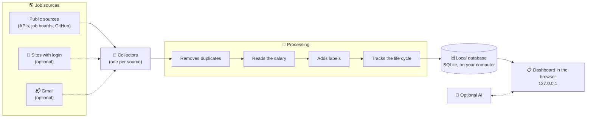

🌐 [Português](Como-funciona) · **English**

# ⚙️ How it works

**The path of a job, from the site where it was posted to your dashboard.**

---

## 🛤️ The path of a job

One search cycle, step by step:

1. ⏰ **At the scheduled time**, joBot wakes up. Or when you press "search now".
2. 🤖 **Each collector** (the code that reads the jobs from a source) visits its source calmly and brings the jobs in a single format.
3. 🧹 **Processing** merges duplicate jobs, understands the salary, adds labels and marks as closed the jobs that disappeared.
4. 🗄️ **Everything goes into the SQLite database**, a file that stays on your computer.
5. 📋 **The dashboard** shows the result in your browser. It only works on your computer (address 127.0.0.1).
6. 🧠 **If you turned on AI**, it calculates the match with your profile and helps prepare applications.

> [!TIP]
> If one source fails, the others continue. If the computer was off at the scheduled time, the missed search runs when it turns on.

## 🧹 How jobs are processed

<strong>Duplicates and life cycle</strong>

- A repeated job is found by its address, without the tracking parameters.
- A job closes when it disappears from the source. If the source was "partial", it only closes after 30 days missing.
- A job past its deadline leaves the lists.
- No job is deleted. The life cycle marks, it does not delete.

<strong>Salary</strong>

- The salary reader separates salary from benefits, checks the period (per hour, month or year) and whether the value is plausible.
- A salary in a foreign currency is converted to reais using the PTAX rate from Brazil's Central Bank, when a rate is available.
- Without a rate, the job is not removed by the minimum salary filter.

<strong>Labels and match</strong>

- Labels: field, level, work mode (on-site, hybrid, remote), region and contract type, plus warnings such as "requires a visa".
- Match with your profile in three levels (● good, ◐ medium, ○ weak), always with the reasons.
- The accuracy of each label is measured on a reference set of 329 real jobs, from 30 sources.

## 🖥️ The two versions

joBot has a single core and two "faces".

| | 💻 Download version | 🌐 Browser version (GitHub Pages) |
|---|---|---|
| **Installation** | Native, with one command (planned) | None: just open the site |
| **Sources** | All | Public sources only |
| **Sites with login** | Yes, with your manual login | No |
| **AI** | Automatic (Claude, local model) or manual | Manual (copy and paste); labels by rules only |
| **Extension, Gmail and audio** | Yes | No |
| **Where the data lives** | In the SQLite database on your computer | Your profile stays in your browser |
| **Updates** | Every 3 h (public) and twice a day (login) | Once a day |
| **When it arrives** | It is the project's focus | Phase 7 |

In the browser version, you can export your profile to a file and import it later into the download version. It never uses logins or secrets.

## 🌎 Job sources

Each source has an on/off switch.

| Group | Examples |
|---|---|
| Job repositories on GitHub | backend-br, frontendbr, soujava, remotejobsbr, developersRJ |
| International sites and APIs | Jobicy, Hacker News "Who is hiring", Remotive, RemoteOK, Himalayas, We Work Remotely |
| Company job boards (recruiting systems, the "ATS") | Greenhouse, Lever, Ashby, SmartRecruiters, Workday, Eightfold, Oracle HCM, InHire, Quickin, Recrutei |
| Brazilian portals | Gupy, CIEE, Sólides, IEL, Super Estágios, Cia de Talentos, Eureca, Abler |
| Careers at big companies | Google, Amazon, Microsoft, NVIDIA |
| Internship boards | Public boards, such as the one at USP |
| 🔐 Sites with login (first) | LinkedIn, Indeed, Catho, Vagas.com |
| 🔐 Sites with login (later, one at a time) | InfoJobs, Glassdoor, Programathor, GeekHunter, Remotar, Trampos, Revelo, Coodesh |

- 🤝 **Polite collection.** The robot identifies itself, waits between one request and the next and waits longer when the site asks for calm.
- 🩺 **Health of each source.** On every search, each source is marked as ok, partial or failed, and you see this in the dashboard.
- 🏷️ **Credit.** Sources that ask for credit show "via &lt;source&gt;" with a link to the original job.

> [!WARNING]
> **Sites with login carry risk.** They may restrict accounts that access them automatically.
> joBot reduces the risk: it opens a visible Chrome, you do the login, it only reads and visits rarely and slowly. Even so, the risk exists. **You decide whether to turn on each site.**

## 📋 The dashboard

- **Tabs:** Today's highlights, All, New, Closing soon, Saved, Applied, Programs and Hidden.
- **Filters** as "chips" (little buttons) with counts. The current filter stays in the page address, so you can save the link. Quick search with the `/` key.
- **Status of each job:** new → saved → applied → interview → rejected or offer.
- **12-month calendar** on each job, to see deadlines at a glance.
- **"Something wrong with this job?"**: a button to fix a label or a piece of data.
- **Look inspired by Apple's style:** translucency, smooth animations, light and dark mode following the system.
- **Languages:** Portuguese and English.

## 🌙 Background

| Source | Frequency |
|---|---|
| Public sources | Every 3 hours |
| Sites with login | Twice a day (9 a.m. and 6 p.m., adjustable) |
| "Search now" button | Right away, respecting the minimum interval of some sources |

Running in the background is your choice, in the first-run assistant or in the settings. When it is on, joBot starts with the computer, without a window, and a "joBot" shortcut opens the dashboard.

## 🧠 Artificial intelligence (optional)

> **Golden rule:** the AI only uses the data in your profile. It never invents experience, courses or skills, and it shows which data it used.

Each task picks its own option: the Claude Code session you already have, an Anthropic API key, a local model (Qwen, free and offline), keywords (no AI) or manual AI (copy and paste). Details in [Technologies](Technologies) and in the [README](https://github.com/fezarosa-dev/joBot/blob/main/README.en.md#artificial-intelligence).
