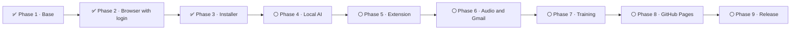

🌐 [Português](Roteiro) · **English**

# 🗺️ Roadmap

**joBot's 9 phases, from the base to the release.**

---

> [!NOTE]
> Each phase only starts after the previous one passes the tests. **No dates are promised.**

## 🧭 The phases

| | Phase | What is included | Status |
|:---:|---|---|---|
| ✅ | **1. Base** | Common core, public sources, database, dashboard and scheduling | Complete |
| ✅ | **2. Browser with login** | Login through a regular window, LinkedIn first, site mapping and CAPTCHA handling | Complete |
| ✅ | **3. Installer** | 64-bit installer with a list of tools to tick (Windows and Linux first, Mac later) | Complete in 0.4.0 |
| ⚪ | **4. Local AI** | Offline package (llama-server + Qwen) | Planned |
| ⚪ | **5. Browser extension** | Browser extension for forms | Planned |
| ⚪ | **6. Audio and Gmail** | Answers by voice and email reading | Planned |
| ⚪ | **7. Training** | Learn from what you save and discard | Planned |
| ⚪ | **8. GitHub Pages version** | Browser version, no installation | Planned |
| ⚪ | **9. Release** | README with badges and security review | Planned |

✅ complete · 🟡 being built · ⚪ planned

Version 0.3.0 came out between phase 2 and phase 3, with the "Overview" screen (an overview of the jobs and the search) and the complete application queue. Version 0.4.0 closes phase 3, with a window of its own and the installer.

## 🔍 A bit more about each phase

<strong>✅ Phase 1, Base</strong>

- The common core, the public source collectors, the SQLite database, the dashboard and the search schedule.
- The first-run assistant has only two steps: search preferences and background.
- The accuracy of each label is measured and recorded.

<strong>✅ Phase 2, Browser with login</strong>

- The login happens in a regular browser window, with no automation: you sign in however you like (Google, email and password) and close the window. joBot checks the session by itself and never types the password.
- Planned site mapping order: LinkedIn, Vagas.com, Catho, Indeed and, last, the technology-only sites. Today only LinkedIn has login; Gupy is public only, and the others are left for the future.
- Logins join the first-run assistant.

<strong>✅ Phase 3, Installer</strong>

- A 64-bit installer, made for people who have never opened a terminal. Windows and Linux first; the Mac comes later.
- A list of tools to tick. The essentials come ticked and cannot be unticked. Whatever you leave unticked shows up later in the dashboard, to download whenever you want.
- In the dashboard you can download the tools you left out and change your choice later.

<strong>⚪ Phase 4, Local AI</strong>

- Offline package: llama-server and a Qwen model, to use AI without internet and without paying.
- The AI choice, the résumé and the questionnaire join the assistant.
- If any label stays below 90% accuracy, only that label starts using the free multilingual-e5-small model.

<strong>⚪ Phase 5, Browser extension</strong>

- An extension that recognizes form fields and suggests answers. You click OK to fill them in.
- It never touches password or card fields.

<strong>⚪ Phase 6, Audio and Gmail</strong>

- Answer the questionnaire by speaking, with transcription on your computer.
- Read job alert emails and recruiter replies, read-only.

<strong>⚪ Phase 7, Training</strong>

- Fine-tuning of models, which only replace the originals if they win on the reference set.
- A personal "save or discard" classifier, trained and kept on your computer.

<strong>⚪ Phase 8, GitHub Pages version</strong>

- The browser version, no installation, updated once a day with public sources only.

<strong>⚪ Phase 9, Release</strong>

- README with badges and security review.
- Planned: a weekly watcher that tests each source and opens an issue when one breaks, and an easy way to update the installation.
- From here on, code pull requests are accepted.

More details in [ADR 0017](https://github.com/fezarosa-dev/joBot/blob/main/docs/decisions/0017-fases.md) (Portuguese only) and in the [README](https://github.com/fezarosa-dev/joBot/blob/main/README.en.md#roadmap).
