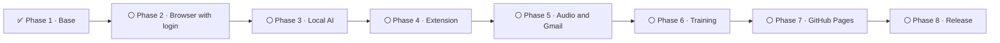

🌐 [Português](Roteiro) · **English**

# 🗺️ Roadmap

**joBot's 8 phases, from the base to the release.**

---

> [!NOTE]
> Each phase only starts after the previous one passes the tests. **No dates are promised.**

## 🧭 The phases

| | Phase | What is included | Status |
|:---:|---|---|---|
| ✅ | **1. Base** | Common core, public sources, database, dashboard and scheduling | Complete |
| ⚪ | **2. Browser with login** | Visible Chrome, site mapping and CAPTCHA handling | Planned |
| ⚪ | **3. Local AI** | Offline package (llama-server + Qwen) | Planned |
| ⚪ | **4. Browser extension** | Browser extension for forms | Planned |
| ⚪ | **5. Audio and Gmail** | Answers by voice and email reading | Planned |
| ⚪ | **6. Training** | Learn from what you save and discard | Planned |
| ⚪ | **7. GitHub Pages version** | Browser version, no installation | Planned |
| ⚪ | **8. Release** | Installers, README with badges and security review | Planned |

✅ complete · ⚪ planned

## 🔍 A bit more about each phase

<strong>✅ Phase 1, Base</strong>

- The common core, the public source collectors, the SQLite database, the dashboard and the search schedule.
- The first-run assistant has only two steps: search preferences and background.
- The accuracy of each label is measured and recorded.

<strong>⚪ Phase 2, Browser with login</strong>

- A visible Chrome controlled by Playwright. You log in with your own hands.
- Site mapping order: Gupy, LinkedIn, Vagas.com, Catho, Indeed and the others.
- Logins join the first-run assistant.

<strong>⚪ Phase 3, Local AI</strong>

- Offline package: llama-server and a Qwen model, to use AI without internet and without paying.
- The AI choice, the résumé and the questionnaire join the assistant.
- If any label stays below 90% accuracy, only that label starts using the free multilingual-e5-small model.

<strong>⚪ Phase 4, Browser extension</strong>

- An extension that recognizes form fields and suggests answers. You click OK to fill them in.
- It never touches password or card fields.

<strong>⚪ Phase 5, Audio and Gmail</strong>

- Answer the questionnaire by speaking, with transcription on your computer.
- Read job alert emails and recruiter replies, read-only.

<strong>⚪ Phase 6, Training</strong>

- Fine-tuning of models, which only replace the originals if they win on the reference set.
- A personal "save or discard" classifier, trained and kept on your computer.

<strong>⚪ Phase 7, GitHub Pages version</strong>

- The browser version, no installation, updated once a day with public sources only.

<strong>⚪ Phase 8, Release</strong>

- Installers, README with badges and security review.
- Planned: a weekly watcher that tests each source and opens an issue when one breaks, and an easy way to update the installation.
- From here on, code pull requests are accepted.

More details in [ADR 0017](https://github.com/fezarosa-dev/joBot/blob/main/docs/decisions/0017-fases.md) (Portuguese only) and in the [README](https://github.com/fezarosa-dev/joBot/blob/main/README.en.md#roadmap).
