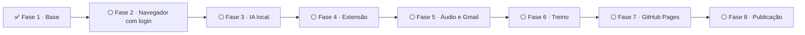

🌐 **Português** · [English](Roadmap)

# 🗺️ Roteiro

**As 8 fases do joBot, da base até a publicação.**

---

> [!NOTE]
> Cada fase só começa depois que a anterior passa nos testes. **Não há datas prometidas.**

## 🧭 As fases

| | Fase | O que entra | Estado |
|:---:|---|---|---|
| ✅ | **1. Base** | Núcleo comum, fontes públicas, banco, painel e agenda | Concluída |
| ⚪ | **2. Navegador com login** | Chrome visível, mapeamento dos sites e tratamento de CAPTCHA | Planejada |
| ⚪ | **3. IA local** | Pacote offline (llama-server + Qwen) | Planejada |
| ⚪ | **4. Extensão do navegador** | Extensão do navegador para formulários | Planejada |
| ⚪ | **5. Áudio e Gmail** | Respostas por voz e leitura de e-mails | Planejada |
| ⚪ | **6. Treino** | Aprender com o que você salva e descarta | Planejada |
| ⚪ | **7. Versão GitHub Pages** | Versão no navegador, sem instalação | Planejada |
| ⚪ | **8. Publicação** | Instaladores, README com selos e revisão de segurança | Planejada |

✅ concluída · ⚪ planejada

## 🔍 Um pouco mais sobre cada fase

<strong>✅ Fase 1, Base</strong>

- O núcleo comum, os coletores das fontes públicas, o banco SQLite, o painel e a agenda das buscas.
- O assistente da primeira execução tem só dois passos: preferências de busca e segundo plano.
- O acerto de cada rótulo é medido e registrado.

<strong>⚪ Fase 2, Navegador com login</strong>

- Chrome visível controlado pelo Playwright. Você faz o login com as próprias mãos.
- Ordem de mapeamento dos sites: Gupy, LinkedIn, Vagas.com, Catho, Indeed e os demais.
- Os logins entram no assistente da primeira execução.

<strong>⚪ Fase 3, IA local</strong>

- Pacote offline: llama-server e um modelo Qwen, para usar IA sem internet e sem pagar.
- Entram no assistente a escolha da IA, o currículo e o questionário.
- Se algum rótulo ficar abaixo de 90% de acerto, só esse rótulo passa a usar o modelo gratuito multilingual-e5-small.

<strong>⚪ Fase 4, Extensão do navegador</strong>

- Uma extensão que reconhece os campos dos formulários e sugere respostas. Você clica OK para preencher.
- Nunca toca em campos de senha ou de cartão.

<strong>⚪ Fase 5, Áudio e Gmail</strong>

- Responder ao questionário falando, com transcrição no seu computador.
- Ler os e-mails de alerta de vagas e as respostas de recrutadores, só leitura.

<strong>⚪ Fase 6, Treino</strong>

- Ajuste fino de modelos, que só substituem os originais se ganharem no gabarito.
- Um classificador pessoal "salvar ou descartar", treinado e guardado no seu computador.

<strong>⚪ Fase 7, Versão GitHub Pages</strong>

- A versão no navegador, sem instalação, atualizada uma vez por dia só com fontes públicas.

<strong>⚪ Fase 8, Publicação</strong>

- Instaladores, README com selos e revisão de segurança.
- Planejado: um vigia semanal que testa cada fonte e abre issue quando uma quebra, e um jeito fácil de atualizar a instalação.
- A partir daqui, pull requests de código passam a ser aceitos.

Mais detalhes na [ADR 0017](https://github.com/fezarosa-dev/joBot/blob/main/docs/decisions/0017-fases.md) e no [README](https://github.com/fezarosa-dev/joBot#roteiro).
