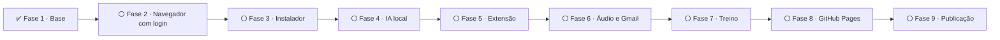

🌐 **Português** · [English](Roadmap)

# 🗺️ Roteiro

**As 9 fases do joBot, da base até a publicação.**

---

> [!NOTE]
> Cada fase só começa depois que a anterior passa nos testes. **Não há datas prometidas.**

## 🧭 As fases

| | Fase | O que entra | Estado |
|:---:|---|---|---|
| ✅ | **1. Base** | Núcleo comum, fontes públicas, banco, painel e agenda | Concluída |
| ⚪ | **2. Navegador com login** | Login pela janela comum, LinkedIn primeiro, mapeamento dos sites e tratamento de CAPTCHA | Planejada |
| ⚪ | **3. Instalador** | Instalador de 64 bits, com lista de ferramentas para marcar (Windows e Linux primeiro, Mac depois) | Planejada |
| ⚪ | **4. IA local** | Pacote offline (llama-server + Qwen) | Planejada |
| ⚪ | **5. Extensão do navegador** | Extensão do navegador para formulários | Planejada |
| ⚪ | **6. Áudio e Gmail** | Respostas por voz e leitura de e-mails | Planejada |
| ⚪ | **7. Treino** | Aprender com o que você salva e descarta | Planejada |
| ⚪ | **8. Versão GitHub Pages** | Versão no navegador, sem instalação | Planejada |
| ⚪ | **9. Publicação** | README com selos e revisão de segurança | Planejada |

✅ concluída · ⚪ planejada

Entre a fase 2 e a fase 3 sai a versão 0.3.0, com a tela "Panorama" (visão geral das vagas e da busca) e a fila de candidaturas completa.

## 🔍 Um pouco mais sobre cada fase

<strong>✅ Fase 1, Base</strong>

- O núcleo comum, os coletores das fontes públicas, o banco SQLite, o painel e a agenda das buscas.
- O assistente da primeira execução tem só dois passos: preferências de busca e segundo plano.
- O acerto de cada rótulo é medido e registrado.

<strong>⚪ Fase 2, Navegador com login</strong>

- O login é numa janela comum do navegador, sem automação: você entra como quiser (Google, e-mail e senha) e fecha a janela. O joBot confere a sessão sozinho e nunca digita a senha.
- Ordem prevista de mapeamento dos sites: LinkedIn, Vagas.com, Catho, Indeed e, por último, os sites só de tecnologia. Hoje só o LinkedIn tem login; a Gupy é só pública, e os outros ficam para o futuro.
- Os logins entram no assistente da primeira execução.

<strong>⚪ Fase 3, Instalador</strong>

- Instalador de 64 bits, feito para quem nunca abriu um terminal. Windows e Linux primeiro; o Mac vem depois.
- Uma lista de ferramentas para marcar. O essencial já vem marcado e não dá para desmarcar. O que ficar sem marcar aparece depois no painel, para baixar quando você quiser.
- No painel dá para baixar as ferramentas que ficaram de fora e refazer a escolha depois.

<strong>⚪ Fase 4, IA local</strong>

- Pacote offline: llama-server e um modelo Qwen, para usar IA sem internet e sem pagar.
- Entram no assistente a escolha da IA, o currículo e o questionário.
- Se algum rótulo ficar abaixo de 90% de acerto, só esse rótulo passa a usar o modelo gratuito multilingual-e5-small.

<strong>⚪ Fase 5, Extensão do navegador</strong>

- Uma extensão que reconhece os campos dos formulários e sugere respostas. Você clica OK para preencher.
- Nunca toca em campos de senha ou de cartão.

<strong>⚪ Fase 6, Áudio e Gmail</strong>

- Responder ao questionário falando, com transcrição no seu computador.
- Ler os e-mails de alerta de vagas e as respostas de recrutadores, só leitura.

<strong>⚪ Fase 7, Treino</strong>

- Ajuste fino de modelos, que só substituem os originais se ganharem no gabarito.
- Um classificador pessoal "salvar ou descartar", treinado e guardado no seu computador.

<strong>⚪ Fase 8, Versão GitHub Pages</strong>

- A versão no navegador, sem instalação, atualizada uma vez por dia só com fontes públicas.

<strong>⚪ Fase 9, Publicação</strong>

- README com selos e revisão de segurança.
- Planejado: um vigia semanal que testa cada fonte e abre issue quando uma quebra, e um jeito fácil de atualizar a instalação.
- A partir daqui, pull requests de código passam a ser aceitos.

Mais detalhes na [ADR 0017](https://github.com/fezarosa-dev/joBot/blob/main/docs/decisions/0017-fases.md) e no [README](https://github.com/fezarosa-dev/joBot#roteiro).
